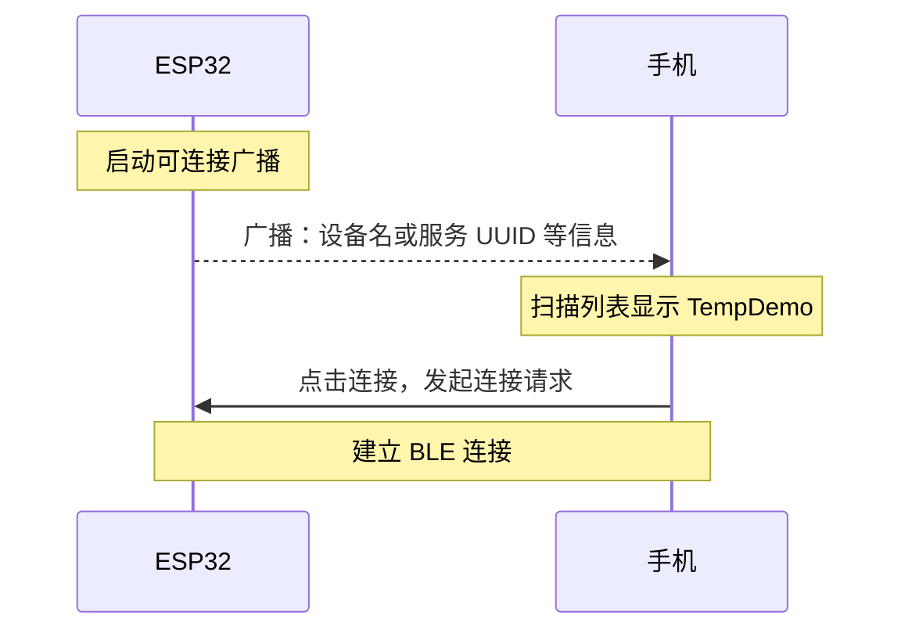
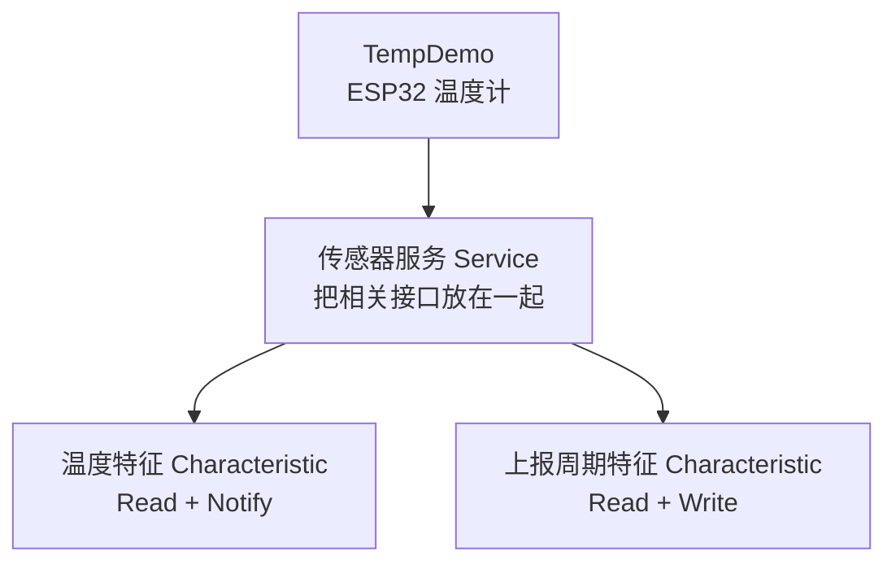
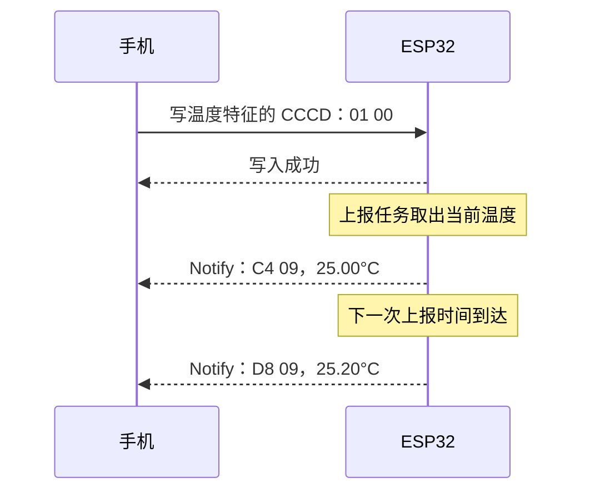
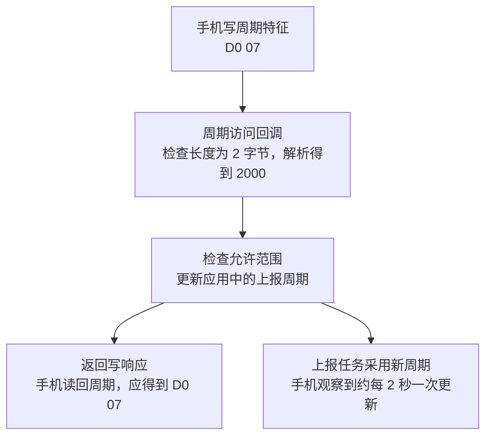
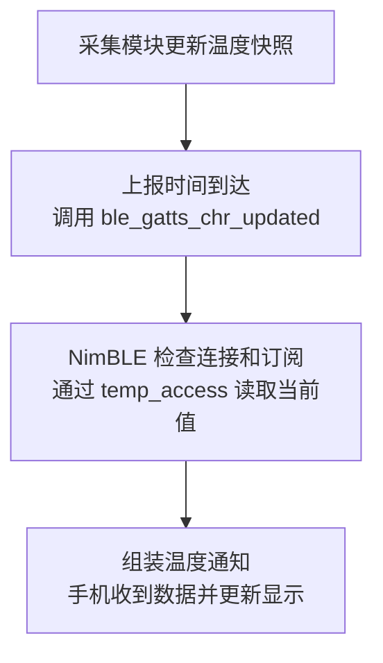
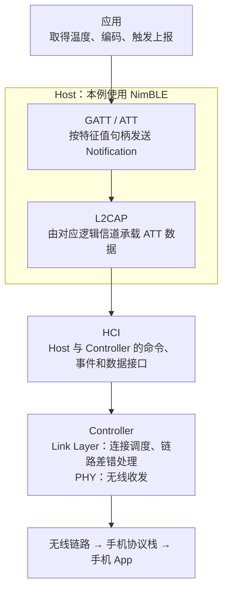

# BLE 协议栈：从手机读取温度开始

你正在做一个 ESP32 温度计：板子采集温度，手机能查看当前读数、持续接收新读数，还能把上报周期从 1 秒改成 2 秒。

下面用这个设备走完一次通信。**每遇到一个协议名，先看它解决了哪一步的问题，再看固件怎样处理。**

> [!example] 本文的教学设备
> 设备名为 `TempDemo`，使用自定义传感器服务。
>
> - **温度**：支持 Read 和 Notify，用于读取当前值、接收持续上报。
> - **上报周期**：支持 Read 和 Write，单位为毫秒，初始值为 1000。
>
> 字段、UUID 和数据格式都是本例的协议约定。手机操作以通用 BLE 调试工具为例；界面按钮名称可能不同。

## 1. 第一次操作：找到板子，连接上去

给 ESP32 上电后，打开手机的 BLE 调试工具并扫描。预期先在设备列表里看到 `TempDemo`，再点击连接。

这一步里，板子周期性发送**广播 Advertisement**，手机执行**扫描 Scan**。本例在广播或扫描响应中放入设备名，并在广播中携带传感器服务 UUID，方便手机筛选。[^discovery]



**GAP（Generic Access Profile，通用访问规范）**规定设备怎样被发现、建立连接，以及相关角色和安全行为。代码中设置广播、启动扫描、处理连接事件，都属于这一部分。[^connection]

在本例的连接中，手机是 **Central（中心设备）**，ESP32 是 **Peripheral（外围设备）**。Controller 负责实际的连接建立和无线调度。[^connection]

> [!tip] 这一步完成后的进度
> 手机已经与板子建立连接。接下来，手机需要找到“温度这个数据入口”，才能发起读取。

## 2. 第二次操作：读到第一个温度值

### 2.1 把数据接口组织成服务和特征

连接成功后，手机执行**服务发现**。本例希望它找到下面这些接口：



可以把 **Service（服务）**理解为一组相关的数据接口，把 **Characteristic（特征）**理解为其中一个具体数据项，以及它支持的访问方式。

**GATT（Generic Attribute Profile，通用属性规范）**负责这种组织方式，也规定服务发现、读取、写入和主动上报等过程。手机先发现服务和特征，再操作找到的数据入口。[^gatt]

本例中，ESP32 提供这些数据，是 **GATT Server**；手机发起查询和访问，是 **GATT Client**。这两个角色描述数据访问的分工，Central / Peripheral 描述连接层的分工。[^gatt]

### 2.2 用 UUID 找到要读的特征

调试工具可能显示厂商自定义的 UUID，而没有“温度”这样的友好名称。**UUID 是接口的类型标识**，手机程序通过它识别传感器服务和温度特征。[^gatt]

> [!info]- 本例的完整 UUID，调试时展开
>
> ```text
> 传感器服务：7c3a0001-9e2b-4f8d-a6c1-2b5d7e9f0100
> 温度特征：  7c3a0002-9e2b-4f8d-a6c1-2b5d7e9f0100
> 周期特征：  7c3a0003-9e2b-4f8d-a6c1-2b5d7e9f0100
> ```
>
> 它们是为教学示例选取的自定义 128 位 UUID。手机与固件使用同一组 UUID，才能定位到约定的接口。

找到温度特征后，查看其 **Properties（特征属性）**，应当有 `Read` 和 `Notify`。这表示设备声明支持“按需读取”和“主动通知”。[^gatt]

### 2.3 点击 Read，得到的是字节

本例约定：温度使用 **2 字节有符号整数，小端序，单位 0.01°C**。例如 25.00°C 编码为整数 2500：

```text
2500 = 0x09C4
小端序：低字节在前 → C4 09

手机 → ESP32：读取温度特征
ESP32 → 手机：C4 09
手机解析：2500 × 0.01°C = 25.00°C
```

因此，在调试工具中读到 `C4 09`，就是读到了本例定义的 25.00°C。手机 App 要按这个约定把字节转换成数字和单位。

在 ESP32 这一端，读取请求会到达温度特征的访问回调。回调取得采集模块中的当前温度，将它编码成这两个字节，再交给协议栈返回。

> [!tip] 这一步完成后的进度
> 手机知道了温度接口在哪里，也成功读到了一次当前值。下一步让新温度自动送到手机。

## 3. 第三次操作：打开持续上报

### 3.1 从“点一次读一次”到“设备主动发”

Read 适合按需读取当前值。若希望温度变化后手机能持续更新，可以由 ESP32 使用 **Notify（通知）**主动发送温度值。[^gatt]

这里有两件事要配合：

| 谁来做 | 要做的事 |
|---|---|
| 手机 | 告诉 ESP32：这条连接订阅温度通知 |
| ESP32 应用 | 到达上报时间后，取得温度并调用通知接口 |

手机在温度特征旁点击“开启通知”时，工具通常会替它写入一个配置项：**CCCD（Client Characteristic Configuration Descriptor，客户端特征配置描述符）**。[^gatt]

**Descriptor（描述符）**是附属于特征的说明或配置。CCCD 的 UUID 为 `0x2902`，用于设置客户端对这项特征的通知、指示订阅状态。

本例开启 Notify 时，手机写入 CCCD 的数值为 `0x0001`；按小端序发送，字节是 `01 00`。



此时，手机应该大约每秒收到一次更新。采集任务更新温度快照，上报任务按周期取值，再调用 BLE 通知接口；采集频率和上报频率可以分别安排。

**特征的 Notify 属性表示“支持通知”；CCCD 表示“这个客户端当前是否订阅”。** 多个客户端连接时，各自有自己的 CCCD 配置。绑定设备还可以恢复保存的订阅配置。[^gatt]

> [!info]- 需要了解上报确认时：Indicate 与 CCCD 配置
> 主动上报还有 **Indicate（指示）**。它与 Notify 的主要差别是，客户端需要在 **ATT（属性协议，第 5 节展开）**层返回一次 Confirmation。
>
> | 过程 | Notify | Indicate |
> |---|---|---|
> | 服务端主动发送值 | 支持 | 支持 |
> | ATT 层确认 | 没有对应的确认消息 | 客户端返回 Confirmation |
> | 同一 ATT 通道上的在途限制 | 不需要逐条等待 ATT 确认 | 前一条确认后，才能发下一条 Indication |
>
> 两者都由底层链路提供相应的差错处理。Indicate 的确认说明客户端 ATT 层收到了消息；若要确认手机已经保存记录或完成业务处理，需要再定义应用层回复。[^att]
>
> CCCD 用两个订阅位配置它们：
>
> | 数值 | 小端字节 | 配置含义 |
> |---|---|---|
> | `0x0000` | `00 00` | 关闭通知和指示 |
> | `0x0001` | `01 00` | 开启 Notify |
> | `0x0002` | `02 00` | 开启 Indicate |
> | `0x0003` | `03 00` | 同时设置两个订阅位，要求特征同时支持二者 |
>
> 本例温度特征支持 Read、Notify，所以使用 `01 00`。[^gatt]

## 4. 第四次操作：把上报周期改成 2 秒

回到服务列表，找到“上报周期”特征。它支持 `Read` 和 `Write`，本例约定使用 **2 字节无符号整数，小端序，单位 ms**，允许范围为 100～10000 ms。

先点 Read，应得到初始值 `E8 03`，即 `0x03E8 = 1000 ms`。再选择带响应的 Write，以 Hex 方式写入：

```text
目标周期：2000 ms
2000 = 0x07D0
写入字节：D0 07
```

ESP32 收到写请求后，在该特征的访问回调中解析并检查新值，再更新应用配置：



写入成功后，读回周期可以确认设备记录的配置值；观察通知时间间隔，可以确认上报任务采用了新配置。

本次使用的 **Write Request / Response**会返回写操作结果。另一种 **Write Without Response**使用写命令，不会收到对应的 ATT 写响应；需要根据业务选择交互方式。[^att]

> [!tip] 到这里，一次完整通信已经串起来了
> **广播让手机找到板子，连接让双方能够交互，GATT 暴露数据接口，Read 取值，Write 配置，Notify 持续上报。**

## 5. 手机看到的接口，在底层怎样表示

### 5.1 从 GATT 的服务树，落到 ATT 的属性表

前面按服务和特征理解接口，适合设计应用。再往下一层看，设备用 **Attribute（属性）**表示这些入口。

每个属性有 **handle（句柄）**、类型 UUID 和值，并有相应的访问权限。服务声明、特征声明、特征值、描述符分别使用属性条目。**ATT（Attribute Protocol，属性协议）**规定怎样发现、读取、写入这些属性，以及发送通知和指示。[^att][^gatt]

下面是本例的一段示意属性表。句柄只是示例，实际值由协议栈注册结果决定：

| handle | 属性类型 | 属性值的含义 |
|---|---|---|
| `0x0010` | `0x2800`，主服务声明 | 本例传感器服务的 UUID |
| `0x0011` | `0x2803`，特征声明 | Read + Notify、温度值句柄 `0x0012`、温度 UUID |
| `0x0012` | 本例温度 UUID | 当前温度，示例为 `C4 09` |
| `0x0013` | `0x2902`，CCCD | 当前客户端的温度订阅配置 |
| `0x0014` | `0x2803`，特征声明 | Read + Write、周期值句柄 `0x0015`、周期 UUID |
| `0x0015` | 本例周期 UUID | 当前周期，修改后为 `D0 07` |

**特征声明**描述“支持哪些操作、特征值在哪里、值属于什么类型”；**特征值属性**才是 Read、Write、Notify 操作的数据入口。CCCD 则是单独的配置属性。[^gatt]

### 5.2 UUID 和 handle 在一次读取中怎样配合

手机先通过服务发现，按温度 UUID 找到对应特征，并取得它的值句柄。之后发送普通 Read Request 时，用这个句柄定位温度值属性。[^gatt][^att]

```text
发现阶段：按温度 UUID 查找 → 得到 value handle = 0x0012
读取阶段：Read Request(handle = 0x0012) → 返回 C4 09
通知阶段：Notification(handle = 0x0012, value = C4 09)
```

可以记住这个分工：**UUID 识别接口类型，属性 handle 定位设备属性表中的具体入口。** NimBLE 的 `conn_handle` 则标识某次连接，供发送、断开等 API 使用。[^nimble-gap]

> [!info]- 标准 UUID 与自定义 UUID
> 蓝牙 SIG 为标准服务、特征和描述符分配了短 UUID，例如 `0x180F` 是 Battery Service，`0x2A19` 是 Battery Level，`0x2902` 是 CCCD。
>
> 16 位 UUID 可以展开到 Bluetooth Base UUID。例如：
>
> ```text
> 0x180F → 0000180f-0000-1000-8000-00805f9b34fb
> ```
>
> 开发自定义接口时使用自己的 128 位 UUID。标准接口的数据格式和行为，按对应服务或 Profile 的规范实现。[^numbers][^gatt]

## 6. 对照 NimBLE，把交互落到代码

这一节展示本例的关键接口片段，承接 [[02-NimBLE-API基础]] 中的初始化和服务注册。`temp_uuid`、`period_uuid` 是按前文 UUID 创建的对象；采集模块负责提供温度快照，配置模块负责保存和读取上报周期。

### 6.1 特征表声明手机能做什么

```c
static uint16_t temp_val_handle;

static const struct ble_gatt_chr_def sensor_chars[] = {
    {
        .uuid = &temp_uuid.u,
        .access_cb = temp_access,
        .flags = BLE_GATT_CHR_F_READ | BLE_GATT_CHR_F_NOTIFY,
        .val_handle = &temp_val_handle,
    },
    {
        .uuid = &period_uuid.u,
        .access_cb = period_access,
        .flags = BLE_GATT_CHR_F_READ | BLE_GATT_CHR_F_WRITE,
    },
    {0},
};
```

把 `sensor_chars` 放到传感器服务定义的 `.characteristics` 中，再随服务表注册。手机发现到的两个特征及其操作能力，就来自这里。

NimBLE 注册时会把温度的**特征值句柄**填入 `temp_val_handle`，并为带 Notify / Indicate 标志的特征自动添加 CCCD。[^nimble-server]

### 6.2 一次 Read 怎样进入温度回调

`temp_access()` 在读取时取得当前温度并编码。这里假设采集模块提供 `get_temperature_centi_c()`，返回以 0.01°C 为单位的一致性快照。

```c
static int temp_access(uint16_t conn_handle, uint16_t attr_handle,
                       struct ble_gatt_access_ctxt *ctxt, void *arg)
{
    if (ctxt->op != BLE_GATT_ACCESS_OP_READ_CHR) {
        return BLE_ATT_ERR_UNLIKELY;
    }

    uint16_t raw = (uint16_t)get_temperature_centi_c();
    uint8_t value[2] = {
        (uint8_t)(raw & 0xff),
        (uint8_t)(raw >> 8),
    };

    return os_mbuf_append(ctxt->om, value, sizeof(value)) == 0
               ? 0 : BLE_ATT_ERR_INSUFFICIENT_RES;
}
```

`ctxt->om` 是这次访问使用的数据缓冲。**Read 时，应用把返回值填进去；Write 时，应用从中取出客户端写来的值。** 回调返回 0 表示访问成功，返回 ATT 错误码表示本次访问失败。[^nimble-server]

周期的 `period_access()` 按相同方式处理两个方向：Read 返回当前周期；Write 检查总长度、解析小端整数、检查允许范围，并更新配置。共享快照和配置的并发访问，由相应模块保证一致性。

### 6.3 采集任务怎样触发通知

温度快照更新后，上报任务可以调用：

```c
ble_gatts_chr_updated(temp_val_handle);
```

这个 API 告诉 NimBLE：“该特征的值已更新，请向订阅了它的已连接客户端发通知或指示。”本例只有 Notify 能力，协议栈通过温度访问回调取得要发送的值。[^nimble-server]



连接和订阅变化也会报告给应用：

| 事件 | 应用可以记录什么 |
|---|---|
| `BLE_GAP_EVENT_CONNECT` | 连接是否成功，成功后的 `conn_handle` |
| `BLE_GAP_EVENT_SUBSCRIBE` | 哪个特征的 Notify / Indicate 订阅状态发生变化 |
| `BLE_GAP_EVENT_DISCONNECT` | 断开原因，清理本次连接状态；按产品流程重新广播 |

用这些日志对照手机操作，就能看出进度停在连接、订阅还是发送阶段。[^nimble-gap]

## 7. 再沿一次温度通知，认识其余协议层

到这里，你已经能把用户操作对应到固件回调。继续向下看：温度通知怎样从 NimBLE 到达手机？[^primer]



**L2CAP（逻辑链路控制与适配协议）**给不同上层协议提供逻辑信道，并完成与底层传输衔接有关的分段、重组等工作。ATT 和安全管理使用的 SMP 可以各走自己的信道。[^primer]

**HCI（Host Controller Interface）**是 Host 与 Controller 的接口。**Link Layer（链路层）**负责无线连接的时序和链路处理，**PHY（物理层）**负责实际的无线收发；这两部分属于 Controller。[^primer]

因此，应用开发通常围绕广播、服务定义、访问回调和上报任务工作。定位到底层链路问题时，再往 HCI 和 Controller 的事件、日志继续看。

> [!info]- 读取接口提示需要加密时，再看 SMP
> **Properties** 声明特征支持的操作；**Permissions（访问权限）**决定当前连接在什么安全条件下可以执行操作。
>
> 例如，某个特征支持 Read，同时要求加密读取。客户端需要先满足安全要求，才能读到值。
>
> **SMP（Security Manager Protocol，安全管理协议）**负责配对和密钥分发等过程，Controller 执行链路加密。**Bonding（绑定）**表示保存配对材料，供后续连接使用。[^security][^primer]

> [!info]- 数据变长以后，再看 MTU
> ATT MTU 表示该 ATT bearer 一次可承载的 ATT PDU 大小。普通 Notification / Indication 需要 1 字节操作码和 2 字节值句柄，所以单条可携带的特征值最多为 `ATT_MTU - 3` 字节。
>
> 例如 ATT MTU 为 23 时，普通通知最多携带 20 字节值。本例温度只有 2 字节，放得下；扩展成长日志时，需要按实际 MTU 和发送方式设计分包。[^att]

## 8. 用实际现象检查理解和实现

沿着本例操作，可以依次留下这些可观察的结果：

| 你做了什么 | 应当观察到什么 | 若未达到，先看哪里 |
|---|---|---|
| 手机扫描 | 找到 `TempDemo` 或约定服务 UUID | 广播是否启动、内容是否正确、扫描过滤条件 |
| 点击连接 | 手机显示已连接，ESP32 报告连接成功 | 连接事件状态、断开原因 |
| 发现服务 | 找到温度和周期两个特征 | 服务注册结果、UUID、客户端服务缓存 |
| Read 温度 | 当前快照为 25.00°C 时，得到 `C4 09` | 读取回调、返回长度、字节序和单位 |
| 开启 Notify | 订阅事件发生，随后收到温度更新 | CCCD 状态、上报任务是否运行、发送状态 |
| Write 周期 `D0 07` | 写入成功，读回得到 2000 ms，更新间隔变长 | 写回调的解析和检查、配置是否被任务采用 |

同样的过程可以用到其他数据：先约定接口和编码，再观察每一步访问，最后沿回调和协议层定位问题。

## 相关笔记

- [[01-蓝牙入门]]
- [[02-NimBLE-API基础]]
- [[04-经典蓝牙协议与开发基础]]

## 官方参考

[^discovery]: ESP-IDF v5.5.2：[Device Discovery](https://docs.espressif.com/projects/esp-idf/en/v5.5.2/esp32/api-guides/ble/get-started/ble-device-discovery.html)。广播、扫描与设备发现。
[^connection]: ESP-IDF v5.5.2：[Connection](https://docs.espressif.com/projects/esp-idf/en/v5.5.2/esp32/api-guides/ble/get-started/ble-connection.html)。GAP 角色、连接建立和事件。
[^gatt]: Bluetooth Core 5.4，Vol 3 Part G：[Generic Attribute Profile](https://www.bluetooth.com/wp-content/uploads/Files/Specification/HTML/Core-54/out/en/host/generic-attribute-profile--gatt-.html)。服务与特征、属性表、Properties、CCCD 和访问过程。
[^att]: Bluetooth Core 5.4，Vol 3 Part F：[Attribute Protocol](https://www.bluetooth.com/wp-content/uploads/Files/Specification/HTML/Core-54/out/en/host/attribute-protocol--att-.html)。读写请求、通知、指示、确认与 ATT MTU。
[^nimble-server]: Apache Mynewt：[NimBLE GATT Server Reference](https://mynewt.apache.org/latest/network/ble_hs/ble_gatts.html)。特征定义、访问回调、自动添加 CCCD 和 `ble_gatts_chr_updated()`。
[^nimble-gap]: Apache Mynewt：[NimBLE GAP Reference](https://mynewt.apache.org/latest/network/ble_hs/ble_gap.html)。连接、订阅、断开事件及连接句柄。
[^numbers]: Bluetooth SIG：[Assigned Numbers](https://www.bluetooth.com/specifications/assigned-numbers/)。标准服务、特征和描述符 UUID。
[^primer]: Bluetooth Core 5.4，Vol 1 Part A：[Architecture](https://www.bluetooth.com/wp-content/uploads/Files/Specification/HTML/Core-54/out/en/architecture%2C-mixing%2C-and-conventions/architecture.html)。Host / Controller、L2CAP、HCI、Link Layer、PHY 和安全机制。
[^security]: Bluetooth Core 5.4，Vol 3 Part H：[Security Manager Specification](https://www.bluetooth.com/wp-content/uploads/Files/Specification/HTML/Core-54/out/en/host/security-manager-specification.html)。配对、密钥分发和绑定相关过程。
