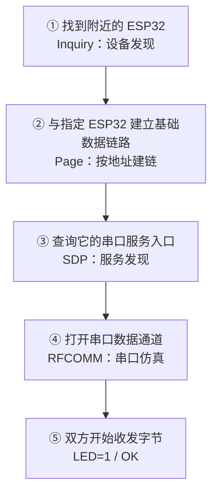
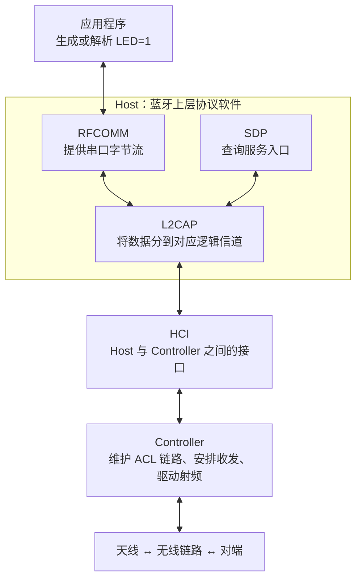
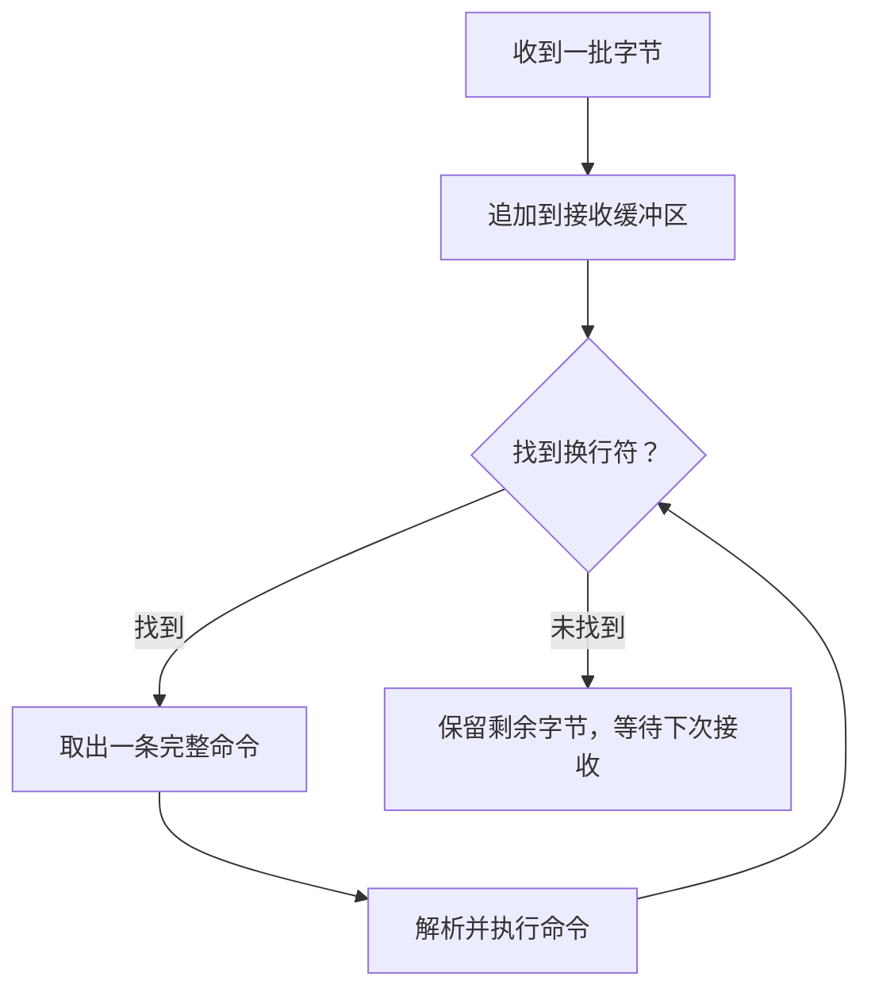
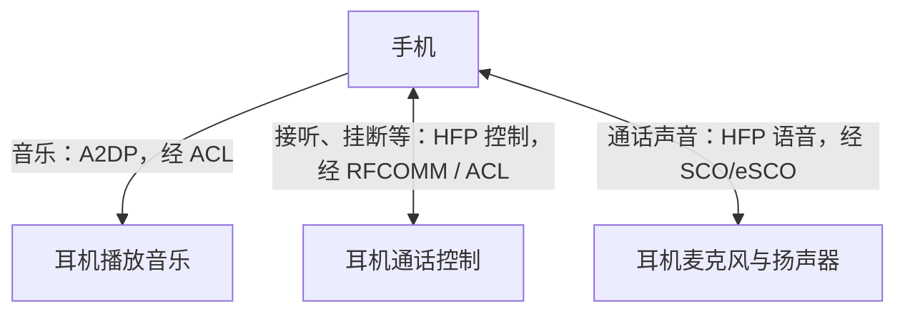

# 经典蓝牙协议与开发基础

经典蓝牙是一套让设备无线传数据、播放音乐和进行通话的通信技术，规范中常写成 **BR/EDR**。传统蓝牙耳机、音箱、串口模块都可能用到它。[^overview]

> [!abstract] 本文的学习主线
> 用“电脑通过蓝牙给 ESP32 发一条点灯命令”理解整个过程：
> **找到设备 → 建立基础链路 → 找到串口服务 → 打开数据通道 → 收发命令。**
> 再沿着这条主线理解配对、协议分层和 ESP-IDF 的回调事件。

## 1. 从一条点灯命令开始

假设有一块支持经典蓝牙的 ESP32 开发板。我们希望电脑发送 `LED=1\n`，ESP32 收到后点亮 LED，再回复 `OK\n`。这里的 `\n` 表示换行符。


如果用 UART，可以用串口线传这些字节。换成经典蓝牙，可以采用 **SPP（Serial Port Profile，串口通信规范）**，通过无线连接提供类似串口的收发能力。主机系统和驱动支持时，还可以把它呈现为虚拟 COM 端口。[^spp]

这里的 **Profile** 指“针对某种用途约定好的一套通信规则”：双方扮演什么角色、使用哪些协议、怎样建立业务连接。SPP 对应串口通信；音乐和通话有各自的 Profile，后面再展开。

对于这个点灯例子，双方的分工很简单：

| 设备 | 业务角色 | 程序要做的事 |
|---|---|---|
| ESP32 | SPP Server，提供串口服务 | 等待连接，接收命令，控制 LED |
| 电脑 | SPP Client，使用串口服务 | 找到服务，发命令，接收回复 |

## 2. 一次 SPP 连接怎样建立

下面按每一步的目的理解连接过程。首次使用时，配对可能穿插其中；系统也可能使用之前保存的地址、密钥和服务信息。



### 2.1 找到设备：Inquiry

电脑先询问附近有哪些设备。ESP32 处于**可发现状态**时，会响应这次查询。

这个过程叫 **Inquiry（设备发现）**。电脑可以得到设备的蓝牙地址，以及设备类别等信息；名称也可能通过后续请求取得。蓝牙地址常写作 **BD_ADDR**，是一个 48 位地址，例如 `24:6F:28:12:34:56`。[^gap]

可以把这一步理解为：电脑知道了“附近有这块板，以及它的地址”。

### 2.2 建立基础链路：Page

知道地址后，电脑可以向指定的 ESP32 发起连接。这个按地址寻找对端、同步并建链的过程叫 **Page**。

成功后，双方建立了可承载一般数据的 **ACL 链路**。后续的服务查询、串口数据等，会在这条基础链路上进行。已经知道地址的设备重连时，可以直接发起 Page。[^baseband]

ESP32 是否响应“找附近设备”和“连接指定设备”，由两个状态分别控制：

| ESP32 的状态 | 底层行为 | 对端能做什么 |
|---|---|---|
| 可发现 | Inquiry Scan，监听设备查询 | 搜索附近设备时找到它 |
| 可连接 | Page Scan，监听针对本机的连接请求 | 已知地址后向它发起连接 |

这里的 `Scan` 表示**被找的一方在监听**。例如，ESP32 开启 Inquiry Scan，电脑执行 Inquiry。[^gap]

### 2.3 找到串口服务：SDP

连到 ESP32 后，电脑还需要知道“这块板提供哪些功能，以及从哪里接入”。

**SDP（Service Discovery Protocol，服务发现协议）**就是查询服务目录的协议。SPP Server 发布一条串口服务记录，电脑查询后取得对应的 **RFCOMM Channel（串口服务通道号）**。[^sdp]

例如，查询结果可能表示：

```text
服务类型：Serial Port，串口服务
服务入口：RFCOMM Channel 5
```

`5` 只是示例，实际值由服务配置和查询结果决定。电脑拿到入口后，就可以请求打开这个串口服务。

### 2.4 打开数据通道：RFCOMM

**RFCOMM** 是实现串口仿真的协议。电脑根据查询到的通道号建立 RFCOMM 连接，之后应用才能通过这个通道收发字节。SPP 规定了怎样用这些机制完成串口通信。[^spp]

回到点灯例子：**SPP 数据通道打开后，电脑发送 `LED=1\n`，ESP32 才能在数据接收回调中读到命令。**

## 3. 配对、绑定、认证和加密分别做什么

配对解决的是连接过程中的安全问题。以首次连接为例，双方可能需要生成一份共同使用的密钥，经典蓝牙中常称为 **Link Key（链路密钥）**。[^gap]

| 过程 | 具体在做什么 |
|---|---|
| 配对 Pairing | 协商、生成共同使用的密钥 |
| 绑定 Bonding | 保存配对得到的密钥，供以后连接使用 |
| 认证 Authentication | 验证对端是否持有正确的密钥 |
| 加密 Encryption | 使用协商出的加密参数保护当前链路上的数据 |

下次连接时，双方可以使用已保存的 Link Key 完成认证，省去重新配对。加密是否启用、密钥是否满足要求，要看本次连接的安全状态和服务要求。[^gap]

> [!tip] 看系统提示时，对应到具体进度
>
> - **搜到设备**：设备发现有结果。
> - **已配对**：系统记录了配对关系。
> - **串口已打开**：应用已经连上 SPP 数据通道，可以开始收发。

> [!info]- 配对窗口中的数字和 PIN 从哪里来
> **SSP（Secure Simple Pairing，安全简单配对）**会根据双方的显示、输入能力和安全要求选择交互方式。
>
> | 方式 | 常见交互 |
> |---|---|
> | Just Works | 适合缺少输入、显示能力的设备，不提供中间人攻击防护 |
> | Numeric Comparison | 两端显示数字，由用户比较并确认 |
> | Passkey Entry | 一端显示数字，用户在另一端输入 |
> | Out of Band | 借助 NFC 等其他途径交换配对所需信息 |
>
> 更早的设备可能使用 PIN 配对。ESP-IDF 中，相应的请求和确认由 GAP 回调处理。[^architecture][^gap-api]

## 4. 一条命令经过哪些层

现在已经知道连接过程，再沿着 `LED=1\n` 看数据怎样进入无线链路。

### 4.1 先看 SPP 数据路径

下图画的是**一端设备内部**的结构；另一端也有对应的收发路径。[^architecture][^l2cap][^spp]



应用发出的字节先进入 RFCOMM，再经过 L2CAP 和 HCI 交给 Controller。Controller 负责把数据发到空中；接收端按对应路径逐层处理，最终把字节交给应用。

图中的 **L2CAP** 可以理解为“共享链路上的数据分发层”：一条 ACL 链路能够承载多个上层协议，L2CAP 用不同逻辑信道区分它们，并完成与底层传输有关的分段、重组等工作。SDP 和 RFCOMM 分别使用自己的 L2CAP 信道。[^l2cap]

### 4.2 Host、Controller 和 HCI

| 名称 | 负责什么 | 在 ESP32 开发中的对应关系 |
|---|---|---|
| Host | 处理服务发现、逻辑信道、Profile 等上层协议 | 经典蓝牙通常使用 Bluedroid |
| Controller | 处理链路、时序、跳频和射频收发 | 由芯片及 Controller 软件实现 |
| HCI | 在两者之间传递命令、事件和数据 | 是接口边界，可通过内部接口或 UART、USB 等传输 |

**Host 和 Controller 是职责划分，可以位于同一颗芯片上。** 在支持经典蓝牙的 ESP32 上，应用调用 SPP API，经由 Bluedroid 和 Controller 完成通信。[^architecture][^idf-overview]

> [!info]- 阅读抓包时再看：PSM、CID 和 RFCOMM Channel
> 它们出现在不同层，用来定位不同的入口或连接。
>
> | 标识 | 用途 |
> |---|---|
> | PSM | 建立 L2CAP 信道时，选择要接入的上层协议或服务 |
> | CID | 标识本端的一条 L2CAP 信道端点 |
> | RFCOMM Channel | 选择 RFCOMM 提供的某个串口服务入口 |
>
> 普通 SPP 应用通常通过 SDK 提供的连接 `handle` 收发数据，底层标识由协议栈管理。[^l2cap][^sdp][^spp-api]

### 4.3 SPP 应用按字节流处理数据

写过 UART 接收程序，就会遇到同一个问题：**接收回调给出的这批字节，未必刚好是一条完整命令。** SPP 同样需要由应用确定命令边界。[^spp]

例如，电脑连续发送两条命令，应用可能分三次收到：

```text
发送的命令：  "LED=1\n"  "LED=0\n"

第一次收到：  "LE"
第二次收到：  "D=1\nLED="
第三次收到：  "0\n"
```

本例规定“换行表示一条命令结束”，因此接收程序可以这样组织：



如果改用二进制命令，可以定义包头和长度字段。协议怎样分帧、接收缓冲区最多存多少字节，都要由应用约定。

## 5. 音乐和通话使用什么通道

理解 SPP 后，再看经典蓝牙的其他用途：同一对设备可以通过不同 Profile 提供不同功能。[^architecture]

| 需求       | 常见 Profile | 双方的分工                 |
| -------- | ---------- | --------------------- |
| 串口收发     | SPP        | 一方提供串口服务，另一方连接使用      |
| 播放音乐     | A2DP       | Source 发送音频，Sink 接收音频 |
| 播放、暂停、切歌 | AVRCP      | 控制端发送操作，目标端处理         |
| 免提通话     | HFP        | AG 提供通话服务，HF 提供免提功能   |
| 键盘、鼠标、手柄 | HID        | 输入设备上报按键、移动等状态        |

例如，手机向耳机播放音乐时，手机是 **A2DP Source（音频源）**，耳机是 **A2DP Sink（音频接收端）**。接收端还要完成音频解码和输出，才能真正发声。[^a2dp]

电话免提则常用 HFP：手机是 **AG（Audio Gateway，音频网关）**，耳机或车机是 **HF（Hands-Free，免提端）**。HFP 中，接听、挂断等控制信息使用 RFCOMM 上的 AT 命令，通话声音使用 SCO/eSCO。[^hfp]

这里需要再认识 **SCO/eSCO（同步语音链路）**：它们为语音安排有时间约束的传输机会。声音需要及时送达，eSCO 还允许在限定窗口内重传。ACL 则用于一般数据，也承载 A2DP 音乐流。[^baseband]



调试时也按这几条路径观察：A2DP 音乐看媒体数据、解码和输出；HFP 通话分别看控制连接和语音连接。[^a2dp][^hfp]

> [!info]- 另外两种常见 Profile
> **HSP** 用于基本的耳机语音功能；**PAN** 用于个人区域网络，通过 **BNEP（蓝牙网络封装协议）**在 L2CAP 上承载网络数据。需要对接相应设备时，再阅读对应规范。[^profiles]

## 6. 在 ESP32 上怎样对应到开发接口

### 6.1 先确认芯片和 Host

本文的点灯例子使用**原始 ESP32**。下面几种常见型号的支持范围如下：[^idf-overview]

| 芯片 | 蓝牙能力 |
|---|---|
| ESP32 | 支持经典蓝牙和 BLE |
| ESP32-S3、ESP32-C3、ESP32-C6、ESP32-H2 | 支持 BLE，片上蓝牙不支持 BR/EDR |

经典蓝牙开发使用 **Bluedroid Host**；**NimBLE Host** 提供 BLE 功能。还需要在项目配置中启用 Classic 和目标 Profile，例如 SPP。[^idf-overview]

以下开发流程对照 **ESP-IDF v5.5.2** 的官方 `bt_spp_acceptor` 示例，采用 callback 模式。示例目录为：[^example]

```text
examples/bluetooth/bluedroid/classic_bt/bt_spp_acceptor
```

### 6.2 初始化：从硬件能力到串口服务

按下面的顺序读示例，每一步都能对应到前面的分层：

```text
初始化 NVS
    ↓
初始化、启用 Controller，模式选择 ESP_BT_MODE_CLASSIC_BT
    ↓
初始化、启用 Bluedroid Host
    ↓
注册 GAP 回调和 SPP 回调
    ↓
调用 esp_spp_enhanced_init(&spp_cfg)
    ↓
在 SPP 初始化完成事件中启动串口服务
```

GAP 可以理解为管理设备发现、连接相关行为和安全交互的一组通用规则。代码中用 `esp_bt_gap_*()` 配置名称、可发现/可连接状态，并在 GAP 回调里处理配对、认证等事件。SPP 的服务和数据事件由另一组回调处理。[^gap-api]

下面是 callback 模式的 SPP 配置片段，放在 Controller、Bluedroid 已启用且回调已注册之后。它用来对照初始化入口，完整工程见官方示例。[^spp-api]

```c
esp_spp_cfg_t spp_cfg = {
    .mode = ESP_SPP_MODE_CB,
    .enable_l2cap_ertm = true,
    .tx_buffer_size = 0,
};

ESP_ERROR_CHECK(esp_spp_enhanced_init(&spp_cfg));
```

`ESP_SPP_MODE_CB` 表示通过回调接收连接、数据等事件；`enable_l2cap_ertm` 表示启用 L2CAP 增强重传模式；`tx_buffer_size` 用于另一种以文件接口读写的 VFS 模式。

### 6.3 等待事件，把服务一步步建立起来

**异步 API 的返回值表示本次调用是否成功提交；操作结果要继续看对应事件及其 `status`。** 这和 FreeRTOS 中“投递一项工作，再等待完成通知”的思路相似。[^spp-api]

| 收到的 SPP 事件 | 表示什么 | 应用接下来做什么 |
|---|---|---|
| `ESP_SPP_INIT_EVT` | SPP 初始化结束 | 成功后调用 `esp_spp_start_srv()` 启动服务 |
| `ESP_SPP_START_EVT` | 服务启动结束 | 成功后设置设备名称，开启可发现、可连接 |
| `ESP_SPP_SRV_OPEN_EVT` | Server 侧有客户端连入 | 成功后保存本次连接的 `handle` |
| `ESP_SPP_DATA_IND_EVT` | 收到一批数据 | 按 `len` 取出 `data`，交给接收缓冲区 |
| `ESP_SPP_WRITE_EVT` | 一次写操作完成 | 检查结果和拥塞状态，安排后续发送 |
| `ESP_SPP_CONG_EVT` | 拥塞状态变化 | 拥塞时暂停提交，解除后继续 |
| `ESP_SPP_CLOSE_EVT` | 连接关闭 | 清理连接状态和对应的接收缓存 |

这张表对应 Server 流程。点灯例子中，收到 `ESP_SPP_SRV_OPEN_EVT` 后建立应用的连接状态，收到数据后组出完整命令，再交给业务代码操作 GPIO。服务启动与设置名称的顺序可直接对照官方示例。[^example]

### 6.4 收发数据时的三个工程要点

1. **按长度处理数据。** `data` 是一段字节，长度由 `len` 给出。文本命令也需要自己处理结束符，二进制数据更要按明确长度读取。[^spp-api]
2. **把耗时业务交给任务。** 回调内完成必要的状态更新和数据复制；若要通过 FreeRTOS 队列交给其他任务，入队前应把数据复制到应用拥有的存储中，避免回调结束后继续引用接收指针。[^spp-api][^example]
3. **发送要等待可继续的时机。** 使用本次连接的 `handle` 调用 `esp_spp_write()`，检查返回值、`ESP_SPP_WRITE_EVT` 和拥塞状态；断开后清理相应发送状态。[^spp-api]

对于 `LED=1\n`，可以约定 ESP32 完成 GPIO 操作后再返回 `OK\n`。电脑收到这个回复，就能把“本次命令已执行”作为应用协议的结果。

## 7. 与 BLE 的知识怎样衔接

前几篇笔记介绍了 BLE 的广播、连接以及 GATT 服务与特征。可以按“完成什么任务”来对应两种开发方式：[^overview][^idf-overview]

| 要完成的任务 | 本文的经典蓝牙 SPP | 常见 BLE GATT 应用 |
|---|---|---|
| 发现设备 | Inquiry 查询，设备响应 | 设备广播，扫描端接收 |
| 找到业务入口 | SDP 查询串口服务及 RFCOMM Channel | 发现 Service 和 Characteristic |
| 交换应用数据 | 在 RFCOMM 字节流上收发 | 读写特征值，使用 Notify/Indicate |
| ESP-IDF 的 Host | Bluedroid | NimBLE 或 Bluedroid |

先确定对端提供的 Profile 或服务，再选择对应开发接口。对接 SPP 串口设备，需要使用 SPP；对接 A2DP 音箱，需要使用 A2DP。BLE GATT 应用则按对端定义的服务和特征通信。

## 8. 按连接进度定位问题

排查时，先找出**最后一个成功的步骤**，再检查紧接着的一步。下面把前文的流程对应到常见现象：

| 现象 | 优先检查 |
|---|---|
| 搜不到 ESP32 | 芯片是否支持 BR/EDR；Classic 是否启用；服务是否启动；是否开启 Inquiry Scan |
| 知道地址但连不上 | 是否开启 Page Scan；对端是否忙；GAP、Controller 报告了什么状态 |
| 配对失败 | 双方输入/显示能力、确认回调、PIN 和保存的密钥是否匹配 |
| 已配对，串口打不开 | SPP 服务是否启动；SDP 是否找到服务；RFCOMM 通道及服务安全要求是否匹配 |
| 已连上，命令解析失败 | 连接 `handle`、接收长度、分帧和缓存处理 |
| 发送一段时间后停住 | 写完成事件、拥塞状态、发送队列是否继续推进 |
| A2DP 连接后没有声音 | 媒体流是否启动；是否收到音频数据；解码和音频输出是否正常 |
| HFP 可以接听但没有声音 | SCO/eSCO 语音连接和本地音频输入、输出 |

> [!info]- 延伸：无线电参数和组网角色
> 这些概念解释 Controller 怎样在空中通信。[^overview][^baseband]
>
> | 概念 | 直观含义 |
> |---|---|
> | 2.4 GHz、79 个信道、间隔 1 MHz | 经典蓝牙可在这些射频信道间切换 |
> | BR / EDR | 基本速率 / 增强数据速率，空中原始速率分别为 1 Mb/s 和 2、3 Mb/s |
> | AFH，自适应跳频 | 根据干扰情况调整使用的信道集合 |
> | 625 μs 时隙 | 无线收发调度的基本时间单位 |
> | Piconet，微微网 | 一个 Central 协调、多个 Peripheral 参与的通信组织 |
>
> 标称每秒 1600 次跳频来自 `1 s ÷ 625 μs` 的时隙节奏；多时隙包会在同一频点持续发送，AFH 也会影响实际跳频行为。应用吞吐量还要扣除协议开销、应答和调度等成本。
>
> 一个 Piconet 最多有 7 个活动 Peripheral，芯片和协议栈的连接数还受实现资源限制。设备参与多个 Piconet 时可以组成 Scatternet。
>
> **Central / Peripheral 描述无线链路调度角色；SPP Server / Client 描述串口业务角色。** 阅读 SDK 时应按所在层理解这些名称。[^architecture]

## 相关笔记

- [[01-蓝牙入门]]
- [[02-NimBLE-API基础]]
- [[03-BLE协议栈]]

## 官方参考

[^overview]: Bluetooth SIG：[Bluetooth Technology Overview](https://www.bluetooth.com/learn-about-bluetooth/tech-overview/)。用于核对 BR/EDR、BLE 和射频参数。
[^spp]: Bluetooth SIG：[Serial Port Profile 1.2](https://www.bluetooth.com/specifications/specs/serial-port-profile-1-2/)。用于核对 SPP、RFCOMM 与串口仿真的关系。
[^gap]: Bluetooth Core 5.4，Vol 3 Part C：[Generic Access Profile](https://www.bluetooth.com/wp-content/uploads/Files/Specification/HTML/Core-54/out/en/host/generic-access-profile.html)。设备发现、可连接状态及配对、绑定、认证。
[^baseband]: Bluetooth Core 5.4，Vol 2 Part B：[Baseband Specification](https://www.bluetooth.com/wp-content/uploads/Files/Specification/HTML/Core-54/out/en/br-edr-controller/baseband-specification.html)。Inquiry、Page、ACL、SCO/eSCO、时隙与跳频。
[^sdp]: Bluetooth Core 5.4，Vol 3 Part B：[Service Discovery Protocol](https://www.bluetooth.com/wp-content/uploads/Files/Specification/HTML/Core-54/out/en/host/service-discovery-protocol--sdp--specification.html)。服务记录及协议参数。
[^architecture]: Bluetooth Core 5.4，Vol 1 Part A：[Architecture](https://www.bluetooth.com/wp-content/uploads/Files/Specification/HTML/Core-54/out/en/architecture%2C-mixing%2C-and-conventions/architecture.html)。Host、Controller、HCI、传输结构及组网。
[^l2cap]: Bluetooth Core 5.4，Vol 3 Part A：[L2CAP Specification](https://www.bluetooth.com/wp-content/uploads/Files/Specification/HTML/Core-54/out/en/host/logical-link-control-and-adaptation-protocol-specification.html)。逻辑信道、PSM、CID 与分段重组。
[^idf-overview]: ESP-IDF v5.5.2：[Bluetooth Overview](https://docs.espressif.com/projects/esp-idf/en/v5.5.2/esp32/api-guides/ble/overview.html)。芯片蓝牙能力及 Bluedroid、NimBLE 支持范围。
[^gap-api]: ESP-IDF v5.5.2：[Classic Bluetooth GAP API](https://docs.espressif.com/projects/esp-idf/en/v5.5.2/esp32/api-reference/bluetooth/esp_gap_bt.html)。名称、扫描模式与安全事件。
[^spp-api]: ESP-IDF v5.5.2：[SPP API](https://docs.espressif.com/projects/esp-idf/en/v5.5.2/esp32/api-reference/bluetooth/esp_spp.html)。初始化、连接、收发和拥塞事件。
[^example]: ESP-IDF v5.5.2：[bt_spp_acceptor / main.c](https://github.com/espressif/esp-idf/blob/v5.5.2/examples/bluetooth/bluedroid/classic_bt/bt_spp_acceptor/main/main.c)。本文开发流程所对应的完整示例。
[^a2dp]: ESP-IDF v5.5.2：[A2DP API](https://docs.espressif.com/projects/esp-idf/en/v5.5.2/esp32/api-reference/bluetooth/esp_a2dp.html)。音频源、接收端及音频数据接口。
[^hfp]: Bluetooth SIG：[Hands-Free Profile Test Suite，§3.1](https://files.bluetooth.com/wp-content/uploads/dlm_uploads/2025/07/HFP.TS.p29.pdf)。HFP 的 RFCOMM 控制与 SCO/eSCO 音频路径。
[^profiles]: Bluetooth SIG：[Specifications and Documents](https://www.bluetooth.com/specifications/specs/)。HSP、HID、AVRCP、PAN 等 Profile 的规范入口。
