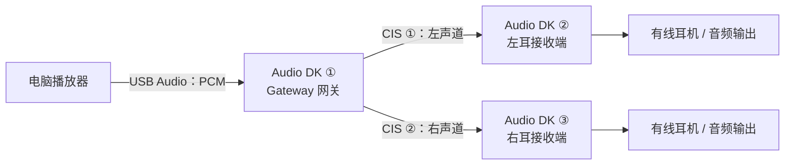
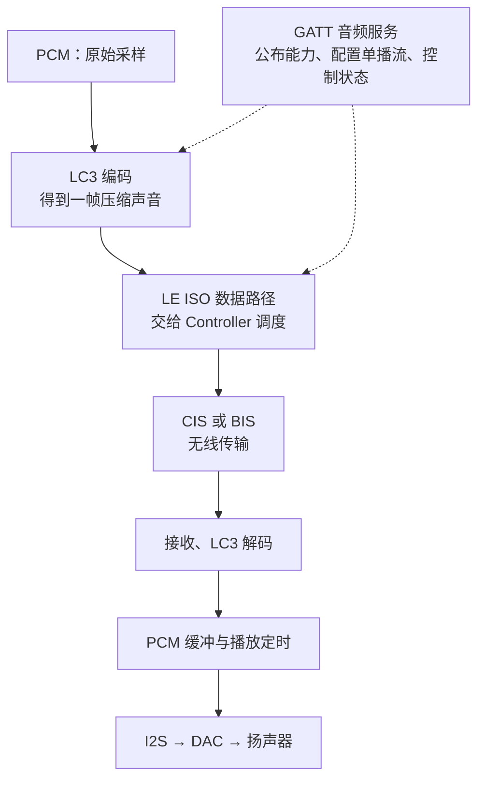
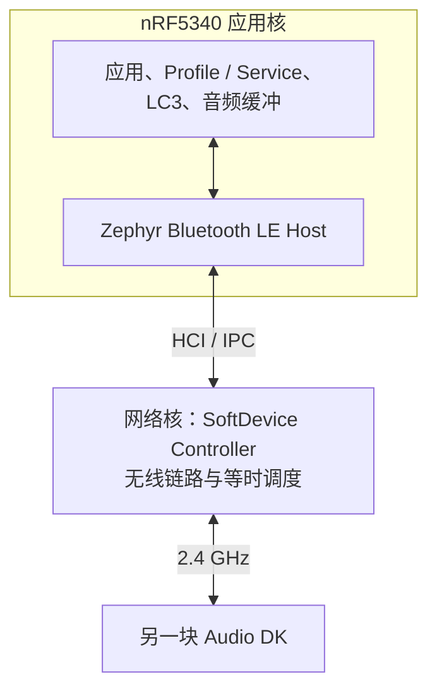
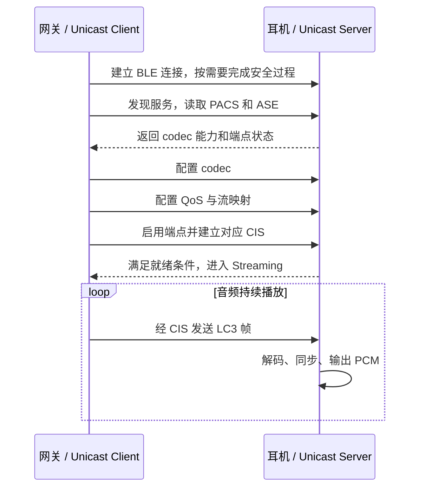
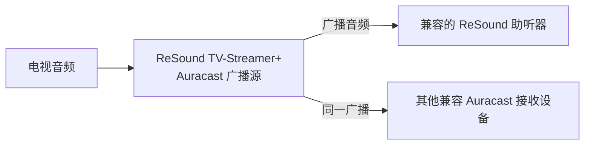

# LE Audio：从原理到真实案例

**LE Audio 是运行在 Bluetooth LE 上的一套音频体系**：LC3 负责压缩声音，LE 等时信道负责有时间要求的传输，音频 Profile 和 Service 负责能力发现、流配置及控制。它可以用于耳机音乐、双向语音、左右耳同步，也可以用于多人接收同一个广播音源。[^sig-overview][^sig-bap]

本文从 Nordic 官方的 **nRF5340 Audio 工程**展开，把协议概念对应到实际开发板、源码和配置，再看助听器产品中的广播音频。方案之间的总体比较见 [[06-蓝牙音频方案全景]]。

> [!info] 案例范围
> 开发案例以 **nRF Connect SDK v2.9.0** 的官方源码和文档为固定基线，便于复查。该版本将 nRF5340 Audio 应用标为 experimental。本文整理硬件连接、配置与官方预期现象；编译、烧录、延迟和功耗实测需在目标硬件上完成。[^nrf-index]

## 1. 先看一个真的能做出来的系统

Nordic 的官方工程可以把电脑声音通过 USB 送给一块 nRF5340 Audio DK，再通过 LE Audio 发给另外一块或两块 Audio DK。接收板连接有线耳机，就能承担耳机端的播放工作。两块板能验证单链路，三块板用于左右耳场景。[^nrf-requirements][^nrf-client]



这个例子对应三个具体问题：

| 问题 | 系统需要完成的事 | 后文对应概念 |
|---|---|---|
| 声音数据很多，怎样传？ | 把 PCM 按帧编码 | LC3 |
| 左右耳怎样同一时刻出声？ | 无线流定时与播放时钟协调 | CIS、CIG、呈现与漂移补偿 |
| 怎样开启播放、回传麦克风？ | 查询能力、配置方向、启动音频端点 | PACS、ASCS、ASE |

电脑在这个实验中选择的是 **nRF5340 USB Audio** 音频设备。LE Audio 无线链路建立在开发板之间，因此电脑自身的蓝牙适配器没有参与这段无线传输。[^nrf-client]

## 2. 把一帧声音拆成三项工作

### 2.1 编码、传输、控制分别做什么



图中实线表示典型音频数据路径，虚线表示控制配置。具体硬件可以使用 DSP、codec offload 或不同的音频外设，但编码、控制和传输仍有各自职责。[^sig-bap][^nrf-architecture]

| 组成 | 直观含义 | 具体例子 |
|---|---|---|
| LC3 | 这 10 ms 声音怎样压缩和还原？ | 采样率、帧长、每帧字节数 |
| LE ISO | 声音帧何时发送、接收，怎样满足时间约束？ | CIS、BIS 及其定时和传输参数 |
| GATT 音频服务 | 双方支持什么，怎样开始这次音频会话？ | PACS、ASCS |
| 本地音频链 | 收到后何时真正出声？ | PCM 缓冲、播放时钟、I2S、DAC |

对于学过 BLE GATT 的开发者，PACS 和 ASCS 仍是服务与特征；持续的标准 LE Audio 音频帧由 **ISO 数据路径**承载。广播接收的发现和配置又有对应的广播机制。[^sig-bap]

### 2.2 Host 和 Controller 各负责什么

以 nRF5340 Audio 为例：应用核运行 Zephyr Bluetooth LE Host、应用和 LC3；网络核运行 SoftDevice Controller，负责无线链路和等时调度，两核通过 HCI 等机制交互。[^nrf-architecture]



这是该案例的分工。其他芯片可以采用单核、多核或外接 Controller，选型时需同时核对 Host、Controller 和音频处理能力。

## 3. LC3：用一组数字理解音频帧

**LC3（Low Complexity Communications Codec，低复杂度通信编解码器）**是 LE Audio 的基础 codec。配置至少涉及采样率、帧长、每声道每帧字节数及声道安排。**BAP（Basic Audio Profile，基础音频规范）**定义单播、广播的基础音频过程，并规定了一组用于互通的 LC3 配置。[^sig-bap]

假设选取 **48 kHz、16-bit、单声道、10 ms 一帧、每帧 100 bytes**。下面是参数换算示例，实际使用前还要确认双方支持该配置。

| 计算项 | 算式 | 结果 |
|---|---|---:|
| 一帧的采样点 | 48,000 × 0.010 | 480 个 |
| 一帧原始 PCM | 480 × 16 ÷ 8 | 960 bytes |
| 每秒帧数 | 1 ÷ 0.010 | 100 帧 |
| LC3 有效码率 | 100 bytes × 8 × 100 帧/s | 80 kbit/s |
| 两个独立声道的有效码率 | 80 × 2 | 160 kbit/s |

**80 kbit/s 是上述配置的单声道压缩载荷码率。** 无线占用还需计入包头、调度、重传和控制信息。若改变每帧字节数，码率也随之变化。

> [!tip] 帧长怎样影响体验
> 7.5 ms、10 ms 等帧长决定一次编码处理的声音长度。实际端到端延迟还包含采集、编码、传输、缓冲、解码和输出等环节；延迟预算要按完整链路建立。[^sig-bap][^nrf-architecture]

## 4. 单播：为指定设备建立音频流

### 4.1 CIS 与 CIG

**CIS（Connected Isochronous Stream，连接等时流）**在已连接的两台设备间承载有时间要求的数据，可以配置单向或双向。**CIG（Connected Isochronous Group，连接等时组）**组织具有共同定时关系的 CIS。[^sig-bap]

前面的三块开发板案例中，网关使用一个 CIG，内部两条 CIS 分别连接左右接收端。每条 CIS 都有自己的接收对象。该版本 Nordic 应用支持的数量为一个 CIG、两条 CIS，这是这个应用的实现范围。[^nrf-client]

### 4.2 区分“谁控制”和“声音往哪走”

| 名称 | 描述的职责 | 在本例中的分配 |
|---|---|---|
| Unicast Client / Server | 谁配置单播业务，谁暴露音频服务 | 网关为 Client，耳机端为 Server |
| Audio Source / Sink | 谁产生声音，谁消费声音 | 播放时网关为 Source，耳机为 Sink |
| Central / Peripheral | BLE 连接层角色 | 本例网关为 Central，耳机为 Peripheral |

耳机回传麦克风时，它仍可以是 **Unicast Server**，同时承担上行的 **Audio Source**。这些名称描述不同层面的职责。[^sig-bap][^nrf-architecture]

### 4.3 PACS、ASCS 与 ASE

| 术语 | 全称 | 可以怎样理解 |
|---|---|---|
| PACS | Published Audio Capabilities Service | 能力目录：支持的 codec、参数、音频位置及用途 |
| ASCS | Audio Stream Control Service | 控制入口：配置、启用、停用音频端点 |
| ASE | Audio Stream Endpoint | 可被配置和启用的音频流端点 |

方向从暴露端点的设备来看：**Sink ASE 接收音频，Source ASE 发出音频**。耳机的播放路径可使用 Sink ASE，麦克风上行可使用 Source ASE。一个设备可以暴露多个端点。[^sig-bap]

下面只画单播播放的关键阶段，便于把日志和业务进度对应起来；具体顺序与条件按 BAP、ASCS 状态机实现。



QoS（Quality of Service，服务质量）参数包含 SDU 间隔、最大 SDU 大小、PHY、传输延迟和重传相关要求等。**SDU 是上层交给传输层的一份数据单元**；它与 LC3 帧的对应关系要看选定配置。[^sig-bap]

### 4.4 左右耳为什么能同步出声

包到达时间和播放时间是两个环节：无线重传可能让左右耳在不同时刻收到相应的数据，而输出端仍需按共同的时间要求播放。[^sig-bap]

Nordic 工程的 `audio_datapath.c` 把问题分为两项：[^nrf-architecture]

| 处理 | 解决的问题 | 官方工程中的做法 |
|---|---|---|
| Presentation compensation，呈现补偿 | 对应声音开始播放的时刻是否一致？ | 根据时间戳调整 FIFO 中音频块的位置，必要时补静音 |
| Drift compensation，漂移补偿 | 连续播放时，两个设备的音频时钟是否越走越偏？ | 调整音频时钟，使播放速度跟随数据流节奏 |

即使两块板标称相同采样率，晶振偏差也可能使缓冲逐渐变满或变空。因此，完成 LC3 解码后，还需要处理本地播放时钟和缓冲。[^nrf-architecture]

## 5. 广播：让多台设备收听同一个音源

### 5.1 BIS 与 BIG

**BIS（Broadcast Isochronous Stream，广播等时流）**从广播源向接收端发送音频。**BIG（Broadcast Isochronous Group，广播等时组）**把相关 BIS 组织在一起。广播源按自己的调度发送；每个接收端选择需要的流并进行同步。[^sig-bap]

| 关注点 | CIS 单播 | BIS 广播 |
|---|---|---|
| 接收对象 | 已连接的指定设备 | 同步到广播的兼容接收端 |
| 方向 | 可单向，也可双向 | 广播源到接收端 |
| 丢包处理 | 有确认与受时限约束的重传机制 | 没有逐个接收端的确认，可通过重复发送等机制提高可靠性 |
| 增加一个收听者 | 通常需要增加或分配连接资源 | 无需为该听众单独建立音频连接 |
| 典型需求 | 耳机播放、麦克风回传 | 电视分享、场馆播报、公共助听 |

表中比较的是传输机制；实际可靠性还取决于射频环境、配置和实现。[^sig-core]

### 5.2 接收端怎样找到节目

广播源除了发送音频，还要提供可发现和可同步的信息。BAP 中的 **BASE（Broadcast Audio Source Endpoint）**描述广播的音频配置，包括子组、codec、元数据和 BIS 等；**BIGInfo**提供接收端同步 BIG 所需的底层信息。[^sig-bap][^sig-core]


部分设备自己扫描、选择节目；也可以让手机充当 **Broadcast Assistant（广播助手）**，通过接收端的 **BASS（Broadcast Audio Scan Service）**帮助其加入广播。音频仍可由耳机直接从广播源接收。[^sig-bap]

### 5.3 Auracast 体现在哪里

**Auracast 是基于 LE Audio 广播的标准化音频分享体验与品牌**，使用 PBP（Public Broadcast Profile）等规范定义互通要求。评估产品时，需要明确它承担广播源、接收端还是广播助手角色。[^sig-auracast]

广播可以公开，也可以加密；加密广播需要相应的 **Broadcast Code** 才能解密。收听者增加时，发射端无需逐人建链，但覆盖距离、干扰和接收能力仍限制实际可用范围。BIS 自身提供下行，若业务需要听众发言，需额外设计上行路径。[^sig-bap]

## 6. 真实开发案例：nRF5340 Audio DK

### 6.1 硬件和工程准备

| 项目 | 具体准备 |
|---|---|
| SDK | nRF Connect SDK **v2.9.0** 及其配套工具链、依赖 |
| 开发板 | **nRF5340 Audio DK**；两块做单链路，三块做左右耳 |
| 输入 | 电脑通过 USB 向 Gateway 发送声音 |
| 输出 | 接收板的 `HEADPHONE` 插孔连接有线耳机 |
| 工程目录 | `nrf/applications/nrf5340_audio/` |
| 模式选择 | CIS 单播或 BIS 广播，按配置构建相应角色 |

官方应用针对 Audio DK 的音频硬件设计，板级要求见该版本 `requirements.rst`。普通 nRF5340 DK 的外设组成不同，移植时需要处理音频输入、输出和板级配置。[^nrf-requirements]

```text
nrf/applications/nrf5340_audio/
├── prj.conf                     调试配置
├── unicast_client/              单播网关
├── unicast_server/              单播耳机端
├── broadcast_source/            广播源
├── broadcast_sink/              广播接收端
├── src/                         共享音频与蓝牙模块
└── tools/buildprog/             构建、烧录脚本及设备映射
```

这些应用共用大量代码，通过配置选择角色和主程序。源码阅读可先从对应角色的 `main.c` 入手，再跟踪音频流、LC3 和 `audio_datapath.c`。[^nrf-architecture]

### 6.2 案例 A：电脑音乐 → 两个耳机端

这是官方 Unicast Client / Server 的测试场景：一个网关给两个接收板传送左右声道。[^nrf-client][^nrf-server]

**第一步：定义板子的角色。** 在 `tools/buildprog/nrf5340_audio_dk_devices.json` 中填写每块板真实的 SEGGER 序列号，并分配以下字段：[^nrf-building]

| 板子 | `nrf5340_audio_dk_dev` | `channel` |
|---|---|---|
| 网关 | `gateway` | `NA` |
| 左耳端 | `headset` | `left` |
| 右耳端 | `headset` | `right` |

**第二步：选择单播。** 该版本默认是单向 CIS；确认 `prj.conf` 中的传输选择为 CIS。脚本根据设备角色构建对应镜像。[^nrf-config]

```ini
CONFIG_TRANSPORT_CIS=y
```

**第三步：构建角色镜像。** 在已经初始化并激活 v2.9.0 工具链的 nRF Connect SDK 工作区中，可按官方脚本入口执行：[^nrf-building]

```sh
cd nrf/applications/nrf5340_audio/tools/buildprog
python buildprog.py -c both -b debug -d both
```

这里 `-c both` 选择应用核和网络核，`-d both` 选择网关和耳机端，`-b debug` 选择调试构建。按照板子序列号和角色完成烧录后，再进行音频验证；完整烧录参数见该版本 `building.rst`。

**第四步：按官方步骤验证。**[^nrf-client][^nrf-server]

| 操作 | 官方预期现象 / 应检查的结果 |
|---|---|
| 开发板上电，等待连接 | 网关 `LED1` 蓝色闪烁，表示已连接并可发送音频 |
| 电脑输出设备选 `nRF5340 USB Audio` | 电脑音频进入网关的 USB 输入 |
| 接收端插入有线耳机，电脑开始播放 | 接收端开始串流，`LED1` 蓝色闪烁 |
| 等待播放同步 | 接收端 `LED2` 常绿，表示漂移和呈现补偿均进入锁定状态 |
| 网关按 `BTN 4` | 发出测试音，可用于比较两个接收端的同步 |

> [!tip] Audio DK 的一个具体硬件细节
> 官方说明指出：板载硬件 codec 是单声道，因此 `HEADPHONE` 插孔使用左声道输出，即使该板被配置为接收右耳音频也是如此。“接收右声道内容”和“插孔右触点出声”要分别确认。[^nrf-client]

测试音可以帮助确认两端都在播放；需要量化同步误差时，可同时采集两路输出，再比较同一瞬态事件的时间差。LED 状态表示软件同步状态，具体误差仍需测量。

### 6.3 案例 B：加入麦克风，做双向语音

同一套官方应用支持 CIS 双向传输。耳机端从板载 PDM 麦克风采集声音并回传；网关端可以采用 USB 音频，也可以在 walkie-talkie 演示中使用板载麦克风。[^nrf-config][^nrf-architecture]


在调试用的 `prj.conf` 中启用双向模式：

```ini
CONFIG_STREAM_BIDIRECTIONAL=y
```

若要复现官方的双向语音演示，再启用：

```ini
CONFIG_WALKIE_TALKIE_DEMO=y
```

重新构建并给两端更新对应镜像。此演示中两端使用 PDM 麦克风，音频链路保持开启，可直接讲话；音量控制仍可使用。这里展示的是开发板间的双向音频，手机通话产品还需要相应场景 Profile、通话控制和系统支持。[^nrf-client][^nrf-config]

该案例把“开启上行”落实到了麦克风采集、Source 方向、双向 CIS、编码以及网关接收路径。做真实免提产品时，还应根据扬声器与麦克风布局评估回声消除和双讲表现。

### 6.4 案例 C：同一音源供多个接收板收听

将传输模式选择为 BIS，网关成为 Broadcast Source，耳机板成为 Broadcast Sink：[^nrf-broadcast-source][^nrf-broadcast-sink]

```ini
CONFIG_TRANSPORT_BIS=y
```

`TRANSPORT_CIS` 和 `TRANSPORT_BIS` 是该工程的传输模式选择项。分别完成广播源与接收端构建、烧录后，按官方测试步骤建立广播同步。[^nrf-config]

| 项目 | 该版本官方应用的具体行为 |
|---|---|
| 广播源 | 一个 BIG，包含两条 BIS；默认广播 48 kHz 音频流 |
| 接收端 | 选择并接收其中一条 BIS，输出到 I2S / 耳机插孔 |
| 增加接收板 | 更多广播接收端可同步到同一广播源 |
| 开始 / 暂停 | 广播源通过启用、停用流实现 |

这些是应用实现与官方预期行为。若要与商用 Auracast 设备互通，还需核对对端支持的广播配置、元数据、选择方式和安全参数。[^nrf-broadcast-source][^nrf-broadcast-sink]

## 7. 真实产品案例：ReSound TV-Streamer+ 与助听器

ReSound 官方的 Auracast 产品页面介绍了 **TV-Streamer+**：它把电视音频发送给兼容助听器，并允许同一广播中的其他兼容 Auracast 设备收听。电视可以通过外接发射器获得这项广播能力。[^resound]



把这个产品映射回前面的知识：

| 产品中的需求 | 对应的技术思路 |
|---|---|
| 电视同时给多位用户提供声音 | 广播源发送，多个接收端同步收听 |
| 助听器直接得到节目声音 | 发射器到助听器的无线音频链路 |
| 用户根据听力需求收听 | 在兼容接收设备上进行相应音频处理与音量控制 |
| 用户已有电视需要加入广播能力 | 外接发射器承担音频输入与 LE Audio 广播功能 |

官方页面确认产品用途和兼容 Auracast 设备的共享收听能力；具体输入接口、助听器型号、软件版本和加入方式应以对应产品说明为准。本文没有对该产品测量延迟、距离或耗电。[^resound]

## 8. 在自己的项目里怎样落地

### 8.1 从需求写出所需角色

| 产品需求 | 需要先确认的能力 |
|---|---|
| 给一个耳机播音乐 | 单播 Source / Client、匹配的接收端、LC3 配置 |
| 左右耳独立接收并同步播放 | 多条流、同步定时、接收端播放时钟补偿 |
| 耳机回传麦克风 | 上行音频端点、双向传输、采集和编码路径 |
| 给多人播放同一节目 | Broadcast Source、BIG/BIS、广播配置和接收选择 |
| 手机辅助用户选择广播 | Broadcast Assistant、接收端 BASS 支持 |

LE 等时信道在 Bluetooth Core 5.2 中引入。芯片支持 BLE 或标有某个 Core 版本，还需逐项核对 Controller 的 ISO 功能、Host 音频协议、LC3、音频外设与目标系统支持。[^sig-faq]

### 8.2 建议按以下顺序验证

```text
确认双方角色和能力
        ↓
发现服务，完成 codec / QoS 配置
        ↓
CIS 建立或 BIG 同步，出现持续 ISO 数据
        ↓
LC3 解码得到 PCM，本地音频外设输出
        ↓
检查连续播放、时钟漂移、上下行和状态切换
        ↓
测量端到端延迟、同步误差、丢包与整机功耗
```

| 现象 | 优先查看 |
|---|---|
| BLE 已连接但无声音 | PACS 能力、ASE 状态、CIS 是否建立、是否真正进入 Streaming |
| ISO 有数据但扬声器无声音 | LC3 参数、解码结果、PCM 格式、I2S/DAC 配置 |
| 一段时间后卡顿或缓冲溢出 | 缓冲水位、播放时钟偏差、调度与无线丢包 |
| 左右耳都有声音但不同步 | 音频位置分配、时间戳、呈现补偿与漂移补偿状态 |
| 广播能发现但无法收听 | codec 和 BIS 选择、BIG 同步、加密广播的 Broadcast Code |
| 开发板互通，商用设备无法使用 | 场景 Profile、必选配置、服务/元数据和平台兼容要求 |

以上为排查建议。记录时写出具体芯片、SDK、对端型号、协商参数和测量方法，才能区分协议能力、实现限制与实际性能。

## 相关笔记

- [[01-蓝牙入门]]
- [[03-BLE协议栈]]
- [[04-经典蓝牙协议与开发基础]]
- [[06-蓝牙音频方案全景]]
- [[常见音频编码格式对比]]
- [[07-Zephyr-Audio-Codec-API]]

## 官方参考

资料核对日期：**2026-11-06**。Nordic 案例固定到 **v2.9.0**，命令与配置按该版本阅读。

[^sig-overview]: Bluetooth SIG：[LE Audio 概览](https://www.bluetooth.com/learn-about-bluetooth/feature-enhancements/le-audio/)。LC3、多流及广播音频。
[^sig-bap]: Bluetooth SIG：[Basic Audio Profile 1.0](https://www.bluetooth.com/wp-content/uploads/Files/Specification/HTML/BAP_v1.0/out/en/index-en.html)。音频角色、端点、LC3 配置、单播、广播和 Presentation Delay。
[^sig-core]: Bluetooth Core 5.4：[Low Energy Link Layer Specification](https://www.bluetooth.com/wp-content/uploads/Files/Specification/HTML/Core-54/out/en/low-energy-controller/link-layer-specification.html)。CIS、BIS、调度、重传与广播同步信息。
[^sig-auracast]: Bluetooth SIG：[Auracast — How it works](https://www.bluetooth.com/auracast/how-it-works/)。广播源、接收端、广播助手及 PBP 关系。
[^sig-faq]: Bluetooth SIG：[Bluetooth LE Audio FAQs](https://www.bluetooth.com/media/le-audio/le-audio-faqs/)。Core 5.2 等时信道与产品能力要求。
[^nrf-index]: Nordic，nRF Connect SDK v2.9.0：[nRF5340 Audio applications](https://github.com/nrfconnect/sdk-nrf/blob/v2.9.0/applications/nrf5340_audio/index.rst)。应用范围和 experimental 状态。
[^nrf-requirements]: Nordic v2.9.0：[Requirements](https://github.com/nrfconnect/sdk-nrf/blob/v2.9.0/applications/nrf5340_audio/doc/requirements.rst)。Audio DK 硬件、板子数量和 LC3。
[^nrf-architecture]: Nordic v2.9.0：[Firmware architecture](https://github.com/nrfconnect/sdk-nrf/blob/v2.9.0/applications/nrf5340_audio/doc/firmware_architecture.rst)。双核职责、音频链路、呈现与漂移补偿。
[^nrf-config]: Nordic v2.9.0：[Configuration](https://github.com/nrfconnect/sdk-nrf/blob/v2.9.0/applications/nrf5340_audio/doc/configuration.rst)。CIS/BIS、双向模式、walkie-talkie 及 USB 输入。
[^nrf-building]: Nordic v2.9.0：[Building and running](https://github.com/nrfconnect/sdk-nrf/blob/v2.9.0/applications/nrf5340_audio/doc/building.rst)。设备 JSON、buildprog.py 及构建参数。
[^nrf-client]: Nordic v2.9.0：[Unicast client](https://github.com/nrfconnect/sdk-nrf/blob/v2.9.0/applications/nrf5340_audio/unicast_client/README.rst)。网关能力、电脑输出设备、测试音、指示灯及耳机插孔行为。
[^nrf-server]: Nordic v2.9.0：[Unicast server](https://github.com/nrfconnect/sdk-nrf/blob/v2.9.0/applications/nrf5340_audio/unicast_server/README.rst)。耳机端、左右声道及同步状态。
[^nrf-broadcast-source]: Nordic v2.9.0：[Broadcast source](https://github.com/nrfconnect/sdk-nrf/blob/v2.9.0/applications/nrf5340_audio/broadcast_source/README.rst)。BIG/BIS 数量、默认采样率和广播源测试。
[^nrf-broadcast-sink]: Nordic v2.9.0：[Broadcast sink](https://github.com/nrfconnect/sdk-nrf/blob/v2.9.0/applications/nrf5340_audio/broadcast_sink/README.rst)。接收配置与测试过程。
[^resound]: ReSound：[Auracast hearing aids](https://www.resound.com/en/hearing-aids/auracast-hearing-aids)。TV-Streamer+ 与兼容助听器、Auracast 设备共享收听的产品说明。
