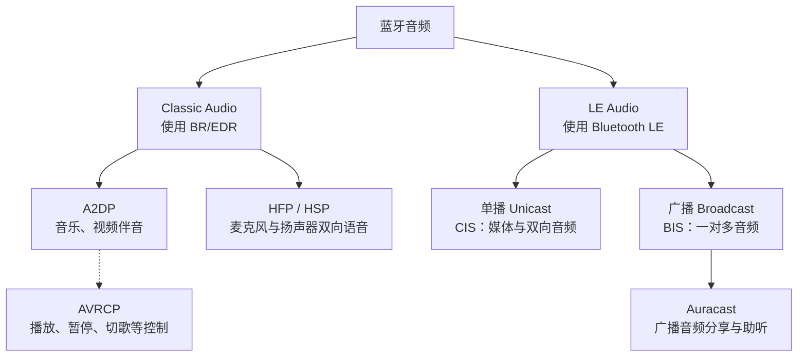
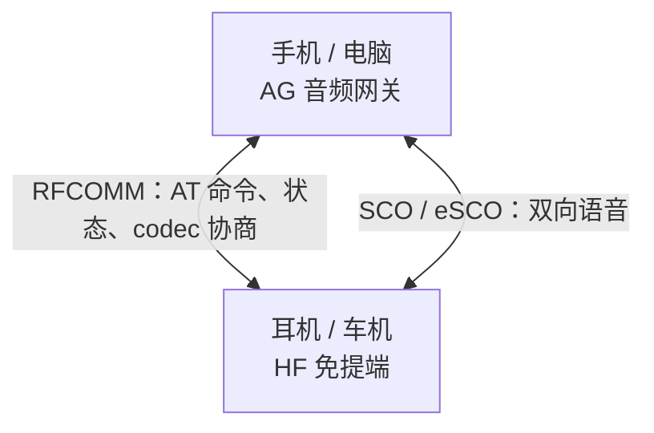
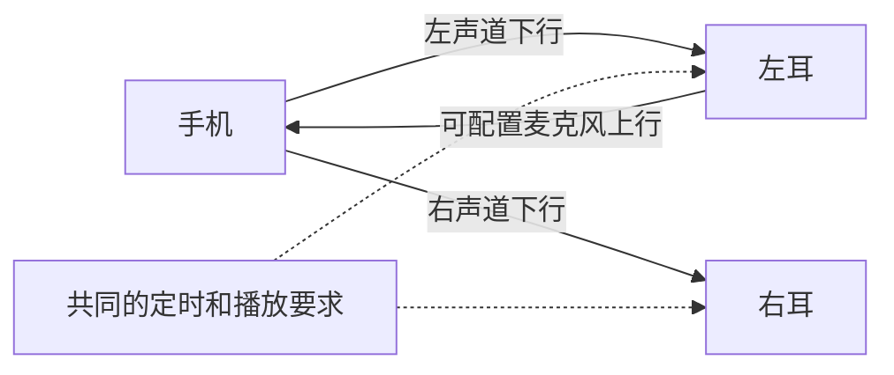
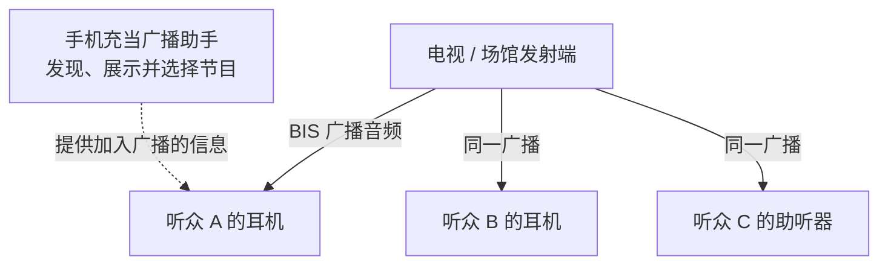

# 蓝牙音频方案全景

蓝牙音频可以先按三个需求理解：**听音乐、双向通话、把同一段声音分享给多人**。经典蓝牙主要用 A2DP 播放媒体、HFP 处理通话；LE Audio 在 Bluetooth LE 上提供单播、多流同步和广播音频能力。[^a2dp][^hfp][^le]

> [!abstract] 阅读主线
> 先看三类需求对应什么方案，再沿着“声音怎样从手机到耳机”理解链路，最后看嵌入式选型。
> **A2DP、HFP 是具体的 Profile；LE Audio 是一整套音频体系，内部包含多个 Profile、Service 和传输机制。**

## 1. 一张图看清主流路线

下图按传输体系和使用场景分类。助听器生态、自定义 BLE 传输在后文单独介绍。[^a2dp][^hfp][^le-specs]



### 1.1 先记住这张对照表

| 方案                         | 典型用途            | 音频方向                 | 音频传输                  | 首先确认什么                |
| -------------------------- | --------------- | -------------------- | --------------------- | --------------------- |
| **A2DP**                   | 手机听歌、音箱、车载音乐    | 一条媒体流从 Source 到 Sink | BR/EDR ACL            | 双方角色、共同 codec         |
| **HFP**                    | 耳机通话、车载免提、会议语音  | 双向单声道语音              | SCO / eSCO            | AG/HF 角色、协商到的语音 codec |
| **HSP**                    | 较早的耳麦及兼容场景      | 双向语音                 | SCO                   | 对端是否要求该 Profile       |
| **LE Audio 单播**            | 耳机媒体播放、通话、同步多流  | 可配置单向或双向             | CIS / CIG             | 双方的角色、配置和系统支持         |
| **LE Audio 广播 / Auracast** | 电视分享、场馆助听、多语言音频 | 广播源到接收端              | BIS / BIG             | 发射、接收及广播选择能力          |
| **ASHA / MFi 助听器方案**       | 手机连接助听器         | 由各生态和设备能力决定          | 各自定义的传输方案             | 手机、助听器与系统兼容表          |
| **自定义 BLE 音频**             | 设备向配套 App 上传语音等 | 应用自行设计               | GATT 或 LE L2CAP CoC 等 | 两端软件、吞吐、缓冲和时序         |

标准方案依据对应 Profile 与官方架构资料；自定义 BLE 一行表示一种应用设计方式。[^a2dp][^hfp][^hsp][^bap][^asha][^mfi]

### 1.2 区分 Profile、codec 和无线链路

以“手机通过 A2DP 给耳机播放 SBC 音频”为例：[^a2dp]

| 层次 | 回答的问题 | 例子 |
|---|---|---|
| Profile，应用规范 | 双方怎样发现、配置和使用音频功能？ | A2DP、HFP、BAP |
| Codec，编解码器 | PCM 怎样编码，收到后怎样还原？ | SBC、AAC、mSBC、LC3 |
| 传输机制 | 音频包通过什么链路发送？ | ACL、SCO/eSCO、CIS、BIS |
| 无线体系 | 使用哪一套蓝牙无线通信机制？ | BR/EDR、Bluetooth LE |

**实际互通需要 codec、传输、Profile 和角色同时匹配。** 例如 HFP 也能使用 LC3-SWB，因此仅凭日志中的 LC3 名称，无法判断当前使用的音频体系。[^hfp]

## 2. A2DP：把媒体音频送到耳机或音箱

**A2DP（Advanced Audio Distribution Profile，高级音频分发规范）**定义高质量音频的传送方式。典型场景是手机作为 **Source / SRC（音频源）**，耳机作为 **Sink / SNK（音频接收端）**。角色按本次音频流的方向确定。[^a2dp]

### 2.1 声音怎样走到扬声器

下面是常见的音频路径；具体芯片也可能通过硬件或 DSP 卸载其中的处理。[^a2dp][^esp-audio]


**AVDTP（Audio/Video Distribution Transport Protocol，音视频分发传输协议）**负责流的协商和传输。一次播放可以概括为：发现能力 → 选择 codec 和参数 → 配置并打开流 → 开始传送音频。A2DP 规定这些机制在音频分发中怎样使用。[^a2dp]

### 2.2 SBC、AAC、aptX、LDAC 分别在哪一层

| 名称 | 在 A2DP 中的定位 | 工程上怎样理解 |
|---|---|---|
| SBC | 必须实现的基础 codec | Source 实现编码，Sink 实现解码，提供共同基础 |
| AAC | 可选 codec | 双方都支持并成功协商后使用 |
| aptX 系列、LDAC 等 | 可选的厂商 codec | 核对具体种类、双方实现及协商结果 |

SBC 的基础要求和可选 codec 规则见 A2DP 规范；Android 官方资料也列出了 AAC、aptX、aptX HD、LDAC 的集成入口。设备实际启用哪些能力，由产品实现决定。[^a2dp][^android-codecs]

### 2.3 耳机上的播放按钮由谁处理

**AVRCP（Audio/Video Remote Control Profile，音视频远程控制规范）**负责播放、暂停、切歌、音量及媒体信息等控制功能，具体功能取决于双方支持的版本和特性。A2DP 提供媒体音频，AVRCP 提供对应的控制交互。[^avrcp]

例如：耳机按下暂停键 → AVRCP 将操作发给手机 → 手机播放器暂停 → A2DP 媒体流随之暂停。

### 2.4 A2DP 耳机的麦克风怎样回传

常规手机和电脑的 A2DP 播放路径提供 **Source → Sink 媒体流**。使用同一副耳机的麦克风时，典型 Classic 耳麦通过 HFP 回传声音。系统将设备显示为一个音频端点时，底层仍可能进行 Profile 切换。[^windows-audio]

## 3. HFP 与 HSP：让双方同时说话和听见

### 3.1 HFP 的两端分别做什么

**HFP（Hands-Free Profile，免提规范）**覆盖双向语音和通话控制。常见的两个角色是：[^hfp]

| 角色 | 典型设备 | 职责 |
|---|---|---|
| AG，Audio Gateway，音频网关 | 手机、电脑 | 对接通话或语音应用，提供音频和通话状态 |
| HF，Hands-Free，免提端 | 耳机、车载免提、免提音箱 | 提供麦克风、扬声器及接听等操作 |

控制信息和实际语音走不同路径：[^hfp-trace]



**SCO** 是同步面向连接的链路；**eSCO** 是其扩展形式，提供更灵活的包类型和受时限约束的重传机制。Controller 安排语音传输时序。调试时要分别确认控制连接和语音连接是否建立。[^core]

### 3.2 HFP 的语音质量也有不同档位

| Codec | PCM 采样率 | 对应语音模式 | 支持条件 |
|---|---:|---|---|
| CVSD | 8 kHz | 窄带语音 | HFP 基础能力 |
| mSBC | 16 kHz | WBS，宽带语音 | 双方支持并协商成功 |
| LC3-SWB | 32 kHz | SWB，超宽带语音 | HFP 1.9 起定义的能力，仍需双方实现和协商 |

这里列的是**采样率**。例如 16 kHz 采样率并不表示能够保留到 16 kHz 的声音频率。HFP codec ID 和协商过程可在 BlueZ 官方抓包文档中对应查看。[^hfp-trace]

### 3.3 为什么打开麦克风后声音会变化

典型 Classic 耳麦听歌时使用 A2DP；应用打开耳机麦克风后，系统可能切换到 HFP，codec、采样率和声道配置随之变化。Microsoft 文档描述了 Windows 的这种选择行为，以及应用采样率与 HFP 端点不一致时的重采样。[^windows-audio]

排查“会议一开始，音乐听感就变了”时，先确认**当前 Profile、实际 codec 和音频端点**。具体表现取决于系统、驱动和设备实现。

### 3.4 HSP 还有什么用途

**HSP（Headset Profile，耳机规范）**定义基础耳麦功能，包括全双工语音、按键以及音量等简单控制，常在较早设备和兼容性要求中遇到。手机免提业务可以从 HFP 的角色和功能开始核对；是否同时实现 HSP，由目标设备的兼容要求决定。[^hsp]

## 4. LE Audio：在 BLE 上实现媒体、通话与同步音频

LE Audio 建立在 **LE Isochronous Channels（LE 等时信道）**之上。这项能力在 Bluetooth Core 5.2 中引入，为有时间要求的数据提供专门的传输机制。标准音频互通以 LC3 为基础，并通过一组 Profile 和 Service 管理音频功能。[^le-faq][^le-specs]

### 4.1 为什么音频需要“等时”

音频需要按节奏播放。假设每次处理 10 ms 声音，接收端就必须持续获得下一段可播放的数据。过晚到达的包可能已经错过播放时刻。等时传输结合时间约束、同步和重传配置来处理这类需求。[^isoal]

对熟悉 BLE GATT 开发的人，可以先看这张分工表：[^bap]

| 工作 | LE Audio 中的机制 |
|---|---|
| 查询设备支持什么音频，配置和管理单播流 | GATT 服务与相关控制过程 |
| 持续发送标准 LE Audio 音频帧 | LE ISO 数据路径，使用 CIS 或 BIS |
| 发现广播，获得同步与音频配置信息 | 广播、周期广播及广播音频过程 |

### 4.2 单播 CIS：听歌、通话和左右耳同步

**CIS（Connected Isochronous Stream，连接等时流）**是两台已连接设备之间的等时流，可以配置单向或双向数据。**CIG（Connected Isochronous Group，连接等时组）**组织具有共同定时关系的 CIS。[^le-book]

例如，一种真无线耳机设计可以采用下面的组织方式。图中展示音频方向，具体流配置由双方能力和协商结果确定。



**Multi-Stream Audio（多流音频）**让同一音源发送多条独立、同步的流，可用于左右耳等场景。设备能维持多少条流，还受 Controller、带宽及产品配置限制。[^le][^bap]

### 4.3 LC3 负责音频编码

**LC3（Low Complexity Communications Codec，低复杂度通信编解码器）**可用于语音和媒体音频。LE Audio 常用配置采用 7.5 ms 或 10 ms 帧长，还需要匹配采样率、每帧字节数、声道分配等参数。[^bap]

> [!tip] 怎样理解低功耗和低延迟
> LC3 的编码效率和 LE Audio 的调度机制提供了优化空间。整机功耗与端到端延迟仍由编码、无线重传、缓冲、DSP 和播放链共同决定，应按实际产品配置测量。**10 ms 帧长只是其中一个时间参数。**[^le-book]

### 4.4 从发现设备到开始播音

以单播播放为例，可以按下面的逻辑理解控制过程；实际实现应遵循相关状态机。[^bap]

| 阶段 | 需要解决的问题 | 相关机制 |
|---|---|---|
| 建立 BLE 连接并发现服务 | 对方提供哪些音频功能？ | GAP、GATT |
| 读取能力 | 支持哪些 codec、参数、音频位置与用途？ | PACS |
| 配置音频端点 | 本次采用什么编码与传输质量参数？ | ASCS、BAP |
| 建立并启用流 | 音频何时、通过哪条 CIS 传输？ | CIS / CIG、音频端点状态机 |
| 开始收发与播放 | 持续提交、解码并按时呈现音频 | LC3、ISO 数据路径、本地音频链 |

> [!info]- 阅读 SDK 时常见的 LE Audio 缩写
> 先按职责查表，具体使用哪些取决于产品角色。[^le-specs][^gmap]
>
> | 缩写 | 名称 / 职责 |
> |---|---|
> | BAP | Basic Audio Profile：基础单播、广播音频过程 |
> | PACS | Published Audio Capabilities Service：公布音频能力 |
> | ASCS | Audio Stream Control Service：管理单播音频端点和状态 |
> | BASS | Broadcast Audio Scan Service：辅助广播扫描与接收控制 |
> | CAP | Common Audio Profile：协调通用音频操作 |
> | CSIP / CSIS | Coordinated Set Identification Profile / Service：识别成组设备，如一对耳机 |
> | MCP / CCP | Media Control Profile / Call Control Profile：媒体与通话控制 |
> | VCP / MICP | Volume Control Profile / Microphone Control Profile：音量与麦克风控制 |
> | TMAP | Telephony and Media Audio Profile：电话和媒体场景互通要求 |
> | HAP | Hearing Access Profile：助听设备场景要求 |
> | GMAP | Gaming Audio Profile：游戏音频场景要求 |
> | PBP | Public Broadcast Profile：公共广播音频互通要求 |

## 5. 广播音频与 Auracast：多人收听同一音源

**BIS（Broadcast Isochronous Stream，广播等时流）**将音频从广播源发送给接收端。多条具有共同定时关系的 BIS 组成 **BIG（Broadcast Isochronous Group，广播等时组）**。接收者同步到广播，发射端无需为每位听众分别建立音频连接。[^bap][^le-book]

**Auracast** 是基于 LE Audio 广播能力的标准化应用体验与品牌，涉及 PBP 及相关互通要求。实际使用时，还要确认设备能发射、接收，或辅助选择广播中的哪一种功能。[^le-faq][^auracast]



图中的手机可以承担 **Broadcast Assistant（广播助手）**：扫描可用节目，将用户选择和所需信息传给耳机；耳机直接接收广播源的音频。一个设备也可以组合多种角色。[^auracast]

| 问题 | 理解方式 |
|---|---|
| 是否需要每个听众都与广播源配对？ | 接收 BIS 音频本身无需逐一建立配对连接 |
| 能否私密分享？ | 可使用加密广播，通过 Broadcast Code 提供接收所需信息 |
| 能否把听众麦克风传回来？ | BIS 音频方向是广播源到接收端；回传需要另外的链路和应用设计 |
| 能否提供多种语言？ | 可通过不同音频流及相关元数据组织内容，接收端选择支持的内容 |
| 听众增多会逐个增加音频连接吗？ | 广播源无需逐个维护接收者，但覆盖范围、干扰与接收能力仍影响体验 |

以上分别对应广播传输、加密和广播配置机制。[^bap][^auracast-guide]

## 6. 还有哪些常见方案

### 6.1 助听器：ASHA、MFi 与 LE Audio HAP

| 方案 | 主要生态 | 理解重点 |
|---|---|---|
| **ASHA**，Audio Streaming for Hearing Aids | Android 与兼容助听器 | 通过 BLE L2CAP CoC 发送音频，用 GATT 控制；规范定义 G.722、16 kHz、64 kbit/s |
| **MFi hearing devices** | Apple 与兼容助听设备 | 按 Apple 官方兼容列表确认；部分型号支持双向音频和免提通话 |
| **LE Audio + HAP** | Bluetooth SIG 标准助听生态 | 通过 LE Audio 承载音频，由 HAP/HAS 定义助听设备相关功能 |

ASHA 的规范音频路径是手机向助听器输出声音；麦克风回传能力要另行确认。MFi 的双向支持也需要具体型号和系统满足要求。按本次建立的方案判断实际链路。[^asha][^mfi][^le-specs]

### 6.2 自定义 BLE 音频：传给自己的 App

已有 BLE 数据通信能力时，可以自行约定音频格式，通过 **GATT Notify / Write** 或 **LE L2CAP CoC（面向连接信道）**等传送。ASHA 就展示了音频传输与 GATT 控制分工的一种具体方案。[^asha]

例如，自研录音设备可以设计为：

```text
麦克风 → PCM → 选定的编码器 → 分帧与序号 → BLE → 配套 App 解码
```

这是应用层设计。项目需要自行实现采样参数协商、分帧、丢包处理、时钟偏差管理和播放缓冲；接入系统的通用耳机或麦克风入口，还需满足平台的音频设备接入机制。

一个先做带宽估算的方法：

```text
16 kHz × 16 bit × 1 声道 = 256 kbit/s = 32 kB/s 原始 PCM
每 10 ms 音频块 = 320 bytes
```

工程上还需为协议开销、调度和重传留出余量。建议记录持续有效吞吐、音频块等待时间、丢包率和缓冲水位；实际结果由两端实现与无线环境决定。

### 6.3 厂商扩展、TWS 与多点连接

**TWS（True Wireless Stereo，真无线立体声）**描述左右耳独立的产品形态；具体实现可以使用厂商的 Classic 方案，也可以使用 LE Audio 多流。**Multipoint（多点连接）**描述设备连接多个音源的能力，实际切换和混音策略由产品决定。[^le-book]

选型时分别记录耳间同步方式、同时连接的音源数量、实际 Profile 和 codec。aptX、LDAC 等名称提供的是 codec 层面的信息。[^android-codecs]

## 7. 嵌入式项目怎样选

以下是按目标功能推导的选型入口；最后应使用真实对端验证支持范围。

| 项目目标 | 优先核对的方案 | 项目侧角色或条件 |
|---|---|---|
| 手机向自制音箱播放音乐 | A2DP + AVRCP | A2DP Sink；按需实现播放和音量控制 |
| 自制播放器给蓝牙耳机送音乐 | A2DP | A2DP Source，能提供对端支持的 codec |
| 自制耳机或免提音箱连接手机通话 | HFP | HF，具备采集与播放链路 |
| 自制网关连接常规蓝牙通话耳机 | HFP | AG；另行实现通话或语音业务 |
| 新耳机产品需要 LE 媒体、通话、多流 | LE Audio 单播及相应场景 Profile | CIS、LC3、Host/Profile 与目标系统均支持 |
| 电视或展厅向多人分享声音 | LE Audio 广播 / Auracast | 广播源及目标接收器的完整互通能力 |
| 对接助听器 | HAP、ASHA 或 MFi | 匹配手机和助听设备支持的生态 |
| 设备向自有 App 传送语音 | 自定义 BLE 音频 | 两端协议、编码、吞吐和时序均可控制 |

### 7.1 沿着四层检查可用性

```text
Controller：支持需要的 BR/EDR、SCO/eSCO 或 LE ISO 能力吗？
    ↓
Host / SDK：实现目标 Profile、角色、codec 和数据路径了吗？
    ↓
对端系统：开放相应媒体、通话或广播功能了吗？
    ↓
实际链路：协商到了什么参数，声音能否稳定连续传输？
```

**蓝牙版本号只是能力核对的入口。** Bluetooth SIG 提醒，单独使用 Core 版本号容易导致对功能支持的误判。LE Audio 的判断还应落到 ISO、相关 Profile、产品角色和系统实现。[^functionality][^le-faq]

产品可以同时实现 Classic Audio 和 LE Audio，以适配不同对端。只支持 A2DP/HFP 的耳机与只支持 LE Audio 的音源之间，需要共同支持的音频模式才能互通；是否具备回退能力，应查看双方产品规格。[^le-faq]

以 ESP32 开发为例，按 2026-11-06 查阅的 Espressif 官方音频方案说明：原始 **ESP32** 支持 Classic，可用于 A2DP、AVRCP、HFP；**ESP32-S3** 的内置蓝牙支持 BLE，官方列出的能力不包含 Classic 与 LE Audio。应按具体型号检查所需能力。[^esp-audio]

### 7.2 音频流建立之后，还要验证什么

下面是项目验证建议，具体阈值由产品需求确定。

| 目标 | 建议记录的证据 |
|---|---|
| 能互通 | 芯片、SDK、对端系统、Profile 角色、协商 codec 与参数 |
| 声音连续 | 音频回调节奏、缓冲水位、欠载次数、丢包及断流情况 |
| 通话自然 | 麦克风回传、回声消除、音量、双向讲话的实际表现 |
| 延迟达标 | 从输入或采集到实际出声的端到端测量 |
| 双耳或多设备同步 | 同一声音事件在各端实际输出的时间差 |
| 耗电可接受 | 明确工作模式和音量后的整机电流、续航测量 |
| 状态切换正常 | 音乐与通话切换、重连、广播加入退出后的音频状态 |

## 相关笔记

- [[05-LE Audio原理与实战]]
- [[01-蓝牙入门]]
- [[03-BLE协议栈]]
- [[04-经典蓝牙协议与开发基础]]
- [[常见音频编码格式对比]]
- [[07-Zephyr-Audio-Codec-API]]

## 官方参考

资料核对日期：**2026-11-06**。版本号标识本文参考资料；实际产品还需核对所用 SDK 与对端支持。

[^a2dp]: Bluetooth SIG：[Advanced Audio Distribution Profile 1.4.1](https://www.bluetooth.com/wp-content/uploads/Files/Specification/HTML/a2dp_v1-4-1_1752513648/A2DP_v1.4.1/out/en/index-en.html)。角色、AVDTP、SBC 基础要求和可选 codec。
[^hfp]: Bluetooth SIG：[Hands-Free Profile 1.9](https://www.bluetooth.com/specifications/specs/hands-free-profile/)。免提功能及规范入口。
[^hfp-trace]: BlueZ 官方项目：[btmon HFP documentation](https://github.com/bluez/bluez/blob/master/doc/btmon-hfp.rst)。AG/HF、RFCOMM AT 交互、SCO/eSCO 与语音 codec 参数。
[^hsp]: Bluetooth SIG：[Headset Profile 1.2](https://www.bluetooth.com/specifications/specs/headset-profile-1-2/)。基础耳麦角色、控制与语音连接。
[^avrcp]: Bluetooth SIG：[A/V Remote Control Profile 1.6.3](https://www.bluetooth.com/specifications/specs/a-v-remote-control-profile1-6-3/)。媒体控制、音量及元数据。
[^core]: Bluetooth Core 5.4，Vol 2 Part B：[Baseband Specification](https://www.bluetooth.com/wp-content/uploads/Files/Specification/HTML/Core-54/out/en/br-edr-controller/baseband-specification.html)。ACL、SCO 与 eSCO。
[^windows-audio]: Microsoft：[Bluetooth Classic audio](https://learn.microsoft.com/en-us/windows-hardware/drivers/bluetooth/bluetooth-classic-audio)。A2DP/HFP 音频端点与麦克风使用时的模式选择。
[^android-codecs]: Android Open Source Project：[Bluetooth services](https://source.android.com/docs/core/connect/bluetooth/services)。A2DP codec 支持及协商优先级。
[^le]: Bluetooth SIG：[LE Audio](https://www.bluetooth.com/learn-about-bluetooth/feature-enhancements/le-audio/)。Classic 与 LE Audio、多流及广播音频概览。
[^le-faq]: Bluetooth SIG：[Bluetooth LE Audio FAQs](https://www.bluetooth.com/media/le-audio/le-audio-faqs/)。Core 5.2、LE 等时信道、产品兼容性及 Auracast。
[^le-specs]: Bluetooth SIG：[LE Audio specifications](https://www.bluetooth.com/learn-about-bluetooth/feature-enhancements/le-audio/le-audio-specifications/)。基础 Profile、控制服务与场景 Profile 的职责。
[^bap]: Bluetooth SIG：[Basic Audio Profile 1.0.3](https://www.bluetooth.com/wp-content/uploads/Files/Specification/HTML/bap_v1-0-3_1782503972/BAP_v1.0.3/out/en/index-en.html)。单播、广播、音频位置及 LC3 配置。
[^isoal]: Bluetooth Core 5.4，Vol 6 Part G：[Isochronous Adaptation Layer](https://www.bluetooth.com/wp-content/uploads/Files/Specification/HTML/Core-54/out/en/low-energy-controller/isochronous-adaptation-layer.html)。带时间约束的数据分段、重组与同步。
[^le-book]: Bluetooth SIG 发布，Nick Hunn：[Introducing Bluetooth LE Audio，第二版](https://www.bluetooth.com/wp-content/uploads/2025/01/Introduction-to-LE-Audio-2.0.pdf)。产品形态、等时流、延迟及场景 Profile。
[^gmap]: Bluetooth SIG：[Gaming Audio Profile 1.0.1](https://www.bluetooth.com/specifications/specs/gaming-audio-profile-4/)。游戏音频互通配置。
[^auracast]: Bluetooth SIG：[Auracast — How it works](https://www.bluetooth.com/auracast/how-it-works/)。发射端、接收端与广播助手的分工。
[^auracast-guide]: Bluetooth SIG：[An Overview of Auracast Broadcast Audio](https://www.bluetooth.com/wp-content/uploads/2024/05/2403_Auracast_Overview.pdf)。广播体验、配置与公开/私密收听。
[^functionality]: Bluetooth SIG：[Communicating supported Bluetooth functionality](https://www.bluetooth.com/communicating-supported-bluetooth-functionality/)。Core 版本与产品功能的区分。
[^asha]: Android Open Source Project：[Hearing aid audio support using Bluetooth LE](https://source.android.com/docs/core/connect/bluetooth/asha)。ASHA、LE CoC、GATT 控制及 G.722 参数。
[^mfi]: Apple：[List of Made for iPhone hearing devices](https://support.apple.com/en-ie/106341)。设备兼容性及双向音频标记。
[^esp-audio]: Espressif：[Bluetooth Audio](https://docs.espressif.com/projects/esp-adf/en/latest/solution-center/bluetooth-audio.html)。具体芯片的 Classic/LE Audio 能力与音频处理链路。
