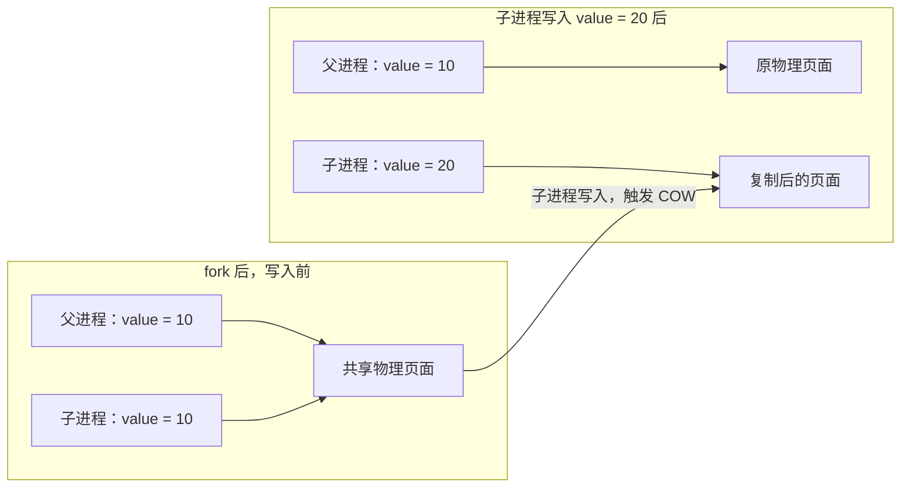

# 第 1 课：进程与线程基础

> [!info] 本课范围
> 理解进程的资源与隔离，掌握 `fork()` → `exec` → `waitpid()` 的基本过程。本课先建立线程的概念，下一课继续学习 `pthread_create()` 和 `pthread_join()`。
> 阶段大纲与完成情况见 [[00-学习进度]]。

## 1. 从设备服务理解进程

假设智能眼镜需要运行音频、蓝牙、UI 和设备管理服务。把服务分别放在不同进程中，可以利用独立地址空间限制内存错误的影响，也便于分别重启服务、设置权限和管理资源。

```text
Linux
├── audio_service
├── bluetooth_service
├── ui_service
└── device_manager
```

在终端运行 `./my_program` 时，Shell 启动这个程序，内核为运行中的程序管理资源和执行状态。**进程（Process）就是程序运行时的一个实例。**

![[image/linux02-process-resources.png]]

| 组成 | 作用 | 例子 |
| --- | --- | --- |
| 虚拟地址空间 | 组织程序能够访问的内存 | 代码、全局变量、堆、线程栈 |
| 文件描述符表 | 记录进程打开的资源接口 | 文件、Socket、设备 |
| 进程控制信息 | 标识进程并管理权限、状态 | PID、身份、权限 |
| 一个或多个线程 | 执行程序指令 | 主线程、工作线程 |
| 其他运行资源 | 保存进程的运行环境 | 工作目录、信号处理配置 |

**进程是资源管理和隔离的基本单位，线程（Thread）是进程内部的执行流。** Linux 内核以 task 管理可调度的执行实体；进程与线程的关系还取决于它们共享哪些资源。

同一进程的线程共享地址空间，可以访问相同的全局变量和堆；每个线程有自己的栈和寄存器上下文。独立进程默认具有各自的虚拟地址空间，需要通过 IPC 等机制交换数据。

## 2. 联系 FreeRTOS Task

在 ESP32-S3 上创建 `sensor_task` 和 `display_task` 时，它们通常处于同一个地址空间，可以直接访问同一全局变量。创建 Task 时，内核为它分配 TCB、栈等执行资源。

```c
xTaskCreate(
    task_function,
    "sensor_task",
    4096,
    NULL,
    5,
    NULL
);
```

| 对比项 | FreeRTOS Task | Linux Process | Linux Thread |
| --- | --- | --- | --- |
| 调度 | 由 RTOS 调度器调度 | 由 Linux 调度器调度其中的线程 | Linux 的可调度执行实体 |
| 栈 | 每个 Task 有自己的栈 | 进程内每个线程有自己的栈 | 每个线程有自己的栈 |
| 地址空间 | 通常共享 MCU 地址空间 | 默认拥有独立虚拟地址空间 | 同一进程的线程共享地址空间 |
| 资源隔离 | 常见 MCU 场景下较弱 | 进程之间具有内存访问隔离 | 线程之间通常没有内存访问隔离 |
| 创建 | `xTaskCreate()` | `fork()` 创建；`exec` 加载程序 | `pthread_create()` |
| 协作 | Queue、Semaphore 等 | IPC、Socket 等 | 共享内存配合同步机制 |

例如，`sensor_process` 修改自己的普通全局变量，`display_process` 不会直接看到修改。进程隔离保护了各自的运行环境；线程共享内存，则需要在并发访问时处理同步。

## 3. fork()：创建子进程

### 3.1 一次调用，两个进程继续执行

`fork()` 成功后，父进程继续运行，子进程也从 `fork()` 返回的位置继续运行。子进程获得父进程执行状态和资源的相应副本，可以根据返回值选择各自的执行分支。

| 返回值 | 当前所在的进程 | 含义 |
| --- | --- | --- |
| `pid == 0` | 子进程 | 当前执行流进入子进程分支 |
| `pid > 0` | 父进程 | 返回值是新建子进程的 PID |
| `pid == -1` | 父进程 | 创建失败，没有新建子进程 |

保存为 `fork_demo.c`：

```c
#include <stdio.h>
#include <sys/types.h>
#include <unistd.h>

int main(void)
{
    printf("Before fork\n");
    fflush(stdout);

    pid_t pid = fork();

    if (pid == -1) {
        perror("fork");
        return 1;
    }

    if (pid == 0) {
        printf("I am child process, PID=%ld\n", (long)getpid());
    } else {
        printf("I am parent process, child PID=%ld\n", (long)pid);
    }

    return 0;
}
```

```bash
gcc -Wall -Wextra -g -O0 fork_demo.c -o fork_demo
./fork_demo
```

可能输出以下内容，PID 仅作示例：

```text
Before fork
I am parent process, child PID=1201
I am child process, PID=1201
```

父、子进程由调度器分别安排运行，**两者的输出顺序不固定**。`fflush(stdout)` 在创建子进程前刷新输出缓冲区，避免未输出的缓冲内容被带入子进程后重复输出。

### 3.2 Copy-on-Write：写时复制

`fork()` 后，父子进程在逻辑上拥有各自的地址空间。对于普通私有可写内存，内核可以先让两者共享物理页面，发生写入时再复制需要修改的页面，这就是 **Copy-on-Write（COW，写时复制）**。



因此，创建子进程时无需立即复制全部物理内存。子进程把自己的普通变量 `value` 从 `10` 改为 `20`，父进程中的 `value` 仍为 `10`。

## 4. exec：替换当前程序

`fork()` 创建子进程后，可以让子进程加载其他程序。`exec` 是一组函数的统称，例如本课使用的 `execl()`。

**exec 成功后，当前进程的程序映像被替换，PID 保持不变，后续执行新程序的入口。** 成功时不会返回原程序；失败时返回 `-1`，可以用 `perror()` 输出原因。

![[image/linux02-fork-exec-wait.png]]

保存为 `exec_demo.c`。子进程执行 `/bin/ls -l`，父进程等待它结束：

```c
#include <errno.h>
#include <stdio.h>
#include <sys/types.h>
#include <sys/wait.h>
#include <unistd.h>

int main(void)
{
    pid_t pid = fork();

    if (pid == -1) {
        perror("fork");
        return 1;
    }

    if (pid == 0) {
        execl("/bin/ls", "ls", "-l", (char *)NULL);

        // exec 失败时报告错误并结束子进程
        perror("execl");
        _exit(127);
    }

    while (waitpid(pid, NULL, 0) == -1) {
        if (errno != EINTR) {
            perror("waitpid");
            return 1;
        }
    }

    return 0;
}
```

```bash
gcc -Wall -Wextra -g -O0 exec_demo.c -o exec_demo
./exec_demo
```

| 代码 | 含义 |
| --- | --- |
| `"/bin/ls"` | 要加载的可执行文件路径 |
| `"ls"` | 新程序的 `argv[0]` |
| `"-l"` | 传给新程序的参数 |
| `(char *)NULL` | 参数列表的结束标记 |
| `_exit(127)` | `execl()` 失败后直接结束子进程 |
| `waitpid(pid, NULL, 0)` | 等待指定子进程结束，此处不读取退出码 |

`EINTR` 表示等待被信号中断，此时重新等待。Shell 执行外部命令也可以用“创建进程 → 加载程序 → 等待结束”来理解。

## 5. waitpid()：等待与回收

子进程退出后，内核需要保留退出状态等信息，供父进程读取。**已经退出、仍等待父进程读取退出状态的子进程处于 Zombie（僵尸）状态。** 父进程调用 `wait()` 或 `waitpid()`，可以取得状态并回收这部分信息。

```text
子进程运行 → 子进程退出 → 内核保留退出状态 → 父进程 waitpid() → 完成回收
                              Zombie
```

保存为 `wait_demo.c`。子进程返回 `10`，父进程读取并打印退出码：

```c
#include <errno.h>
#include <stdio.h>
#include <sys/types.h>
#include <sys/wait.h>
#include <unistd.h>

int main(void)
{
    pid_t pid = fork();

    if (pid == -1) {
        perror("fork");
        return 1;
    }

    if (pid == 0) {
        printf("Child running\n");
        return 10;
    }

    int status;

    while (waitpid(pid, &status, 0) == -1) {
        if (errno != EINTR) {
            perror("waitpid");
            return 1;
        }
    }

    if (WIFEXITED(status)) {
        printf("Child exit code: %d\n", WEXITSTATUS(status));
    }

    return 0;
}
```

```bash
gcc -Wall -Wextra -g -O0 wait_demo.c -o wait_demo
./wait_demo
```

预期输出：

```text
Child running
Child exit code: 10
```

| 接口 / 宏 | 作用 |
| --- | --- |
| `waitpid(pid, &status, 0)` | 阻塞等待指定子进程退出，并保存退出状态 |
| `WIFEXITED(status)` | 判断子进程是否正常退出 |
| `WEXITSTATUS(status)` | 在正常退出时提取退出码 |

`status` 包含编码后的退出信息，应先判断退出方式，再提取对应字段。本例中的父进程退出码为 `0`，它读到的子进程退出码为 `10`。

## 6. 动手观察进程

以下命令在 Ubuntu / WSL 的 Bash 中执行。

| 观察目标 | 命令 | 关注内容 |
| --- | --- | --- |
| 查看所有进程 | `ps aux` | PID、状态、资源占用、命令 |
| 查看父子关系 | `ps -ef` | PID、PPID |
| 查看当前 Shell 的 PID | `echo $$` | Bash 自身的 PID |
| 查看当前 Shell 与其父进程 | `ps -o pid,ppid,comm -p $$` | PID、PPID、进程名 |
| 观察进程树 | `pstree -p` | 进程层级与 PID |

如果系统没有 `pstree`，安装提供该工具的软件包：

```bash
sudo apt install psmisc
```

| 字段 | 含义 |
| --- | --- |
| PID | Process ID，进程自身的标识 |
| PPID | Parent Process ID，父进程的标识 |

先用 `echo $$` 取得 Shell 的 PID，再在 `ps -ef` 或 `pstree -p` 中定位它，观察 Shell、父进程以及从 Shell 启动的程序之间的关系。

## 7. 自测

1. 为什么 `fork()` 调用后，父进程和子进程都能执行后面的代码？
2. 父进程中有普通变量 `int value = 10`，`fork()` 后子进程把自己的 `value` 改为 `20`。父进程看到的值是多少？为什么？
3. `exec` 成功后，当前进程的 PID 会改变吗？

> [!tip]- 参考答案
> 1. `fork()` 为子进程建立相应的执行状态。成功后，父子进程分别从 `fork()` 返回的位置继续运行，返回值用于区分所在分支。
> 2. 父进程仍看到 `10`。父子进程拥有各自的虚拟地址空间，普通私有内存的写入会通过 COW 分离相应页面。
> 3. PID 保持不变。`exec` 替换当前进程的程序映像，当前进程继续执行新程序。

## 来源与相关笔记

- 根据 2026-11-05 提供的《阶段 2：Linux 系统编程》第 1 课文本整理。
- 阶段进度：[[00-学习进度]]
- 前置知识：[[01-Linux基础与开发环境]]
- 命令速查：[[linux常用命令]]
- 下一课：Linux 线程与 pthread。
