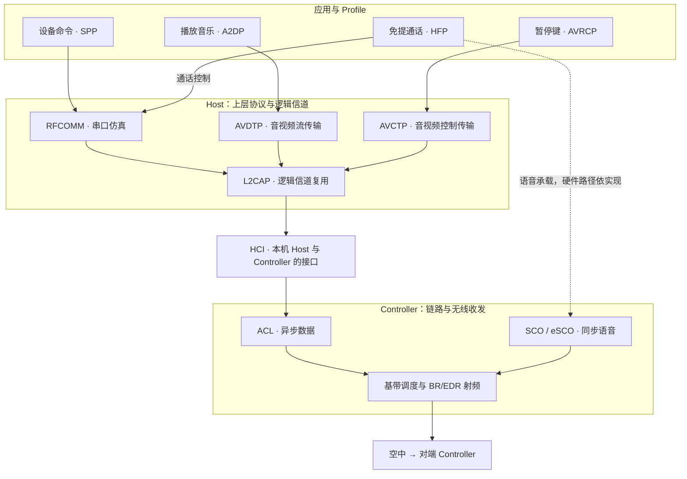
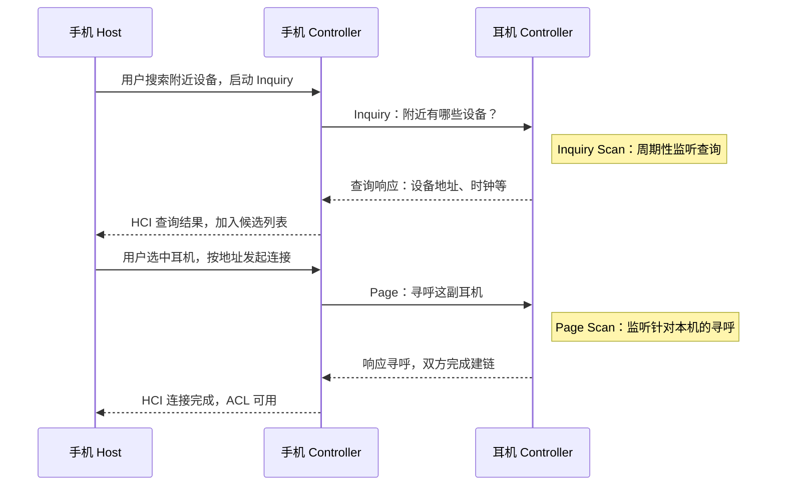

# 经典蓝牙架构：从应用到无线链路

手机连着一副耳机，能播放音乐、响应耳机上的暂停键，也能接听电话。对用户来说，这是同一台蓝牙设备；对开发者来说，却是几条可以分别建立、分别出故障的数据路径。理解经典蓝牙（BR/EDR），可以从这三个动作往下追：**应用要传什么？哪个协议解释这些数据？最后由谁把它发到空中？**

## 目录

- [[#1. 先看全貌：一台设备里的协议栈|架构总览]]
- [[#2. 应用与 Profile：双方要一起完成什么？|应用与 Profile]]
- [[#3. Host：服务入口在哪里，数据交给谁？|Host：服务与信道]]
- [[#4. HCI：Host 怎样使用本机 Controller？|HCI：本机接口]]
- [[#5. Controller：什么数据怎样占用空口？|Controller：空口调度]]
- [[#6. 发现机制：手机怎样找到一副陌生耳机？|发现机制：Inquiry 与 Page]]
- [[#7. 把各层连起来：一次连接中，哪些状态值得看？|连接状态与业务就绪]]
- [[#继续阅读|继续阅读]]

## 1. 先看全貌：一台设备里的协议栈

从上往下读图。箭头表示上面的功能使用下面的能力；最下面的“空中”才是本机与对端的边界。图中取四种常见业务，省略了服务发现和链路管理，后文单独说明。



读图时先记住三个名字：**Profile** 是双方实现某项功能的约定；**Host** 运行服务发现、通道管理等上层协议；**Controller** 负责建立无线链路并实际收发。Host 和 Controller 可以集成在同一颗芯片里，这个分工仍然成立。[^architecture]

## 2. 应用与 Profile：双方要一起完成什么？

开发固件时，先选功能和角色。例如手机播歌、耳机出声，双方要约定谁提供音频、谁接收音频、支持哪些编码，以及怎样开始或暂停媒体流。**A2DP 就是这套互操作约定**。它指导双方使用下层协议，不是每份音乐数据上都要再套一层叫作“Profile”的包头。

| 应用动作 | Profile 与双方角色 | 这条路径上传的内容 |
|---|---|---|
| 手机让设备点灯 | SPP：Client 打开 Server 的串口服务 | 应用自定义的字节，例如 `LED=1\n` |
| 手机向耳机播放音乐 | A2DP：手机是 Source，耳机是 Sink | 协商编码后的媒体流 |
| 按耳机暂停键 | AVRCP：本次操作中耳机是 Controller，手机是 Target | 播放控制命令及响应 |
| 用耳机接电话 | HFP：手机是 Audio Gateway，耳机是 Hands-Free | 接听等控制命令，以及双向通话语音 |

角色总要带着所属功能读：同一副耳机既能是接收音乐的 **A2DP Sink**，又能是发出暂停指令的 **AVRCP Controller**。这里的 Controller 指遥控指令的发起方，与架构图下半部负责无线收发的蓝牙 Controller 是两个概念。[^profiles]

## 3. Host：服务入口在哪里，数据交给谁？

**先找入口。** 手机知道一台设备的蓝牙地址，只能确定“连哪台设备”。要知道对端提供哪些服务以及如何访问，Host 可以用 **SDP（Service Discovery Protocol）** 查询服务记录。例如，手机按 Serial Port 服务 UUID 查询，得到 RFCOMM 服务端通道号。SDP 自己通过 L2CAP 完成这次查询；随后发送的点灯命令走 RFCOMM。[^sdp]

**再按业务解释数据。** RFCOMM 给 SPP 应用提供串口式字节流，也能承载 HFP 的通话控制命令；AVDTP 为 A2DP 协商、打开和传输媒体流；AVCTP 为 AVRCP 运送控制消息。因此音乐能正常播放、耳机暂停键却无效时，先看 AVRCP 控制路径。[^profiles]

**最后汇入 L2CAP（逻辑链路控制与适配协议）。** 同一对设备可以同时传音乐和按键命令，接收端仍要把数据交给正确的协议。建立面向连接的 L2CAP 信道时，**PSM** 标识要接入的上层协议或服务；建立后，**CID** 标识本端具体的信道端点。接收端按目的 CID 分发数据，这就是多条上层信道能够共用同一条底层 ACL 传输的关键。[^l2cap]

## 4. HCI：Host 怎样使用本机 Controller？

**HCI（Host Controller Interface）是本机接口。** 以建立连接为例：Host 向本机 Controller 发出建链命令，Controller 与远端完成无线交互，再通过 HCI 事件把结果和连接句柄交回 Host。发送业务数据时，Host 可以通过 HCI ACL Data 把数据和句柄交给 Controller，由后者安排发送。[^architecture]

```text
本机 Host  ── HCI 命令 / ACL 数据 ──→  本机 Controller  ←── 空中 ──→  对端 Controller
本机 Host  ←── HCI 事件 / ACL 数据 ──  本机 Controller
```

Host 与 Controller 分属两颗芯片时，HCI 可以通过 UART 或 USB 实现；集成实现可以在芯片内部交互。对应用开发者，实用的区分是：**HCI 建链成功表示无线连接已建立，Profile 的就绪事件才表示对应服务可用。** 例如，要发点灯命令，应用等的是串口通道打开。[^architecture][^spp]

## 5. Controller：什么数据怎样占用空口？

到了 Controller，上层各条路径主要落到两类逻辑传输上。选择它们的依据是数据的时序要求，而不是业务名称里有没有“音频”。[^architecture][^baseband]

| 逻辑传输 | Controller 怎样调度 | 回到耳机例子 |
|---|---|---|
| ACL（异步） | 在可用时隙调度分组，可通过确认与重传提高可靠性 | 音乐媒体、暂停指令、通话控制都可通过 L2CAP 共用 ACL |
| SCO / eSCO（同步） | 按约定间隔预留传输机会；eSCO 可在限定窗口内重传 | HFP 双向语音按节奏传送，不经过 RFCOMM 或 L2CAP |

这解释了为什么**耳机能接听，通话却可能没有声音**：接听命令已经通过 RFCOMM 到达手机，但语音还需要单独建立同步连接，并接通本地麦克风和扬声器。具体芯片可以经 HCI 交换语音数据，也可以使用专用音频接口。[^hfp][^architecture]

再往下，**链路管理器**通过 LMP（Link Manager Protocol）与对端协商链路能力和参数；**基带**把已建立的传输安排到具体时隙；**射频**在 2.4 GHz 频段按跳频序列收发。BR 和 EDR 是这一层的基本速率和增强数据速率。应用实际能传多快，还取决于空口调度、重传和上层开销。[^architecture][^baseband]

## 6. 发现机制：手机怎样找到一副陌生耳机？

手机第一次搜索耳机时，还不知道该向哪个地址发起连接。经典蓝牙把这个问题分成两步：**先在附近公开询问（Inquiry），拿到地址；用户选中耳机后，再按地址定向寻呼（Page）。** 这两步由 Controller 在空中完成。链路建立后，如果还需要知道耳机提供哪些服务、从哪里接入，再由 Host 通过 SDP 查询。[^baseband][^sdp]



**搜索列表为什么会逐个出现设备？** 手机 Controller 在查询跳频序列上反复发送查询并监听回应；耳机只在自己的扫描窗口里监听。双方在同一时间遇到同一频点，耳机才有机会响应。响应里有蓝牙设备地址 `BD_ADDR`；可选的扩展查询响应（EIR）还可带设备名称或服务 UUID。如果没有名称，手机仍可先发现地址，再单独请求远端名称。[^baseband][^architecture]

**为什么耳机退出可发现模式后，原来的手机还能重连？** 固件可以分别控制两种监听：`Inquiry Scan` 决定陌生手机能否通过查询发现它；`Page Scan` 决定它是否监听已知地址的定向寻呼。原来的手机保存了地址，就能跳过 Inquiry，直接 Page。此时即使新手机搜不到它，原来的手机仍有机会连上；后续认证和服务连接各有自己的条件。[^gap][^baseband]

## 7. 把各层连起来：一次连接中，哪些状态值得看？

上面从应用向下看依赖；实际启动时，应用通常是从底层向上等条件就绪。**GAP（Generic Access Profile）**规定设备如何表现为可发现、可连接，以及如何建立安全关系。这些规则可供多个业务共用。以首次连接为例，各阶段能证明的事情不同：[^gap]

| 观察到的状态 | 能确定什么 | 应用还要等什么 |
|---|---|---|
| 搜索到设备（Inquiry） | 对端响应了设备发现 | 已知地址后，通过 Page 建立基础连接；重连可省去搜索 |
| ACL 已建立 | 两端已有基础数据传输能力 | 查询或使用已知服务入口，满足服务安全要求 |
| 已配对 / 已绑定 | 配对建立了密钥；绑定表示保存密钥供以后使用 | 认证验证对端持有密钥，加密保护链路；业务还要打开自己的通道 |
| Profile 就绪 | 对应业务通道已建立 | SPP 可写入命令；A2DP 还需启动媒体流；HFP 通话语音还需同步连接 |

表中是观察点，配对发生的时机由安全策略决定。回到点灯：**ACL 已建立 → RFCOMM 通道已打开 → 设备回复执行结果**，分别是链路、服务、业务三个层次的证据。开发应用时，先确定自己需要哪一层的结果，再决定要等哪个事件。

## 继续阅读

- [[02-SPP应用层开发与关键配置]]：沿点灯命令这条路径，配置服务 UUID、打开通道、接收完整命令并处理拥塞。
- [[蓝牙音频方案全景]]：沿音乐和通话两条路径，继续看音频方案与数据流。

[^spp]: Bluetooth SIG：[Serial Port Profile 1.2](https://www.bluetooth.com/specifications/specs/serial-port-profile-1-2/)。用于核对 SPP、RFCOMM 与串口仿真的关系。
[^gap]: Bluetooth Core 5.4，Vol 3 Part C：[Generic Access Profile](https://www.bluetooth.com/wp-content/uploads/Files/Specification/HTML/Core-54/out/en/host/generic-access-profile.html)。设备发现、可连接状态及配对、绑定、认证。
[^baseband]: Bluetooth Core 5.4，Vol 2 Part B：[Baseband Specification](https://www.bluetooth.com/wp-content/uploads/Files/Specification/HTML/Core-54/out/en/br-edr-controller/baseband-specification.html)。Inquiry、Page、ACL、SCO/eSCO、时隙与跳频。
[^sdp]: Bluetooth Core 5.4，Vol 3 Part B：[Service Discovery Protocol](https://www.bluetooth.com/wp-content/uploads/Files/Specification/HTML/Core-54/out/en/host/service-discovery-protocol--sdp--specification.html)。服务记录及协议参数。
[^architecture]: Bluetooth Core 5.4，Vol 1 Part A：[Architecture](https://www.bluetooth.com/wp-content/uploads/Files/Specification/HTML/Core-54/out/en/architecture%2C-mixing%2C-and-conventions/architecture.html)。Host、Controller、HCI、传输结构及组网。
[^l2cap]: Bluetooth Core 5.4，Vol 3 Part A：[L2CAP Specification](https://www.bluetooth.com/wp-content/uploads/Files/Specification/HTML/Core-54/out/en/host/logical-link-control-and-adaptation-protocol-specification.html)。逻辑信道、PSM、CID 与分段重组。
[^hfp]: Bluetooth SIG：[Hands-Free Profile Test Suite，§3.1](https://files.bluetooth.com/wp-content/uploads/dlm_uploads/2025/07/HFP.TS.p29.pdf)。HFP 的 RFCOMM 控制与 SCO/eSCO 音频路径。
[^profiles]: Bluetooth SIG：[Specifications and Documents](https://www.bluetooth.com/specifications/specs/)。HSP、HID、AVRCP、PAN 等 Profile 的规范入口。
