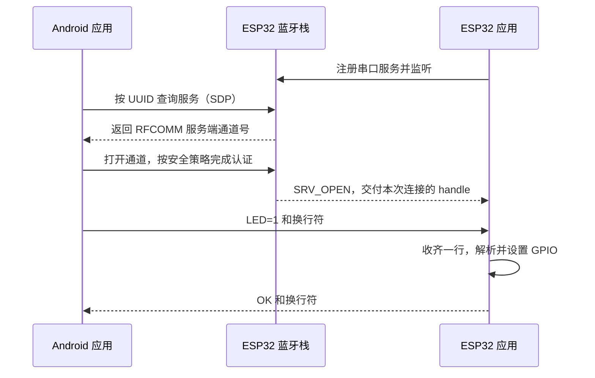

# SPP 应用层开发与关键配置

**SPP（Serial Port Profile）给两个应用提供一条双向字节流。** 接着 [[01-经典蓝牙协议与开发基础]] 的点灯例子看：手机能把 `LED=1\n` 发给 ESP32，ESP32 也能主动上报按键。谁先连接决定谁是 Client；连上之后，两端都能随时发送，不必一问一答。SPP 规定怎样建立串口仿真连接，命令怎样分帧、设备何时算执行成功，要由两个应用约定。[^spp]

## 1. 联调前先对齐哪些配置？

| 配置项 | 手机与固件怎么配 | 为什么要先确定 |
|---|---|---|
| 连接角色 | 手机做 Client；ESP32 做 Server，开机后启动监听 | 只有监听成功，手机才有可连接的服务 |
| 服务 UUID | 本例使用标准 Serial Port 服务 `0x1101`；Android 写完整 UUID `00001101-0000-1000-8000-00805F9B34FB` | 手机用 UUID 查服务。如果产品发布自定义 RFCOMM 服务，就填固件实际发布的 UUID |
| 服务端通道号（SCN） | ESP32 传 `local_scn = 0` 让栈分配；手机通过 SDP（服务发现协议）查询 | UUID 表示“找哪种服务”；SCN 表示“这个设备上由哪个通道接入”。`0` 是分配请求，不是手机应连接的通道 |
| 可发现、可连接 | 首次搜索时让设备可发现；要接受新连接时保持可连接并监听服务 | 已知设备地址可省去搜索。系统列出了已配对设备，只说明有配对记录 |
| 安全策略 | 手机使用安全 RFCOMM socket；固件服务要求认证，配对交互与设备的屏幕、按键能力匹配 | 两端要能完成同一套配对流程。能开锁、改配置等敏感命令还要检查业务权限 |
| 消息边界 | 双方约定编码、结束条件和最大长度。本例：ASCII，每条命令以单字节 `0A` 结束 | 一次 `read()` 或一次接收回调可能只给半条，也可能给多条 |
| 资源与超时 | 固件限定单帧长度和收发队列容量；手机分别设置连接期限和业务应答期限 | 连接超时查监听和配对；应答超时查命令有没有收全、执行和回复 |

**波特率配在哪里？** 手机 socket 直连 ESP32 应用时，没有两端必须匹配的 `115200 8N1`。如果 ESP32 再通过物理 UART 接另一颗 MCU，波特率、数据位、校验位和停止位要在**那段 UART 的两端**匹配。调 UART 波特率也只会改变这段链路的能力。[^spp]

## 2. 从点击连接到收到应答



图中省略了系统代办的步骤。**SDP 负责找入口，RFCOMM 负责运字节，业务解析器负责认出命令。** UUID 是服务标识，设备地址用于选设备，`handle` 是固件协议栈交给本次连接的本地句柄。断线重连后要从新的打开事件取 `handle`。[^android][^idf]

## 3. ESP32 服务端：按事件配置与收发

以下使用**原版 ESP32、Bluedroid、ESP-IDF v5.2.8 回调模式**。配置中确认 `CONFIG_BT_ENABLED`、`CONFIG_BT_BLUEDROID_ENABLED`、`CONFIG_BT_CLASSIC_ENABLED`、`CONFIG_BT_SPP_ENABLED` 已开启。先初始化并启用支持 BR/EDR 的控制器和 Bluedroid，再注册 SPP 回调并调用 `esp_spp_enhanced_init()`，配置 `.mode = ESP_SPP_MODE_CB`。[^idf][^config]

```c
// 在 ESP_SPP_INIT_EVT 成功分支中启动标准串口服务
esp_err_t err = esp_spp_start_srv(ESP_SPP_SEC_AUTHENTICATE,
                                  ESP_SPP_ROLE_SLAVE, 0, "Device Serial");
```

`esp_spp_start_srv()` 决定本机监听；`ESP_SPP_ROLE_SLAVE` 是该接口的链路角色参数。`"Device Serial"` 是 SDP 服务名，手机扫描列表显示的设备名由 GAP 单独设置。检查 `err` 后还要看异步事件：[^idf]

| 回调 | 应用动作 |
|---|---|
| `ESP_SPP_START_EVT` 成功 | 记录分配的 `scn`；本例在此配置 GAP 为可连接、可发现 |
| `ESP_SPP_SRV_OPEN_EVT` 成功 | 保存 `srv_open.handle`，为本次连接建立独立收发状态 |
| `ESP_SPP_DATA_IND_EVT` | 按 `data_ind.len` 复制字节到有界缓冲，再交给解析任务；不能把回调指针留给异步任务 |
| `ESP_SPP_WRITE_EVT` | 检查写结果；成功且 `write.cong == false` 才继续提交下一块 |
| `ESP_SPP_CONG_EVT` | `cong == true` 暂停提交；转为 `false` 后由发送任务恢复，避免循环重试占满 CPU |
| `ESP_SPP_CLOSE_EVT` | 作废该连接的句柄，清掉半帧，唤醒等待应答的任务并报告断线 |

## 4. Android 客户端：连接成功后持续读取

对于运行在 Android 12 及以上、`targetSdk >= 31` 的应用，连接已配对设备需要声明并获得运行时权限 `BLUETOOTH_CONNECT`；搜索设备或调用 `cancelDiscovery()` 还需要 `BLUETOOTH_SCAN`。正在进行设备发现时，先取消发现再连接。本例假设已取得权限和目标 `BluetoothDevice`。[^permissions][^android]

```kotlin
// 在 I/O 工作线程执行；feed 按长度消费字节，未完成的一行留到下次
val uuid = UUID.fromString("00001101-0000-1000-8000-00805F9B34FB")
device.createRfcommSocketToServiceRecord(uuid).use { socket ->
    socket.connect()
    socket.outputStream.write("LED=1\n".toByteArray(Charsets.US_ASCII))
    val buf = ByteArray(512)
    while (true) {
        val n = socket.inputStream.read(buf)
        if (n < 0) break
        feed(buf, n)
    }
}
```

这里的 `512` 是一次读取最多取多少字节，不限制业务消息长度。`connect()` 和 `read()` 都可能阻塞；连接管理器需要持有 socket，取消或超时时从另一线程 `close()`，并在 I/O 边界处理 `IOException`。上层有多个发送者时，用一个发送队列串行写入完整业务帧。[^android]

## 5. 收发设计：怎样判断一条命令完成了？

假设手机连续写入 `LED=1\n` 和 `LED=0\n`，固件完全可能这样收到：

| 接收回调 | 本次字节 | 解析动作 | 留给下一次 |
|---|---|---|---|
| 第一次 | `LE` | 没有换行，等待 | `LE` |
| 第二次 | `D=1\nLED=` | 取出 `LED=1` 并执行一次 | `LED=` |
| 第三次 | `0\n` | 取出 `LED=0` 并执行一次 | 空 |

实现时循环取出缓冲区内**所有**完整行。本例可约定行内容最多 64 字节；超过上限仍无结束符，就丢弃该行直到下一个换行，再重新收帧。发送的是字节 `0A`，不是反斜杠和字母 `n`。这个例子也适合直接用作解析器的联调输入。

传图片或文件时，负载本身可以含 `0A`，更适合用长度分帧。例如双方约定 `类型(1 B) | 序号(2 B) | 负载长度(2 B) | 负载`，多字节整数按小端编码。接收端先攒齐 5 字节头，检查长度不超过约定上限，再等足负载；非法长度可直接关闭本次连接。各字段和上限都是**产品协议**，双方可独立于 SPP 扩展它们。

**本地写完成和业务完成要分开记。** 点灯以设备设置 GPIO 后返回的 `OK` 为准；文件传输可返回“已持久化至偏移 N”。若断线发生在执行之后、回复之前，手机只能判定结果未知。`设置为亮` 可以重复执行；`切换亮灭` 重试会产生不同结果，这类操作需要请求 ID 和设备端去重。

## 6. 吞吐调优与定位

RFCOMM 可使用 credit 流控：接收方发放额度，发送方消耗额度发送数据帧。协议栈负责链路帧大小和额度；应用通常能直接调的是**每次提交的字节数、发送队列容量、接收任务消费速度**。业务帧可以跨多个链路帧。增加队列能吸收短时突发，但接收方长期处理不过来时，仍要暂停生产或明确报告队列满。[^rfcomm][^idf]

调参时固定设备、距离、数据量和传输方向，只改一个变量。例如比较不同写块大小，记录有效吞吐（对端确认的业务字节数 ÷ 耗时）、拥塞累计时长、队列峰值以及控制命令的应答延迟。大文件与控制命令共用连接时，在文件块之间调度控制帧；已进入栈的大批数据不能靠调整应用队列重新排序。

| 现象 | 第一条有区分度的证据 |
|---|---|
| 能配对，连不上 socket | 固件是否收到成功的 `START_EVT`？手机查的 UUID 是否就是 SDP 实际发布的服务？ |
| `connect()` 成功，命令没响应 | 对照发送端十六进制数据与接收回调长度，检查末尾 `0A` 和解析器剩余字节 |
| 短命令正常，发文件停住 | 看最后一次写结果、拥塞解除事件和接收队列峰值，区分未恢复发送与消费过慢 |
| 重连后第一条消息异常 | 对照新旧 `handle`，核对旧半帧、待发队列和未完成请求是否仍被使用 |

[^spp]: [Bluetooth SIG：Serial Port Profile 1.2](https://www.bluetooth.com/specifications/specs/serial-port-profile-1-2/)
[^rfcomm]: [Bluetooth SIG：RFCOMM 1.2](https://www.bluetooth.com/specifications/specs/rfcomm-1-2/)
[^idf]: [Espressif：ESP-IDF v5.2.8 SPP API](https://docs.espressif.com/projects/esp-idf/en/v5.2.8/esp32/api-reference/bluetooth/esp_spp.html)
[^config]: [Espressif：ESP-IDF v5.2.8 项目配置](https://docs.espressif.com/projects/esp-idf/en/v5.2.8/esp32/api-reference/kconfig.html#config-bt-spp-enabled)
[^android]: [Android Developers：Connect Bluetooth devices](https://developer.android.com/develop/connectivity/bluetooth/connect-bluetooth-devices)
[^permissions]: [Android Developers：Bluetooth permissions](https://developer.android.com/develop/connectivity/bluetooth/bt-permissions)
