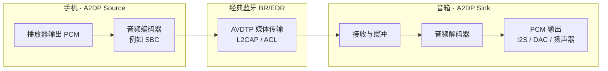
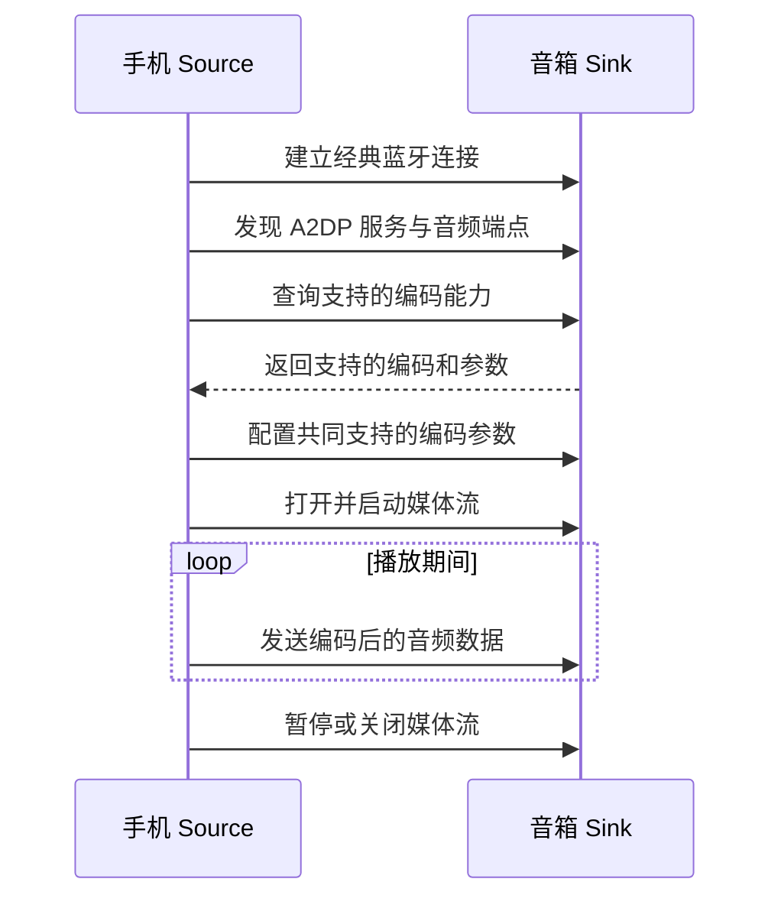
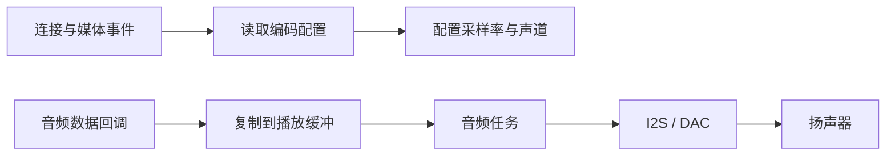

# A2DP 音频传输与开发基础

手机连接蓝牙音箱后，音乐从手机的播放器流向音箱的扬声器。A2DP（Advanced Audio Distribution Profile）规定双方如何协商并传输高质量音频。手机通常是提供音频的 **Source**，音箱是接收音频的 **Sink**。[^a2dp]

这篇笔记沿用 [[01-经典蓝牙协议与开发基础|经典蓝牙协议与开发基础]] 中的分层，从音频路径、连接流程和嵌入式开发三个角度理解 A2DP。

## 1. 音乐从哪里来，到哪里去？

图中的 PCM 是未压缩音频采样数据。Source 将音频编码后发送，Sink 接收、解码，再交给音频硬件播放。实际产品可能把编解码、缓冲和音频输出放在不同芯片或软件模块中。[^a2dp]

| 功能 | 典型协议或 Profile | 手机与耳机场景 |
|---|---|---|
| 音乐音频 | A2DP、AVDTP | 手机向耳机发送音频流 |
| 播放、暂停、切歌 | AVRCP、AVCTP | 耳机向手机发送播放控制命令 |
| 电话控制与通话语音 | HFP、RFCOMM、SCO / eSCO | 双方建立通话控制和语音路径 |
| 自定义数据 | SPP、RFCOMM | 应用与设备交换自定义字节流 |

A2DP 连接成功后，耳机还可能需要 AVRCP 才能控制播放器。通话的实际路径由设备支持的通话 Profile 和系统实现决定。SPP 开发可以参考 [[02-SPP应用层开发与关键配置]]。[^profiles]

## 2. 一次播放经历哪些阶段？

下面是手机作为 Source、音箱作为 Sink 的常见流程。实际状态名称与事件顺序以所用蓝牙协议栈为准。

| 阶段 | 需要确认的事实 |
|---|---|
| 配对与链路 | 双方完成配对或重连，经典蓝牙链路可用 |
| 能力发现 | 对端发布了预期的 A2DP 角色，双方能够发现音频端点 |
| 编码配置 | 编码格式、采样率、声道模式等参数存在双方支持的组合 |
| 媒体流启动 | 协议栈报告音频流已启动，接收侧开始收到媒体数据 |
| 音频输出 | Sink 的缓冲、解码和音频硬件均已工作 |

**配对成功、A2DP 已连接和正在播放是不同状态。** 排查时应分别记录连接状态、编码配置、媒体流状态与音频输出状态。AVDTP 负责音视频分发的传输和信令，A2DP 规定音频分发的角色、能力与互操作要求。[^a2dp]

## 3. 编码格式如何选择？

A2DP 1.4.1 要求 Source 支持 SBC 编码、Sink 支持 SBC 解码。其他编码格式需要双方都支持并协商成功，最终还受产品和系统实现影响。[^a2dp]

| 内容 | 说明 |
|---|---|
| SBC | A2DP 的必选基础编码格式，可作为互操作的共同基础 |
| AAC 等可选编码 | 双方支持时可以使用，是否选用取决于能力和具体实现 |
| 厂商定义编码 | 需要设备和协议栈支持对应能力与参数 |
| 采样率、声道模式 | 属于编码配置的一部分，应查看实际协商结果 |
| 码率 | 受编码参数和实现影响，不能只凭编码名称确定 |

例如一端支持 SBC 和 AAC，另一端只支持 SBC，双方可以协商使用 SBC。两端都支持 AAC 时，还需要协商出共同支持的参数；单看设备宣传或支持列表无法确定当前实际使用的格式。

## 4. 嵌入式 Sink 需要接好哪些环节？

以音箱为例，蓝牙协议栈负责连接和媒体传输，应用还需要处理解码后的数据、播放缓冲和音频外设。不同 SDK 暴露的数据可能是编码帧或 PCM，应以具体版本的 API 文档为准。

ESP-IDF v5.4.3 的 ESP32 A2DP Sink API 是一个具体例子。启用 Bluedroid 后，应用注册 A2DP 事件回调和 Sink 数据回调，再初始化 Sink。该版本的 Sink 数据回调提供 SBC 解码后的 PCM，`buf` 指向可能被后续数据覆盖的静态内存。需要异步处理时，应在回调中及时复制到应用自己的缓冲区。音频处理任务再从缓冲区取数据并送往音频外设。[^idf]

| 需要记录 | 排查价值 |
|---|---|
| 连接状态和断开原因 | 区分链路问题与音频链路问题 |
| 编码配置和音频流状态 | 确认实际使用的格式以及媒体流是否启动 |
| 回调数据长度与频率 | 判断接收侧是否持续收到音频 |
| 缓冲区占用、溢出和欠载次数 | 区分生产与消费速度不匹配 |
| I2S / DAC 配置和输出状态 | 核对采样率、声道及硬件输出是否匹配 |

回调中尽量只做有界的数据复制和状态记录，把较慢的处理交给音频任务。缓冲区满时需要明确丢弃或恢复策略，并记录次数，方便分析卡顿。

## 5. 延迟与缓冲如何估算？

播放延迟由编码、发送与传输、接收缓冲、解码和音频硬件等多个环节共同产生。只测量某个缓冲区的容量，无法得到完整的端到端延迟。

对于固定格式的 PCM，已排队音频的时长可以按字节数估算：

$$
T = \frac{B}{f_s \times C \times W}
$$

其中 $B$ 是缓冲中的字节数，$f_s$ 是采样率，$C$ 是声道数，$W$ 是每个采样点每声道的字节数。假设为 48 kHz、双声道、16 bit PCM，缓存 19,200 字节时：

$$
T = \frac{19200}{48000 \times 2 \times 2} = 0.1\ \text{s}
$$

这部分队列约对应 **100 ms 音频**。增大缓冲可吸收更长的短时波动，但也会增加排队时长。A2DP 还定义了 Sink 向 Source 报告延迟的机制；其支持要求需要结合所用规范版本与双方实现核对。[^a2dp]

## 6. 常见现象从哪里查？

| 现象 | 首先查看 |
|---|---|
| 已配对但无法作为音箱连接 | 对端是否发布 A2DP Sink，协议栈是否报告连接失败或资源不足 |
| A2DP 已连接但没有声音 | 音频流是否启动，数据回调是否持续到达，I2S / DAC 是否有输出 |
| 有数据但声音异常 | 实际采样率、声道、PCM 格式和外设配置是否一致 |
| 断续或爆音 | 缓冲区欠载、溢出次数，音频任务调度和无线链路状态 |
| 可以播放但暂停键无效 | AVRCP 是否连接，按键事件是否发送到正确的控制角色 |
| 手机显示 AAC，设备实际行为不符 | 查看设备端的编码配置事件和双方协商结果 |
| 音画不同步 | 分别测量发送端到实际出声的延迟与视频显示延迟，再检查各级缓冲 |

## 参考资料

[^a2dp]: [Bluetooth SIG：Advanced Audio Distribution Profile 1.4.1](https://www.bluetooth.com/wp-content/uploads/Files/Specification/HTML/a2dp_v1-4-1_1752513648/A2DP_v1.4.1/out/en/index-en.html)
[^profiles]: [Espressif：Classic Bluetooth Profiles and Protocols](https://docs.espressif.com/projects/esp-idf/en/latest/esp32/api-guides/classic-bt/profiles-protocols.html)
[^idf]: [Espressif：ESP-IDF v5.4.3 Bluetooth A2DP API](https://docs.espressif.com/projects/esp-idf/en/v5.4.3/esp32/api-reference/bluetooth/esp_a2dp.html)