# 嵌入式架构设计：状态机百解

> 从一个按键开始：先记住按下与松开，再加入消抖、单击、双击和长按，随后把规则整理成 FSM，用 HFSM 共享行为，最后用 DSL 描述同一套规则。

## 1. 先看清这条学习路线

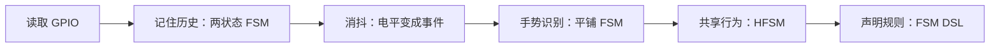

这条路线逐步增加的是**问题规模、组织方式和表达方式**。两状态的按键程序已经可以是 FSM；表驱动是 FSM 的一种实现；HFSM 为状态增加层次；DSL 则是一种描述规则的语言，可以描述平铺 FSM，也可以描述 HFSM。

| 阶段 | 按键需求 | 这一阶段解决的问题 |
| --- | --- | --- |
| 基础状态机 | 一次按下只触发一次 | 怎样记住之前发生了什么？ |
| 消抖状态机 | 忽略触点抖动 | 原始电平何时才能被确认？ |
| 平铺 FSM | 单击、双击、长按 | 怎样把历史分成互斥、可枚举的阶段？ |
| HFSM | 按住期间共享处理，支持整体禁用 | 多个状态的公共规则放在哪里？ |
| FSM DSL | 集中声明并检查规则 | 怎样让业务规则与执行机制分开？ |

本文用 C 展开实现，用 Mermaid 画状态图。后文的 `FSM DSL` 指 **Finite State Machine Domain-Specific Language，状态机领域专用语言**；本文自建一个小型 C 宏 DSL 来展示原理，不依赖某个同名库。

## 2. 起点：为什么读取 GPIO 还不够？

假设按键低电平有效，每隔 `5 ms` 采样一次：

```c
if (gpio_read(KEY_PIN) == 0) {
    toggle_led();
}
```

这段代码表达的是“**现在按着，就翻转 LED**”。按住 `500 ms` 会被采到大约 100 次，LED 也会翻转大约 100 次。我们要表达的却是“**从松开变成按下时，翻转一次**”。

区别在于：仅凭这一次电平，无法知道这是刚按下，还是已经按住了一段时间。程序需要保存一点历史。

### 2.1 用一个状态记住历史

暂时假设输入已经稳定，只考虑 `UP` 和 `DOWN` 两个状态：

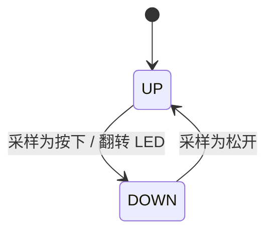

```c
#include <stdbool.h>

typedef enum { KEY_UP, KEY_DOWN } key_level_t;

void key_sample(bool pressed)
{
    static key_level_t state = KEY_UP;

    switch (state) {
    case KEY_UP:
        if (pressed) {
            state = KEY_DOWN;
            toggle_led();
        }
        break;
    case KEY_DOWN:
        if (!pressed) {
            state = KEY_UP;
        }
        break;
    }
}
```

`toggle_led()` 由应用提供。这个示例只演示边沿识别，下一节再接入消抖。

| 本次采样 | 原状态 | 新状态 | 动作 |
| --- | --- | --- | --- |
| 按下 | `KEY_UP` | `KEY_DOWN` | 翻转一次 |
| 按下 | `KEY_DOWN` | `KEY_DOWN` | 无 |
| 松开 | `KEY_DOWN` | `KEY_UP` | 无 |
| 松开 | `KEY_UP` | `KEY_UP` | 无 |

**状态保存的是影响后续判断的历史。** 不必记录全部采样，只要记住“已经确认按下”这一事实，后续相同电平就能得到不同处理。

### 2.2 给这些组成部分命名

| 概念 | 含义 | 按键中的例子 |
| --- | --- | --- |
| State，状态 | 系统当前所处的阶段 | `KEY_UP`、`KEY_DOWN` |
| Event，事件 | 交给状态机处理的一次输入 | 确认按下、确认松开、时间检查 |
| Transition，转移 | 从一个状态切换到另一个状态的规则 | 松开状态收到按下事件后进入按住状态 |
| Action，动作 | 处理事件时执行的操作 | 翻转 LED、发送单击通知 |
| Guard，守卫条件 | 允许某条转移发生的布尔判断 | 已按住至少 `800 ms` |

状态图上的一条边通常写成：

```text
源状态 ── 事件 [守卫条件] / 动作 ──> 目标状态
```

基本的有限状态机称为 **FSM（Finite State Machine）**。在严格的简单模型中，下一状态由当前状态与输入决定；工程代码还常用计时、计数等上下文数据配合 guard，这类扩展模型也称为 **EFSM（Extended Finite State Machine）**。下文沿用嵌入式开发中常见的 FSM 称呼。

> 状态与事件的区别：`PRESSED` 表示“现在处于按住阶段”；`EV_DOWN` 表示“刚刚确认发生了一次按下”。前者持续存在，后者被处理一次。

## 3. 先把电平变成可靠事件：消抖

机械按键在按下和松开时都可能抖动。前面的程序若直接读取原始 GPIO，就可能把同一次操作识别成多次按下。

```text
时间 →
原始输入：松开 ── 按下 松开 按下 松开 按下 ─────────
候选输入：          每次变化，都重新开始稳定计时
确认输入：松开 ────────────────────── 按下 ──────
输出事件：                            EV_DOWN 一次
```

采用一种容易实现的规则：**候选电平连续保持 `20 ms`，才把它确认为新的稳定电平。** `5 ms` 采样和 `20 ms` 消抖只是本文示例参数，实际值要结合器件、噪声和响应要求确定。

### 3.1 四状态图帮助理解过程

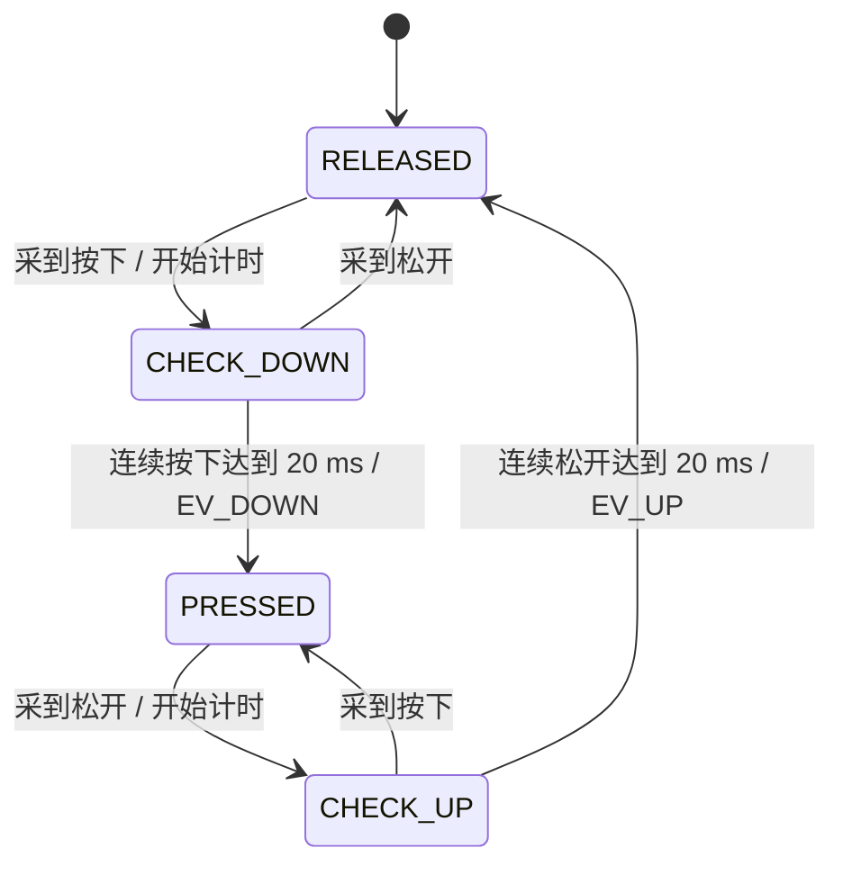

`CHECK_DOWN` 表示“发现了疑似按下，正在等它稳定”。它与 `PRESSED` 的后续行为不同，因此值得成为一个独立状态。

### 3.2 用稳定值、候选值和时间戳实现

按下与松开的消抖过程对称，可以合并为下面的 C 实现。此段可以独立编译；`edge` 的含义是一次确认后的边沿。

```c
#include <stdbool.h>
#include <stdint.h>

enum { DEBOUNCE_MS = 20 };

typedef enum { EDGE_NONE, EDGE_DOWN, EDGE_UP } edge_t;

typedef struct {
    bool stable;
    bool candidate;
    uint32_t candidate_since;
} debounce_t;

void debounce_init(debounce_t *d, uint32_t now)
{
    *d = (debounce_t){
        .stable = false,
        .candidate = false,
        .candidate_since = now,
    };
}

edge_t debounce_step(debounce_t *d, bool raw_pressed, uint32_t now)
{
    if (raw_pressed != d->candidate) {
        d->candidate = raw_pressed;
        d->candidate_since = now;
    }

    if (d->candidate != d->stable &&
        (uint32_t)(now - d->candidate_since) >= DEBOUNCE_MS) {
        d->stable = d->candidate;
        return d->stable ? EDGE_DOWN : EDGE_UP;
    }

    return EDGE_NONE;
}
```

这里初始化为松开：若上电时按键已经被按住，首次采样开始计时，稳定确认后产生 `EDGE_DOWN`。这是本文选定的上电行为。

轮询能确认的是**采样点上连续稳定**；采样间隙内的短暂变化可能不可见。事件时间戳采用确认时刻，后续长按和双击也统一使用这个时间基准。

### 3.3 把消抖与手势识别分层

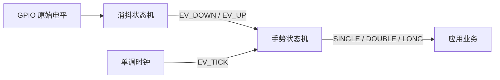

消抖只回答“按键是否真的发生了变化”；手势识别回答“这些变化组成了什么操作”；应用再决定单击是否翻页、长按是否关机。后文只替换中间的手势状态机，继续复用这条输入输出链路。

## 4. 平铺 FSM：识别单击、双击与长按

### 4.1 先定行为，再决定状态

要加入双击，一个很容易忽略的问题就出现了：第一次松开时，还不知道用户是否会再按一次。

```text
单击： DOWN ── UP ─────────────── 等满 250 ms ── SINGLE
双击： DOWN ── UP ── 小于 250 ms ── DOWN ── UP ── DOUBLE
长按： DOWN ───────────────────── 达到 800 ms ── LONG ── UP
```

本文选定以下行为，后续代码、转移表和 DSL 都遵守它：

| 规则 | 明确定义 |
| --- | --- |
| 单击 | 第一次短按松开后，等待 `250 ms`；没有合格的第二次按下才报告 `SINGLE` |
| 双击 | 第二次确认按下距第一次确认松开严格小于 `250 ms`，且第二次按住不足 `800 ms` 后松开，报告 `DOUBLE` |
| 长按 | 任意一次按住达到 `800 ms`，报告一次 `LONG`；继续按住和随后松开均不重复报告 |
| 第二次变成长按 | 这组操作只报告 `LONG`，第一次短按不再单独报告 |
| 恰好等于双击窗口 | `250 ms` 归入窗口过期；先报告上一次 `SINGLE`，这次按下开始新一轮 |
| 恰好等于长按阈值 | `800 ms` 归入长按 |
| 事件顺序 | 每轮先处理确认后的边沿，再发送一次携带当前时间的 `EV_TICK` |

因此 `SINGLE` 有等待延迟。这是“单击与双击互斥”的交互选择带来的结果。`EV_TICK` 的含义是“现在检查时间条件”，并不要求真的每毫秒调用一次。

### 4.2 从历史中找出五个状态

| 状态 | 已经知道的事实 | 接下来关注什么？ |
| --- | --- | --- |
| `IDLE` | 没有待决操作 | 第一次按下 |
| `PRESS_1` | 第一次按下，尚未报长按 | 松开或达到长按阈值 |
| `WAIT_2` | 第一次短按已松开 | 第二次按下或窗口结束 |
| `PRESS_2` | 窗口内已发生第二次按下 | 松开形成双击，或变成长按 |
| `LONG_HELD` | 已报告长按，按键仍按着 | 松开结束本轮 |

`PRESS_1` 与 `PRESS_2` 都是物理上的“按着”，但短按松开后的行为不同，必须保留这段历史。`LONG_HELD` 则让“只报告一次长按”自然成立，不需要在每次扫描中反复维护一个 `long_sent` 标志。

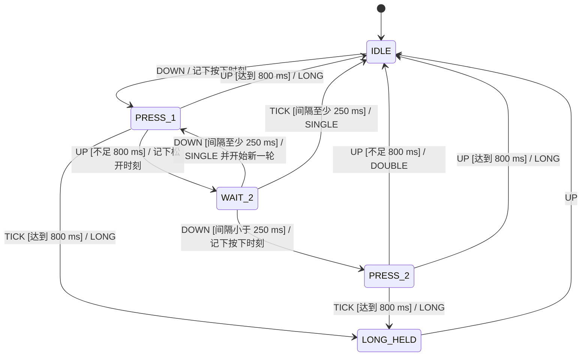

图中 `UP [达到 800 ms]` 是必要的边界处理：如果任务晚了一点运行，松开事件可能先于下一次时间检查到达，此时仍应按实际时长报告长按。

### 4.3 共同的数据与动作

下面这段是后续 `switch`、表驱动和 C 宏 DSL 三种写法共用的定义。三种写法各选一个 `button_dispatch()`，即可组成手势识别模块。

```c
#include <stdbool.h>
#include <stddef.h>
#include <stdint.h>

enum { LONG_MS = 800, DOUBLE_MS = 250 };

typedef enum {
    IDLE, PRESS_1, WAIT_2, PRESS_2, LONG_HELD
} button_state_t;

typedef enum { EV_DOWN, EV_UP, EV_TICK } event_kind_t;
typedef enum { OUT_SINGLE, OUT_DOUBLE, OUT_LONG } output_t;

typedef struct {
    event_kind_t kind;
    uint32_t now;
} event_t;

typedef void (*emit_fn)(void *user, output_t output);

typedef struct {
    button_state_t state;
    uint32_t pressed_at;
    uint32_t released_at;
    emit_fn emit;
    void *user;
} button_t;

void button_init(button_t *b, emit_fn emit, void *user)
{
    *b = (button_t){ .state = IDLE, .emit = emit, .user = user };
}

static bool long_due(const button_t *b, const event_t *e)
{
    return (uint32_t)(e->now - b->pressed_at) >= LONG_MS;
}

static bool window_open(const button_t *b, const event_t *e)
{
    return (uint32_t)(e->now - b->released_at) < DOUBLE_MS;
}

static void start_press(button_t *b, const event_t *e)
{
    b->pressed_at = e->now;
}

static void start_wait(button_t *b, const event_t *e)
{
    b->released_at = e->now;
}

static void emit_single(button_t *b, const event_t *e)
{
    (void)e;
    if (b->emit) b->emit(b->user, OUT_SINGLE);
}

static void emit_double(button_t *b, const event_t *e)
{
    (void)e;
    if (b->emit) b->emit(b->user, OUT_DOUBLE);
}

static void emit_long(button_t *b, const event_t *e)
{
    (void)e;
    if (b->emit) b->emit(b->user, OUT_LONG);
}

static void single_then_press(button_t *b, const event_t *e)
{
    emit_single(b, e);
    start_press(b, e);
}
```

`pressed_at` 和 `released_at` 是**上下文数据**：状态回答“正处于哪个阶段”，数据回答“这个阶段从什么时候开始”。每个按键各有一个 `button_t`，即可复用同一份逻辑。

时间戳来自同一个单调递增的 `uint32_t` 毫秒计数器。无符号减法可以跨越一次计数器回绕；前提是真实经过时间小于计数器的一整圈，不能让一个计时过程跨过约 `49.7` 天而不处理。

### 4.4 先用熟悉的 switch 写出来

```c
void button_dispatch(button_t *b, const event_t *e)
{
    switch (b->state) {
    case IDLE:
        if (e->kind == EV_DOWN) {
            start_press(b, e);
            b->state = PRESS_1;
        }
        break;

    case PRESS_1:
        if (e->kind == EV_UP) {
            if (long_due(b, e)) {
                emit_long(b, e);
                b->state = IDLE;
            } else {
                start_wait(b, e);
                b->state = WAIT_2;
            }
        } else if (e->kind == EV_TICK && long_due(b, e)) {
            emit_long(b, e);
            b->state = LONG_HELD;
        }
        break;

    case WAIT_2:
        if (e->kind == EV_DOWN) {
            if (window_open(b, e)) {
                start_press(b, e);
                b->state = PRESS_2;
            } else {
                single_then_press(b, e);
                b->state = PRESS_1;
            }
        } else if (e->kind == EV_TICK && !window_open(b, e)) {
            emit_single(b, e);
            b->state = IDLE;
        }
        break;

    case PRESS_2:
        if (e->kind == EV_UP) {
            if (long_due(b, e)) {
                emit_long(b, e);
            } else {
                emit_double(b, e);
            }
            b->state = IDLE;
        } else if (e->kind == EV_TICK && long_due(b, e)) {
            emit_long(b, e);
            b->state = LONG_HELD;
        }
        break;

    case LONG_HELD:
        if (e->kind == EV_UP) {
            b->state = IDLE;
        }
        break;
    }
}
```

一次调用处理一个事件，然后返回。没有匹配规则的事件被忽略，状态保持不变。例如，在 `LONG_HELD` 中再收到 `EV_TICK`，就不会再次报告长按。

回调 `emit` 必须快速返回，不能在回调中再次调用同一个实例的 `button_dispatch()`。这里动作执行期间，状态切换尚未完成；后文会用 Run-to-Completion 解释这个约束。

### 4.5 接回采样循环

将第 3 节消抖代码与本节公共定义、`switch` 实现放在同一个 C 文件中，再加入：

```c
void button_poll(debounce_t *d, button_t *b, bool raw_pressed, uint32_t now)
{
    edge_t edge = debounce_step(d, raw_pressed, now);

    if (edge != EDGE_NONE) {
        event_t e = {
            .kind = edge == EDGE_DOWN ? EV_DOWN : EV_UP,
            .now = now,
        };
        button_dispatch(b, &e);
    }

    event_t tick = { .kind = EV_TICK, .now = now };
    button_dispatch(b, &tick);
}
```

应用先调用 `debounce_init()` 和 `button_init()`，随后以目标周期调用 `button_poll()`；低电平有效的 GPIO 在调用前转换为 `raw_pressed = (level == 0)`。实际响应时间还包括采样周期、消抖和任务调度延迟。

## 5. 表驱动 FSM：让规则变成可检查的数据

### 5.1 为什么同一个状态机还要换写法？

`switch` 已经完整表达了需求。现在希望评审时能逐条看到“状态、事件、条件、动作、目标”，也希望多个状态机复用相同的执行流程，可以把它整理成转移表。

```text
switch 实现：规则与判断流程写在各个 case 中
表驱动实现：规则放进表，通用执行器逐条匹配

两种实现使用相同状态、相同输入、相同输出。
```

### 5.2 一条转移需要哪些字段？

```c
typedef bool (*guard_fn)(const button_t *, const event_t *);
typedef void (*action_fn)(button_t *, const event_t *);

typedef struct {
    button_state_t from;
    event_kind_t event;
    guard_fn guard;
    action_fn action;
    button_state_t to;
} transition_t;

static bool short_press(const button_t *b, const event_t *e)
{
    return !long_due(b, e);
}

static bool window_closed(const button_t *b, const event_t *e)
{
    return !window_open(b, e);
}

static const transition_t transitions[] = {
    /* 源状态       事件      条件            动作                目标状态 */
    { IDLE,        EV_DOWN, NULL,           start_press,        PRESS_1 },
    { PRESS_1,     EV_UP,   short_press,    start_wait,         WAIT_2 },
    { PRESS_1,     EV_UP,   long_due,       emit_long,          IDLE },
    { PRESS_1,     EV_TICK, long_due,       emit_long,          LONG_HELD },
    { WAIT_2,      EV_DOWN, window_open,    start_press,        PRESS_2 },
    { WAIT_2,      EV_DOWN, window_closed,  single_then_press,  PRESS_1 },
    { WAIT_2,      EV_TICK, window_closed,  emit_single,        IDLE },
    { PRESS_2,     EV_UP,   short_press,    emit_double,        IDLE },
    { PRESS_2,     EV_UP,   long_due,       emit_long,          IDLE },
    { PRESS_2,     EV_TICK, long_due,       emit_long,          LONG_HELD },
    { LONG_HELD,   EV_UP,   NULL,           NULL,               IDLE },
};

void button_dispatch(button_t *b, const event_t *e)
{
    for (size_t i = 0; i < sizeof transitions / sizeof transitions[0]; ++i) {
        const transition_t *t = &transitions[i];

        if (t->from != b->state || t->event != e->kind) continue;
        if (t->guard && !t->guard(b, e)) continue;

        if (t->action) t->action(b, e);
        b->state = t->to;
        return;
    }
}
```

用这一段替换第 4.4 节的函数，其余代码不变。`NULL` guard 表示无条件；`NULL` action 表示无需执行动作。

**执行顺序是：匹配源状态 → 匹配事件 → 判断 guard → 执行动作 → 更新状态 → 返回。** guard 应只检查条件，不修改状态或发送消息。

这张表采用稀疏表示：只列有效转移。找不到匹配项就保持状态。若同一个状态、事件的多个 guard 同时成立，本执行器采用“表中第一条匹配项获胜”；示例使用互补条件，让优先级无需靠读者猜测。

### 5.3 表驱动带来的取舍

| 组织方式 | 适合的情况 | 需要注意 |
| --- | --- | --- |
| `switch` | 状态较直观，每个状态的逻辑比较集中 | 公共规则可能散落在多个分支 |
| 稀疏转移表 | 转移规则需要集中评审、生成文档 | 线性扫描是 `O(T)`，`T` 为表项数 |
| 二维状态×事件表 | 组合密集、每格规则简单 | 条件分支与无效项需要显式设计 |
| 每状态一个函数 | 每个状态处理逻辑较多 | 仍需约定未处理、已处理和转移的返回语义 |

用 `static const` 表达规则只读；最终放在 Flash 还是占用 RAM，要结合编译器、链接脚本和 map 文件确认。数组长度检查可以检查数量，**完整行为覆盖仍需要逐条检查条件与路径**。

## 6. Entry / Exit：把状态的共同动作放回状态

现在加一个小需求：只要按住按键就亮灯，离开按住阶段就熄灯。把亮灭写到每条边上，很容易在新增路径时漏掉一处。

可以为状态定义两个钩子：

| 钩子 | 执行时机 | 按键例子 |
| --- | --- | --- |
| `entry` | 进入这个状态时 | 点亮指示灯、建立该状态拥有的资源 |
| `exit` | 离开这个状态时 | 熄灭指示灯、清理该状态拥有的资源 |
| 转移动作 | 已选中某条转移时 | 报告单击、记录本次按下时间 |

对于两个不同的平铺状态，本文约定的外部转移顺序是：

```text
guard 成立
    ↓
源状态 exit
    ↓
转移动作
    ↓
更新当前状态
    ↓
目标状态 entry
```

有了钩子之后，还需要明确“留在原地”是什么意思：

| 行为 | 是否执行动作 | 是否 exit / entry |
| --- | --- | --- |
| 忽略事件 | 否 | 否 |
| 内部处理 / internal transition | 是 | 否 |
| 外部自转移 `A → A` | 可以 | 退出 `A` 后重新进入 `A` |

因此，在支持这些语义的执行器里，仅凭 `next == current` 无法区分三者，需要独立的转移类型。第 5 节的最小执行器没有 entry/exit，也没有引入这组完整语义。

从理论分类看，**Moore 模型的输出由当前状态决定，Mealy 模型的输出由当前状态和输入决定**。指示灯反映“当前按着”是 Moore 风格，松开时报告双击是 Mealy 风格。`entry/exit` 是工程钩子，理解输出依赖关系后，再决定动作放在哪里。

## 7. HFSM：让公共行为有一个归属

### 7.1 从重复出现的行为找到父状态

观察前面的 FSM：

- `PRESS_1` 与 `PRESS_2` 都需要判断长按，只有短按松开的行为不同。
- `PRESS_1`、`PRESS_2`、`LONG_HELD` 都表示按键仍然按着，可以共同拥有指示灯。
- 再增加一个 `EV_DISABLE`，所有识别中的阶段都应该取消操作、进入禁用状态。

**HFSM（Hierarchical Finite State Machine，层次有限状态机）**，也常称 HSM，允许把状态嵌套起来：公共行为写在父状态，具体行为写在子状态。

```text
ROOT
├── DISABLED                      禁用，不识别手势
└── ENABLED                       所有子状态共享 DISABLE 处理
    ├── IDLE                      默认初始子状态
    ├── WAIT_2                    等第二次按下
    ├── REARM                     启用时仍按着，先等松开
    └── HELD                      entry 亮灯，exit 灭灯
        ├── SHORT_PENDING         共享长按判断
        │   ├── PRESS_1           默认初始子状态
        │   └── PRESS_2
        └── LONG_HELD             长按已经报告
```

如果当前叶子状态是 `PRESS_2`，则 `PRESS_2 → SHORT_PENDING → HELD → ENABLED → ROOT` 整条路径都处于激活状态。这个单区域 HFSM 仍然只有一个当前叶子；父状态表示它所属的更大阶段。

`REARM` 补齐一个使用细节：禁用期间仍继续采样消抖，重新启用时若稳定电平为按下，先等松开，再允许识别新的按下。这样启用操作本身不会产生一轮手势。

### 7.2 状态嵌套后，原来的路径仍然存在

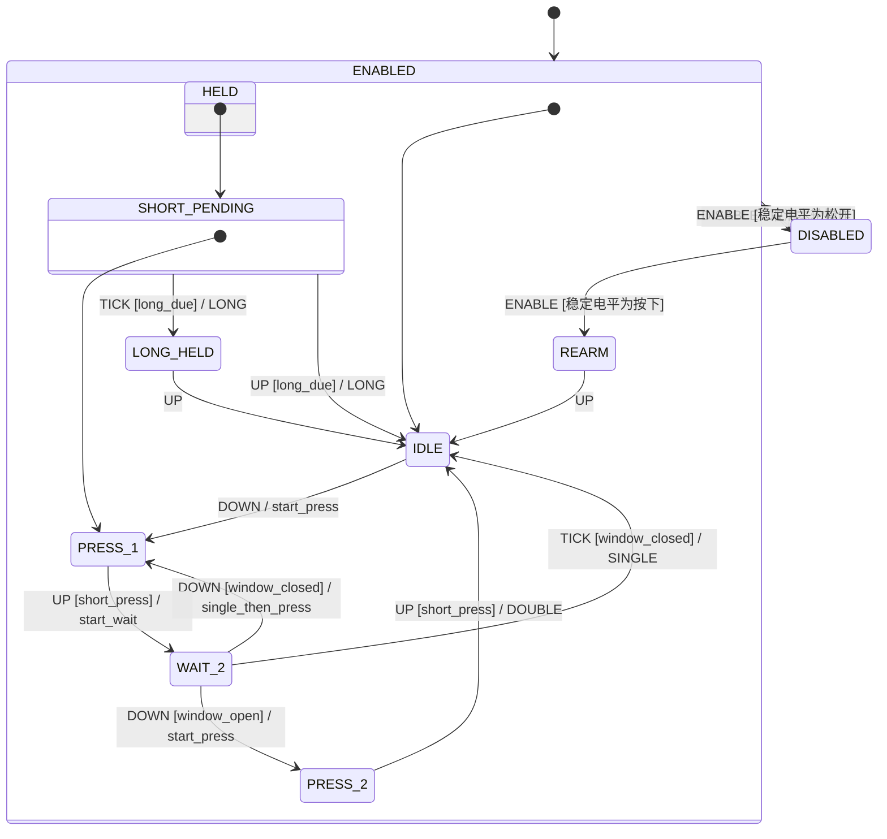

图中的 `ENABLED`、`HELD`、`SHORT_PENDING` 都是**复合状态（composite state）**。`HELD.entry` 点亮指示灯，`HELD.exit` 熄灭指示灯。`[*]` 指定复合状态的初始子状态：如果转移只指向复合状态本身，执行器需要继续沿初始路径进入叶子；直接指向 `PRESS_2` 时，则进入对应路径。

这一节增加的是公共处理与禁用能力；启用状态下的单击、双击、长按输出继续遵守第 4 节。

### 7.3 事件先交给叶子，再逐级交给父状态

以 `PRESS_2` 收到 `EV_UP` 为例：

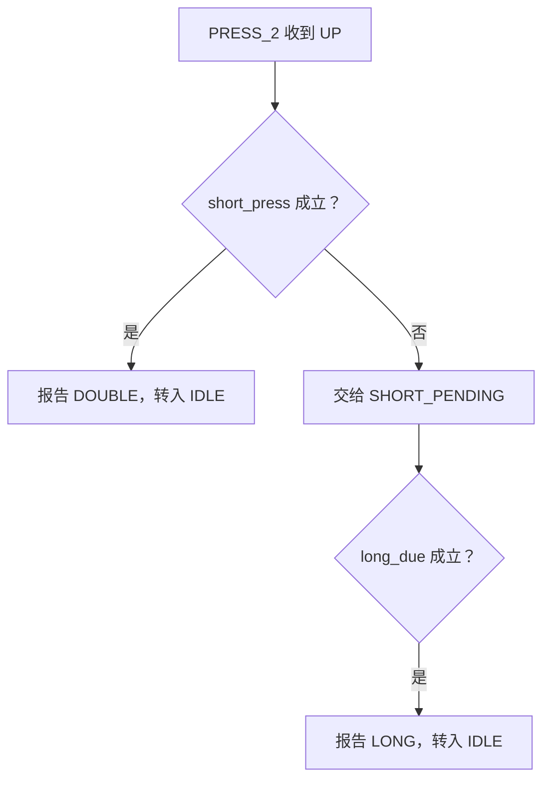

两个 guard 在本文的时长定义下互补。若 `PRESS_2` 的 guard 不成立，它必须返回“未处理”，让父状态继续尝试；若事件已经被消费，即使没有切换状态，也应停止向上传递。

| 返回结果 | 含义 | 执行器下一步 |
| --- | --- | --- |
| `UNHANDLED` | 当前状态没有处理这个事件 | 查父状态 |
| `HANDLED` | 已消费这个事件，叶子状态保持不变 | 结束本次派发 |
| `TRANSITION` | 选中了一条转移 | 执行退出、动作、进入过程 |

下面是**执行流程伪代码**，用于理解接口职责：

```text
dispatch(machine, event):
    handler_state = machine.active_leaf

    while handler_state 存在:
        result = handle(handler_state, event)

        if result.kind == HANDLED:
            return

        if result.kind == TRANSITION:
            transition(
                active_leaf = machine.active_leaf,
                source = handler_state,
                target = result.target,
                kind = result.transition_kind,
                action = result.action
            )
            return

        handler_state = parent(handler_state)
```

`active_leaf` 与 `source` 各有用途：当前可能处于 `PRESS_2`，但真正声明转移的是父状态 `SHORT_PENDING`。执行器既要知道从哪个叶子开始退出，也要知道所选转移属于哪个源状态。

父状态返回 `HANDLED` 时，当前叶子仍是原来的叶子。接收到事件的父状态不因此成为新的当前叶子。

### 7.4 按执行顺序推演一次长按

当前位于 `PRESS_1`，时间检查发现已按住 `800 ms`：

```text
1. PRESS_1 不处理 TICK，向父状态传播
2. SHORT_PENDING 的 long_due 成立
3. 选中 SHORT_PENDING → LONG_HELD
4. exit(PRESS_1)
5. exit(SHORT_PENDING)
6. 执行 emit_long
7. entry(LONG_HELD)
8. 当前叶子变为 LONG_HELD
```

这两个阶段都属于 `HELD`，因此此次转移不退出 `HELD`，指示灯会持续亮着。随后松开时：

```text
exit(LONG_HELD) → exit(HELD)：灭灯 → entry(IDLE)
```

对于这种跨兄弟分支的转移，可以沿层次树找到**最近公共祖先 LCA（Lowest Common Ancestor）**，从当前叶子向上退出到它的下方，再沿目标路径向下进入。

```text
                  HELD ← 公共祖先，保持激活
                 /    \
     SHORT_PENDING    LONG_HELD
          |               ↑
       PRESS_1 ──退出──→ 进入
```

完整执行器还要按转移类型处理“父到子”“子到父”“外部自转移”等情况。例如 `HELD → HELD` 的外部自转移会退出并重新进入 `HELD`，还要进入它的初始子状态。**计算退出边界时，要同时考虑转移源、目标和类型**。LCA 的兄弟分支示例不能直接覆盖全部情况。

### 7.5 公共禁用规则只定义一次

假设当前处于 `PRESS_2`，收到 `EV_DISABLE`：

```text
事件查找：PRESS_2 → SHORT_PENDING → HELD → ENABLED
选中规则：ENABLED -- DISABLE --> DISABLED
退出顺序：PRESS_2 → SHORT_PENDING → HELD → ENABLED
执行动作：取消本轮待决操作
进入顺序：DISABLED
```

`HELD.exit` 保证灯被关闭；本轮不再产生 `SINGLE`、`DOUBLE` 或 `LONG`。如果后续改用异步定时器，离开识别阶段时还需要取消计时并使旧超时失效。

这里约定各子状态都把 `EV_DISABLE` 向上传递。父状态规则能否执行，取决于子状态是否消费事件，因此这些公共事件应在模型中保留一致约定。

### 7.6 什么时候值得采用 HFSM？

观察**是否存在稳定的共同规则与生命周期**：

| 观察到的关系 | 层次划分 |
| --- | --- |
| 第一、第二次按住都判断长按 | `SHORT_PENDING` |
| 所有按住阶段共同拥有指示灯 | `HELD` |
| 所有识别阶段都响应禁用 | `ENABLED` |

层次更深也意味着需要理解传播、初始状态和转移边界。若状态之间很少共享行为，平铺 FSM 往往更直接。多个独立按键通常各用一个实例；需要同时激活多个独立区域时，才进一步研究正交区域等 statechart 机制。

## 8. FSM DSL：把已经明确的规则写成声明

### 8.1 从转移表到语言

走到这里，已经知道一条规则需要什么：

```text
源状态 + 事件 + 条件 + 动作 + 目标状态
```

**DSL（Domain-Specific Language，领域专用语言）**为某一类问题提供专用的表达形式。状态机 DSL 可以让“发生什么时，满足什么条件，执行什么，进入哪里”成为一段可读取、可检查的声明。

例如下面是本文用于说明的**外部 DSL 伪语法**：

```text
machine Button {
    initial IDLE

    IDLE:
        on DOWN -> PRESS_1 do start_press

    PRESS_1:
        on UP   when short_press -> WAIT_2    do start_wait
        on UP   when long_due    -> IDLE      do emit_long
        on TICK when long_due    -> LONG_HELD do emit_long
}
```

这段只展示第一段手势规则。它需要解析器、名称校验和执行器或生成器才能运行。下一步先利用 C 预处理器实现一个可以编译的小型内部 DSL。

### 8.2 内部 DSL：用 C 宏声明同一张转移表

内部 DSL 嵌在已有语言里，复用该语言的编译工具。下面使用 X-macro：**一份规则列表，传入不同的宏，就能展开成不同的数据**。

保留第 4.3 节的公共定义、第 5.2 节的 `transition_t`、`short_press()`、`window_closed()` 和派发函数，只把 `transitions[]` 的定义替换为：

```c
#define BUTTON_RULES(X) \
    X(IDLE,      EV_DOWN, NULL,          start_press,       PRESS_1) \
    X(PRESS_1,   EV_UP,   short_press,   start_wait,        WAIT_2) \
    X(PRESS_1,   EV_UP,   long_due,      emit_long,         IDLE) \
    X(PRESS_1,   EV_TICK, long_due,      emit_long,         LONG_HELD) \
    X(WAIT_2,    EV_DOWN, window_open,   start_press,       PRESS_2) \
    X(WAIT_2,    EV_DOWN, window_closed, single_then_press, PRESS_1) \
    X(WAIT_2,    EV_TICK, window_closed, emit_single,       IDLE) \
    X(PRESS_2,   EV_UP,   short_press,   emit_double,       IDLE) \
    X(PRESS_2,   EV_UP,   long_due,      emit_long,         IDLE) \
    X(PRESS_2,   EV_TICK, long_due,      emit_long,         LONG_HELD) \
    X(LONG_HELD, EV_UP,   NULL,          NULL,              IDLE)

#define MAKE_TRANSITION(src, evt, cond, act, dst) \
    { src, evt, cond, act, dst },

static const transition_t transitions[] = {
    BUTTON_RULES(MAKE_TRANSITION)
};

#undef MAKE_TRANSITION
```

例如第一行经过预处理，会展开为：

```c
{ IDLE, EV_DOWN, NULL, start_press, PRESS_1 },
```

运行时仍是第 5 节那张表和同一个派发函数。这里不需要运行时解析字符串；宏只是改变源代码的组织方式。

### 8.3 让同一份规则也生成调试说明

再把同一份 `BUTTON_RULES` 交给另一个宏：

```c
#define MAKE_RULE_TEXT(src, evt, cond, act, dst) \
    #src " -- " #evt " [" #cond "] / " #act " --> " #dst,

static const char *const rule_text[] = {
    BUTTON_RULES(MAKE_RULE_TEXT)
};

#undef MAKE_RULE_TEXT
```

这样 `rule_text[0]` 对应第一条规则的文字描述，后续可以记录命中的规则序号。`#src` 是 C 宏的字符串化操作；这些字符串会占用存储空间，可按调试构建需要保留。

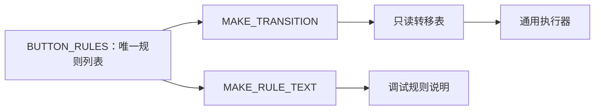

收益在于规则只维护一份，而转移表和调试描述都从它得到。若进一步需要生成状态图，可以再编写生成器读取这份模型。

### 8.4 DSL 怎样表达 HFSM？

第 8.2 节实现的是平铺 FSM 的 DSL。描述第 7 节的层次模型，还需要提供父状态、初始子状态、entry/exit 和转移类型。概念上可以写成下面这样，**仍是设计伪语法**：

```text
machine Button {
    initial ENABLED

    state DISABLED {
        on ENABLE when released -> ENABLED
        on ENABLE when pressed  -> ENABLED.REARM
    }

    state ENABLED {
        initial IDLE
        on DISABLE -> DISABLED do cancel_gesture

        state IDLE {
            on DOWN -> HELD.SHORT_PENDING.PRESS_1 do start_press
        }

        state WAIT_2 {
            on DOWN when window_open
                -> HELD.SHORT_PENDING.PRESS_2 do start_press
            on DOWN when window_closed
                -> HELD.SHORT_PENDING.PRESS_1 do single_then_press
            on TICK when window_closed -> IDLE do emit_single
        }

        state REARM {
            on UP -> IDLE
        }

        state HELD {
            initial SHORT_PENDING
            entry led_on
            exit  led_off

            state SHORT_PENDING {
                initial PRESS_1
                on TICK when long_due -> LONG_HELD do emit_long
                on UP   when long_due -> IDLE      do emit_long

                state PRESS_1 {
                    on UP when short_press -> WAIT_2 do start_wait
                }
                state PRESS_2 {
                    on UP when short_press -> IDLE do emit_double
                }
            }

            state LONG_HELD {
                on UP -> IDLE
            }
        }
    }
}
```

这里约定：目标名从当前作用域向外查找；guard 失败后可继续查找本状态其他规则，随后向父状态传播；所有 `->` 都是外部转移；若目标是复合状态，沿其初始路径进入叶子。`pressed/released` 读取消抖后的稳定电平。

实现这种 DSL 时，声明会转成两类数据：

| 数据 | 必要信息 |
| --- | --- |
| 状态定义 | 状态 ID、父状态 ID、初始子状态 ID、entry、exit |
| 转移定义 | 源状态、事件、guard、action、目标、转移类型 |

**DSL 负责描述，HFSM 执行器负责落实语义。** 父子状态如何退出、guard 失败后是否传播、同一事件是否只能触发一条转移，都必须有明确约定。

### 8.5 从 DSL 到固件，中间发生什么？

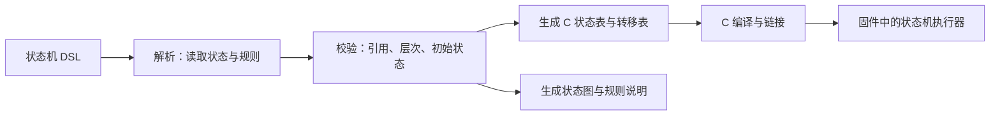

构建期生成 C 是一种嵌入式实现路径。另一条路径是在设备上解释执行 DSL，它允许更动态的模型加载，也需要额外处理解析、存储和模型有效性。

| 可做的检查 | 检查的边界 |
| --- | --- |
| 状态、事件、动作是否存在 | 名称检查不能证明业务逻辑正确 |
| 父状态关系是否成环 | 层次树合法后，仍需检查具体转移 |
| 初始子状态是否属于父状态 | 还要明确直接转移到复合状态的语义 |
| 状态在图上是否可达 | guard 可能使一条看似可达的路径永远无法发生 |
| 同源同事件规则是否重复 | 任意 C guard 的互斥性通常仍要人工分析或专门验证 |
| 是否存在默认处理与忽略规则 | 未处理事件可以是有意设计，应让策略可见 |

对于当前这个按键，C 宏已经足够演示“规则一份、多处生成”。当多个状态机需要统一检查、文档与代码生成时，专用语法和生成工具的维护成本才更容易获得回报。

## 9. 接到真实嵌入式系统：保持处理顺序可控

### 9.1 Run-to-Completion：一个事件处理完，再取下一个

**Run-to-Completion（RTC，运行到完成）**表示：对同一个状态机实例，一次事件处理及其引发的转移完成后，再开始处理下一事件。

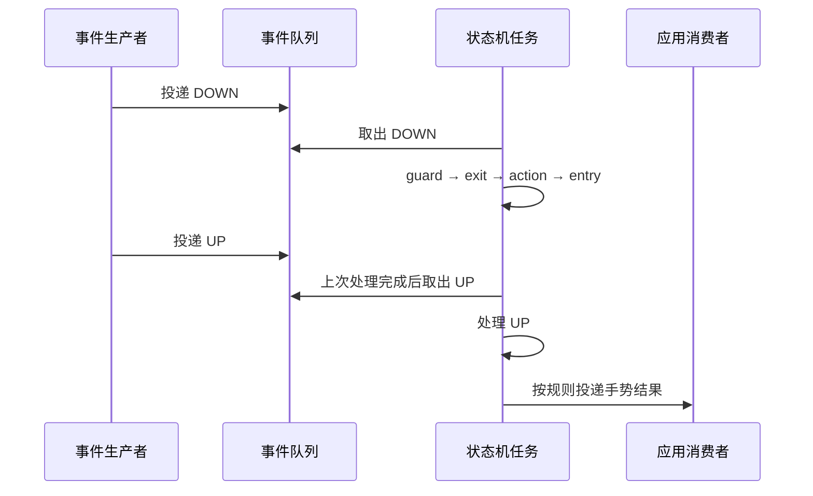

RTC 约束的是同一实例的事件处理，RTOS 仍然可以调度其他任务。常见落地方式是单个任务拥有状态机数据，其他任务或 ISR 只负责送消息；简单裸机程序也可以由主循环按顺序调用，不必额外引入任务。

动作里只做有界、快速的工作，例如更新字段或投递输出。若长按要启动一次耗时操作，可以启动工作后返回，完成时再发送一个结果事件。

### 9.2 时间戳和队列要采用同一套约定

本文的 `button_poll()` 在同一调用中生成边沿与 `TICK`，时间顺序天然明确。迁移到队列时，需要保留这些条件：

| 约定 | 原因 |
| --- | --- |
| 统一时钟与单位 | GPIO 事件、时间检查都使用同一毫秒时间轴 |
| 时间戳表示输入确认时刻 | 排队延迟不应被直接算成实际按住时长 |
| 同一实例按事件时间顺序消费 | 较新的 TICK 若越过较旧的 UP，可能提前判成长按 |
| 同时刻先处理边沿再处理 TICK | 与本文的等号边界、采样循环一致 |
| 明确队列满时的处理 | 丢失 UP 可能使状态机一直停在按住阶段 |

多个生产者的消息到达顺序未必等于事件发生顺序。可让一个输入任务统一完成采样、消抖和派发；采用异步边沿与定时器时，则需要设计排序与时效校验。FIFO 只保证入队后的顺序。

### 9.3 用一次性定时器替换 TICK 时

周期检查容易理解，但存在固定扫描开销。也可以进入等待阶段时启动定时器，到期发送 `LONG_TIMEOUT` 或 `DOUBLE_TIMEOUT`。这会增加一个需要显式处理的问题：**已入队的旧超时，可能在取消后才被取出。**

```text
第一轮按下：启动 LONG 定时器，token = 41
第一轮松开：取消定时器，使 token = 41 失效
第二轮按下：启动 LONG 定时器，token = 42
旧超时到达：携带 token = 41，校验失败，丢弃
```

超时消息携带用途、实例标识和本次计时 token；处理时校验当前状态与 token。token 在可能存在旧消息的期间必须能区分新旧计时。取消底层定时器后，仍应考虑队列中已经存在的消息。

### 9.4 每个按键拥有自己的实例

```text
按键 A：debounce_t A + button_t A ─┐
                                ├─ 共享同一份只读规则
按键 B：debounce_t B + button_t B ─┘
```

状态、时间戳和回调上下文随实例保存；静态规则可以共享。不要在动作函数内再放一个跨所有按键共享的 `static pressed_at`。

状态机结果可以通过 [[嵌入式设计模式-事件总线|事件总线]] 发送给界面或业务，也可以用回调。状态机决定**何时产生结果**，消息通道决定**如何送达消费者**。

## 10. 用输入序列验证，比只看状态图更具体

### 10.1 先验证稳定事件，再单独验证消抖

下面时间单位均为 `ms`，`D/U/T` 分别代表确认后的 `EV_DOWN/EV_UP/EV_TICK`。每行从新的 `IDLE` 实例开始；除列出的事件外，不额外插入事件。

| 场景 | 输入序列 | 预期输出与最终状态 |
| --- | --- | --- |
| 普通单击 | `D0 U100 T349 T350` | 仅在 350 输出 `SINGLE`，最后 `IDLE` |
| 普通双击 | `D0 U100 D200 U300 T600` | 仅在 300 输出 `DOUBLE`，最后 `IDLE` |
| 长按持续不放 | `D0 T799 T800 T1600 U1700` | 仅在 800 输出一次 `LONG`，最后 `IDLE` |
| 松开先于下一次时间检查 | `D0 U800` | 输出 `LONG`，最后 `IDLE` |
| 第二次按下恰好在窗口边界 | `D0 U100 D350 U450 T700` | 350、700 各输出一次 `SINGLE` |
| 第二次按下在窗口内最后一毫秒 | `D0 U100 D349 U400` | 输出一次 `DOUBLE` |
| 第二次按住变成长按 | `D0 U100 D200 T1000 U1100` | 仅输出一次 `LONG` |
| 第二次长按在松开时补判 | `D0 U100 D200 U1000` | 仅输出一次 `LONG` |
| 空闲时收到松开 | `U100 T1000` | 无输出，保持 `IDLE` |
| 重复按下输入 | `D0 D100 T800 U900` | 起点仍为 0，仅输出一次 `LONG` |
| 32 位时间戳回绕 | `D@0xFFFFFF00 T@0x00000220 U@0x00000221` | 经过 800 时输出 `LONG`，最后 `IDLE` |

消抖单独输入原始采样，例如：

```text
0：松开
5：按下
10：松开
15：按下
30：按下   → 距最后变化仅 15 ms，无输出
35：按下   → 确认 EDGE_DOWN
40：按下   → 无输出
50：松开
55：按下
60：松开
80：松开   → 确认 EDGE_UP
```

验证重点是输出次数、输出顺序、时间边界和最终状态。将同一组序列分别交给 `switch`、表驱动和 C 宏 DSL 版本，三者应得到相同结果。

### 10.2 HFSM 额外检查生命周期

| 路径 | 需要观察的行为 |
| --- | --- |
| `IDLE → PRESS_1` | 进入 `HELD`，灯亮一次 |
| `PRESS_1 → LONG_HELD` | `HELD` 保持激活，灯持续亮 |
| `LONG_HELD → IDLE` | 退出 `HELD`，灯灭一次 |
| `PRESS_2 → DISABLED` | 逐层退出，灯灭，无手势结果 |
| 按住时重新启用 | 进入 `REARM`，松开后回 `IDLE`，无手势结果 |
| 父状态消费普通事件 | 当前叶子保持不变 |
| 子状态 guard 失败 | 事件继续交给父状态 |

## 11. 把这条路线记成一张图

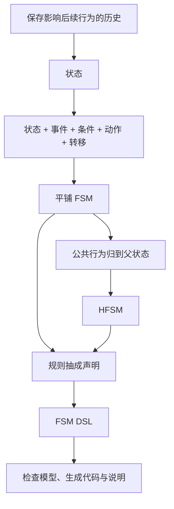

| 层次 | 最值得掌握的一件事 |
| --- | --- |
| 状态 | 把影响未来判断的历史保存下来 |
| FSM | 明确每个阶段如何处理输入 |
| 表驱动 | 将转移规则与匹配流程分开 |
| HFSM | 让公共事件处理与资源生命周期有明确归属 |
| FSM DSL | 用一份声明表达模型，并交给明确的执行语义 |

练习可以沿着现有按键继续：先增加长按后的周期连发，再找出连发状态与长按状态共享的行为，最后把新增规则加入 DSL。每次扩展先写出预期输入输出，再修改状态图和实现。

## 12. 参考与相关笔记

本文的按键阈值、手势策略和 DSL 语法都是教学示例。HFSM 的层次、事件传播和转移语义可对照以下官方资料；框架各自的完整语义应以其文档为准。

| 官方资料 | 对照本文的内容 |
| --- | --- |
| Zephyr：State Machine Framework | 平铺与层次状态、entry/run/exit、事件传播与初始转移 |
| QP/C：State Machines，Software Requirements Specification | 父子状态、guard、内部处理、自转移、退出与进入路径 |

```text
Zephyr SMF
https://docs.zephyrproject.org/latest/services/smf/index.html

QP/C State Machines
https://www.state-machine.com/qpc/srs-qp_sm.html
```

相关笔记：[[消抖算法的选择]] · [[嵌入式设计模式-事件总线]] · [[嵌入式函数设计原则]]
