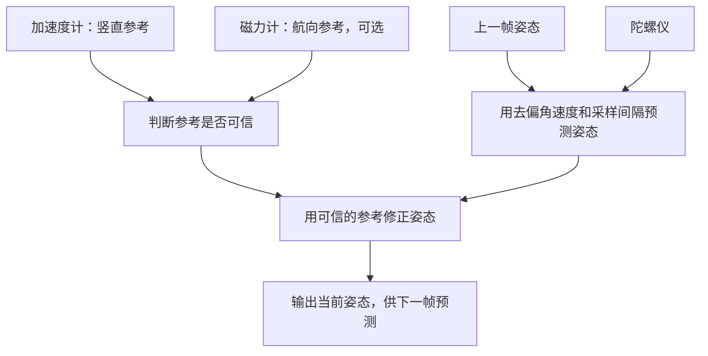
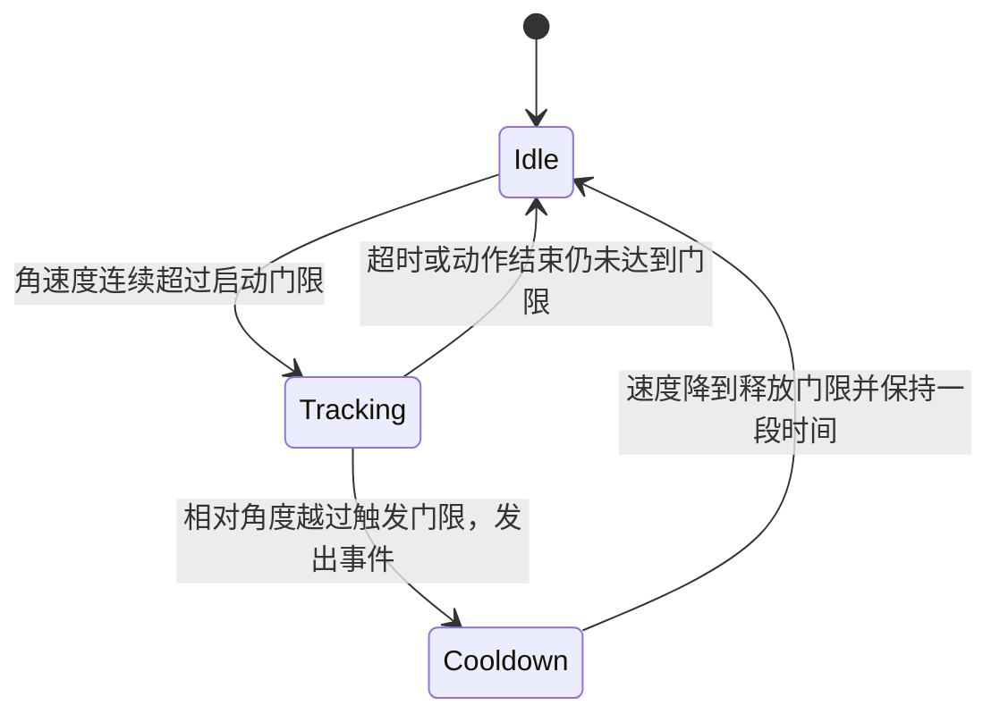

# 01-IMU算法基础概念

## 先用数字算一遍

想象眼镜固定在一个只能绕单轴转动的支架上。先看它这一帧转了多少，再看估计值怎么被拉回。

1. **积分：把每一帧的转角加起来。** 这一帧持续 `100 ms = 0.1 s`，去偏后的陀螺仪读数是 `60°/s`，那么这一帧转过 `60 × 0.1 = 6°`。上一帧如果是 `14°`，这一帧就预测成 `20°`。公式里的 `Δt` 就是这 `0.1 s`。
2. **融合：朝参考值挪一点。** 这一帧的陀螺仪预测是 `20°`，加速度计在可信时给出的倾角是 `10°`。给预测 `80%` 的权重，给参考 `20%`，结果就是 `18°`。也可以直接想成：从 `20°` 朝 `10°` 挪差值的五分之一。这里算的是**倾角**；仅靠加速度计，不能用这招纠正左右转头的航向。
3. **四元数：把这次旋转存下来。** 以绕 Z 轴转 `90°` 为例，眼镜实际转了 `90°`；编码时用它的一半 `45°`。四元数的 `w` 取 `cos(45°)`，`z` 取 `sin(45°)`，得到约 `(0.707, 0, 0, 0.707)`。之所以用半角，是因为用四元数转向量时，会在向量两边分别乘 `q` 和它的逆；最终转出来的是完整的 `90°`。初读时只要记住 `四元数存的是旋转，四个数本身不是角度`。

> [!summary] 先分清三件事
> **IMU 测运动，姿态融合估计朝向，四元数保存旋转。** 对眼镜来说，「刚才往左转了多少」是短时相对变化；「现在是不是朝北」需要可信的航向参考。

## 1. IMU 的轴数

IMU（Inertial Measurement Unit，惯性测量单元）的核心是加速度计和陀螺仪。产品的「轴数」通常数的是**测量通道**；刚体的 **6DoF** 则是空间中的三维平移和三维旋转。6 轴 IMU 不直接给出位置和姿态，9 轴也不代表多出三个运动自由度。

| 产品标法 | 常见构成 | 能获得什么 |
| --- | --- | --- |
| 3 轴 | 三轴加速度计或三轴陀螺仪 | 一种物理量在 X、Y、Z 上的分量 |
| 6 轴 | 三轴加速度计 + 三轴陀螺仪 | 借助重力估计倾斜，用角速度跟踪短时转动；航向缺少外部参考 |
| 9 轴 | 6 轴 + 三轴磁力计 | 磁场可信时可约束航向；磁北转真北还需要当地磁偏角 |
| 10 轴 | 有些模块指 9 轴 + 气压计 | 通过气压估计相对高度变化；换算海拔需要参考气压 |
| 11 / 12 轴 | 查具体产品的数据手册 | 可能计入额外传感器的读数或冗余测量通道，没有统一组合 |

例如 BMI270 有温度读数，仍标为 6 轴。温度可用于补偿随温度变化的零偏；气压可辅助估计高度，但天气变化也会影响估计。

## 2. 姿态融合

### 2.1 单个传感器能知道什么

| 传感器 | 实际测量 | 适合做什么 | 局限 |
| --- | --- | --- | --- |
| 加速度计 | 比力，常用 `m/s²` 或 `g` | 近静止时利用竖直方向校正倾斜 | 加速和振动会干扰倾斜估计；不能确定航向 |
| 陀螺仪 | 机体系下的角速度，常用 `rad/s` 或 `°/s` | 跟踪快速、短时的转动 | 静止时也可能有零偏；积分会累积误差 |
| 磁力计 | 当地磁场向量，常用 `µT` | 磁场可信时，配合倾斜补偿提供航向参考 | 磁铁、钢材、载流导线等可扰动读数 |

**为什么静放桌上还能测到约 `1 g`？** 忽略误差时，世界系中的比力满足 $\mathbf f_W=\mathbf a_W-\mathbf g_W$。$\mathbf a_W$ 是运动加速度，$\mathbf g_W$ 指向地面；静置时 $\mathbf a_W=0$，比力朝上，模长约为 $1g$。理想自由落体时 $\mathbf a_W=\mathbf g_W$，比力接近零。芯片输出的是比力在自身各轴上的投影。

**为什么 yaw 会漂移？** 把设备水平放置，再保持水平左转 90°。起点和终点的竖直方向在设备各轴上的投影相同，因此加速度计不能区分两个朝向。陀螺仪能测到转动过程，但积分后的航向误差无法单靠重力纠正。比如单轴纯积分时，`0.5°/s` 的残余零偏在 `20 s` 内会累积约 `10°`。

### 2.2 先约定坐标系

| 坐标系 | 含义 | 本文约定 |
| --- | --- | --- |
| 传感器系 S | 芯片数据手册定义的轴 | 按芯片安装方向将读数转换到机体系 |
| 机体系 B | 随设备一起转动的轴 | 以眼镜为例，X 朝前、Y 朝左、Z 朝上，构成右手系 |
| 世界系 W | 用来描述姿态的固定参考 | Z 朝上；无航向参考时可把起始航向设为零 |

本文用 $q_{WB}$ 表示**将机体系向量转到世界系**的旋转。欧拉角采用 Z-Y-X 约定，roll、pitch、yaw 分别对应 X、Y、Z 的角参数。陀螺仪测的是绕当前**机体轴**的角速度；设备倾斜后，`gyro.z` 一般不等于 yaw 的变化率。

### 2.3 先预测，再纠偏

先看小角度的单轴倾斜。上一帧倾角加上陀螺仪测得的转角，得到预测角；近静止时再用加速度计测得的倾角把它拉回：

$$
\theta_{\mathrm{pred}}=\theta_{k-1}+(\omega-b_g)\Delta t,\qquad
\theta_k=\alpha\theta_{\mathrm{pred}}+(1-\alpha)\theta_{\mathrm{acc}}
$$

$b_g$ 是陀螺仪零偏。$\alpha$ 越接近 1，短时越依赖陀螺仪，纠偏越慢。例如取 $\alpha=\tau/(\tau+\Delta t)$，其中 $\tau$ 是纠偏时间常数。这就是单轴互补滤波：陀螺仪跟踪短时变化，加速度计约束长期倾角。

三维融合沿用这个思路，但在三维旋转上纠偏。明显加速时，可降低加速度计权重；磁场异常时，可暂时停止磁校正。加速度计模长接近 `1 g` 只是可信度线索，不能单靠它判断设备静止。

## 3. 四元数：怎么表示和更新旋转

### 3.1 从旋转轴和角度得到四元数

一个三维旋转可以描述为绕单位轴 $\mathbf u=(u_x,u_y,u_z)$ 转过 $\theta$。采用 Hamilton 乘法、标量在前的写法：

$$
q=(w,x,y,z)=\left(\cos\frac{\theta}{2},\ u_x\sin\frac{\theta}{2},\ u_y\sin\frac{\theta}{2},\ u_z\sin\frac{\theta}{2}\right)
$$

例如绕 Z 轴按右手规则转 $90^\circ$，$q=(\sqrt{2}/2,0,0,\sqrt{2}/2)$，会把 X 方向转到 Y 方向。四个分量受 $\|q\|=1$ 约束，仍然表示三自由度旋转；$(x,y,z)$ 不是三个角度。

### 3.2 用一帧角速度预测姿态

假设去偏后的机体系角速度 $\boldsymbol\omega_B$ 在一帧内不变。它的方向是转轴，模长乘以 $\Delta t$ 是旋转角。代入上式得到增量 $\delta q_B$；角速度为零时，增量为单位旋转 $(1,0,0,0)$。

$$
q_{WB,\mathrm{pred}}=\operatorname{normalize}\left(q_{WB,k-1}\otimes\delta q_B\right)
$$

$\otimes$ 表示四元数乘法。这里右乘是因为增量用机体系表达；算角度时用 `rad/s` 和秒，更新后归一化以维持单位长度。上式只完成陀螺仪预测，后续由融合算法用观测纠偏。

### 3.3 优势与局限

| 表示 | 适合场景 | 工程注意点 |
| --- | --- | --- |
| 欧拉角 | UI、日志、人工读数 | Z-Y-X 在 pitch 达到 $\pm90^\circ$ 时有万向节锁；角度跨过表示边界时可能跳变 |
| 旋转矩阵 | 直接变换三维向量 | 9 个元素，更新时需保持正交性和行列式为 +1 |
| 单位四元数 | 保存内部姿态、复合旋转、插值 | 要保持单位长度；对接时核对坐标系、旋转方向和分量顺序 |

- $q$ 与 $-q$ 表示同一旋转。做连续输出或最短路径插值时，可检查相邻四元数的点积；若小于零，就将其中一个取反。
- 旋转顺序有意义。先点头再转头，通常与先转头再点头不同。接入新库时，可用已知的单轴 `90°` 和两个顺序不同的组合旋转检查约定。
- 四元数本身不受欧拉角万向节锁影响；转回欧拉角时仍有相应奇异点。四元数也不提供观测，无法自行消除漂移。

## 4. 常见融合方法

| 方法 | 怎么纠偏 | 适合场景 |
| --- | --- | --- |
| 单轴互补滤波 | 混合陀螺仪积分角和加速度计倾角 | 单轴倾角、验证采样和符号 |
| Mahony | 对比预计与实测的参考向量，用反馈修正姿态；积分项可估计有观测约束的陀螺仪零偏 | MCU 上的低成本三维姿态估计 |
| Madgwick | 用预测向量和实测向量的误差构造梯度修正 | 轻量级四元数姿态估计 |
| EKF / ESKF | 按模型预测，用观测更新估计与不确定度；ESKF 估计名义状态附近的小误差 | 联合估计多个状态，或接入视觉、GNSS 等外部观测 |

**IMU 负责测量，AHRS（姿态与航向参考系统）估计姿态，INS（惯性导航系统）还传播速度和位置。** 要估计位置，先把比力转到世界系并加回重力得到运动加速度，再积分得到速度和位置。零偏会累积，倾角误差也会把一部分重力误算成水平加速度。因此消费级 IMU 单独积分难以维持可靠的长期位置估计。

## 5. 嵌入式实例：眼镜的左右转头

左右转头检测关心的是**一次动作里的相对转角**。头部接近直立时，可用去偏后的机体 Z 轴角速度做短时积分；倾斜明显时，可用融合姿态把眼镜前向投影到水平面，再比较动作前后的航向。前向接近竖直时，水平投影过短，应暂缓用它判定左右；用欧拉角差值时则要处理跨 `±180°` 的情况。

| 检查项 | 实操要点 |
| --- | --- |
| 采样时序 | 优先用采样时间戳；FIFO 批读时按采样序列和已知采样周期重建每帧 `dt`，不要用任务唤醒或日志到达间隔代替。掉帧和长间隙单独处理。 |
| 单位和量程 | 按手册缩放原始计数；统一单位。快速甩头时检查角速度是否饱和。 |
| 安装和标定 | 静置采多帧估计陀螺仪零偏；逐轴转动确认符号和轴映射。需要磁航向时，做整机磁标定，并检查工作时的磁扰。 |
| 手势验证 | 记录 `timestamp`、`dt`、去偏角速度、累计转角和状态。依次测试静置、左右转、纯点头、连续转头和走路，检查误触发、漏触发与延迟。 |

> [!question] 自检
> 眼镜静置时 yaw 缓慢变化，但 roll 和 pitch 基本稳定，先看哪两项？
>
> 先看陀螺仪零偏是否扣除，再看是否有可信的航向参考。重力能约束倾斜，但不约束航向。

## 6. 延伸阅读

- [[卡尔曼滤波]]：观测不确定度如何影响更新权重。
- [VectorNav：Inertial Navigation Primer](https://www.vectornav.com/resources/inertial-navigation-primer)：惯性测量、坐标系和导航。
- [Bosch Sensortec：BMI270 Datasheet](https://www.bosch-sensortec.com/media/boschsensortec/downloads/datasheets/bst-bmi270-ds000.pdf)：量程、温度、Sensor Time 和 FIFO。
- [Joan Solà：Quaternion kinematics for the error-state Kalman filter](https://arxiv.org/abs/1711.02508)：四元数约定、旋转增量和 ESKF。
- [Mahony 等：Nonlinear Complementary Filters on the Special Orthogonal Group](https://doi.org/10.1109/TAC.2008.923738)：三维互补滤波和零偏估计。
- [Sebastian Madgwick：An efficient orientation filter for inertial and inertial/magnetic sensor arrays](https://x-io.co.uk/downloads/madgwick_internal_report.pdf)：基于梯度修正的姿态估计。
