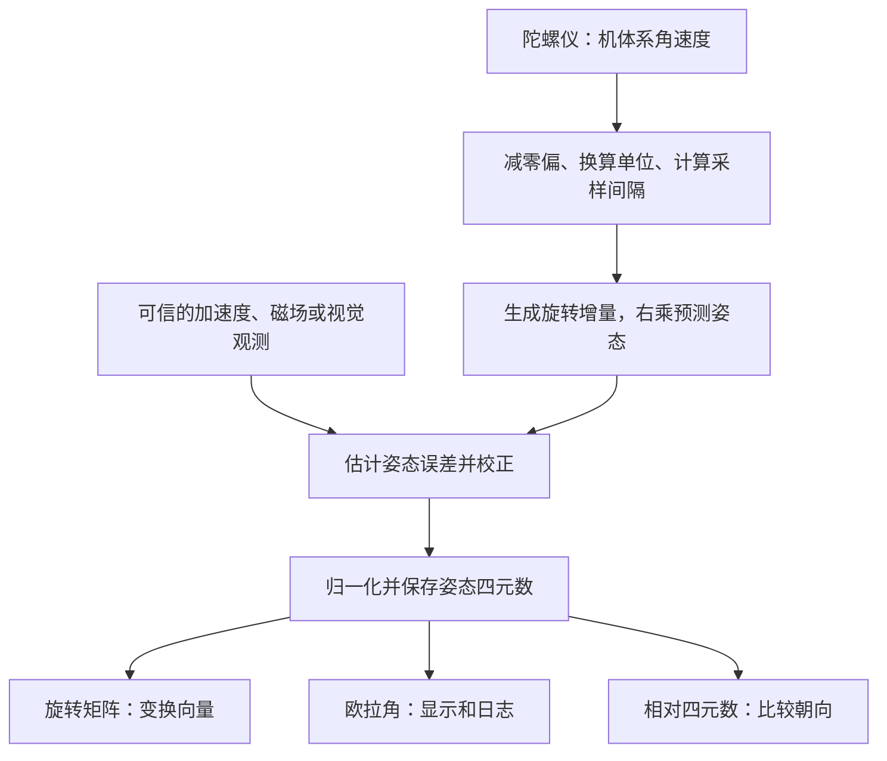

# 四元数与欧拉角

欧拉角和单位四元数都用来描述物体的**姿态，也就是物体相对参考坐标系的朝向**。欧拉角把朝向拆成按顺序进行的三次旋转；单位四元数把一个等效的「绕某根轴转某个角度」编码成四个数。本文从具体动作出发，推导两种表示如何描述同一次旋转，以及它们怎样用于 IMU 姿态更新。

前置阅读：[[01-IMU算法基础概念]]。本文只讨论旋转，位置平移另行处理。

## 目录

- [[#1. 先算一次绕 Z 轴转 90°]]
- [[#2. 先约定坐标系和旋转方向]]
- [[#3. 从二维旋转推导旋转矩阵]]
- [[#4. 欧拉角如何描述三维姿态]]
- [[#5. 万向节锁究竟丢失了什么]]
- [[#6. 从轴角走到四元数]]
- [[#7. 为什么四元数能旋转向量，为什么使用半角]]
- [[#8. 四元数如何组合旋转]]
- [[#9. 欧拉角、四元数和旋转矩阵的转换]]
- [[#10. 从陀螺仪角速度更新四元数]]
- [[#11. 工程中如何理解和使用姿态]]
- [[#12. 用具体例子检查理解]]
- [[#参考资料]]

## 1. 先算一次绕 Z 轴转 90°

把眼镜平放，初始时镜头朝世界系的 X 正方向。让眼镜绕朝上的 Z 轴左转 $90^\circ$，镜头就朝向世界系的 Y 正方向。

```text
从 +Z 一侧俯视，+Z 指向读者：

              +Y：转动后朝向
               ↑
               │   ↶ 正向旋转 90°
               O────────→ +X：初始朝向
```

同一个终点朝向可以写成：

| 表示方式 | 这个例子中的数值 | 数值表达什么 |
| --- | --- | --- |
| 欧拉角，按本文 Z-Y-X 约定 | roll = $0^\circ$，pitch = $0^\circ$，yaw = $90^\circ$ | 三次有序旋转的角度 |
| 轴角 | 转轴 $(0,0,1)$，转角 $90^\circ$ | 绕朝上的轴转四分之一圈 |
| 单位四元数，标量在前 | $(w,x,y,z)=(\sqrt2/2,0,0,\sqrt2/2)$ | 用 $45^\circ$ 的正弦、余弦编码这次旋转 |

先用结果检查物理含义：机体上朝前的单位向量，在机体系中一直是 $(1,0,0)$；眼镜转完后，这根向量在世界系中变成 $(0,1,0)$。**姿态负责把「相对机体的方向」换算成「相对世界的方向」。**

四元数中的 $0.7071$ 没有角度单位。它由三角函数得到；它的两个非零分量也不表示眼镜分别绕两个轴转了 $0.7071$ 度。

## 2. 先约定坐标系和旋转方向

### 2.1 世界系 W 与机体系 B

沿用 [[01-IMU算法基础概念]] 的约定：

| 项目 | 本文约定 |
| --- | --- |
| 世界系 W | 固定参考坐标系，Z 朝上，X、Y 位于水平面；本文不把 X 强制绑定到地理北方 |
| 机体系 B | 固定在眼镜上，X 朝前、Y 朝左、Z 朝上，随眼镜一起转动 |
| 坐标系手性 | 右手系，$\mathbf e_x\times\mathbf e_y=\mathbf e_z$ |
| 正转方向 | 右手拇指指向旋转轴正方向，四指弯曲的方向为正转 |
| 向量写法 | 列向量，矩阵在左侧相乘 |
| 姿态方向 | $R_{WB}$、$q_{WB}$ 将机体系 B 中的坐标转换到世界系 W |
| 四元数约定 | Hamilton 乘法，标量在前，$q=(w,x,y,z)$ |

例如 $\mathbf v_B=(1,0,0)^T$ 表示机体朝前的单位向量。它在世界系中的坐标为：

$$
\mathbf v_W=R_{WB}\mathbf v_B
$$

下标 $WB$ 在本文中读成「从 B 到 W」。其他资料可能采用不同下标规则，需要看它的定义。

### 2.2 旋转向量与更换坐标表达

有两种常见观察方式：

- **主动旋转**：坐标系固定，把向量本身转动。例如把世界系的 X 方向转到 Y 方向。
- **被动变换**：物理向量不动，更换描述它的坐标系。例如把同一根重力向量从世界系写到机体系。

本文用 $R_{WB}$ 描述机体姿态。它的列向量是机体各轴在世界系中的方向，因此将它乘到 $\mathbf v_B$ 上，就得到同一物理向量的世界系坐标。

反向变换为：

$$
\mathbf v_B=R_{WB}^{-1}\mathbf v_W=R_{WB}^T\mathbf v_W
$$

这里 $T$ 表示转置。把「机体转了多少」与「固定向量在机体里怎样变化」混在一起，会导致旋转方向相反。例如眼镜左转时，一根固定在世界系的水平参考箭头在眼镜坐标里会向右转。

> [!important] 后续公式的适用条件
> 本文始终使用右手系、列向量、B 到 W 的姿态、Hamilton 四元数和 Z-Y-X 欧拉角。对接其他资料或库时，先核对这些约定，再比较公式。

## 3. 从二维旋转推导旋转矩阵

### 3.1 一根箭头转动后，各坐标是多少

先只看 XY 平面。长度为 $r$、与 X 正方向夹角为 $\alpha$ 的向量是：

$$
x=r\cos\alpha,\qquad y=r\sin\alpha
$$

把它正向旋转 $\gamma$，角度变为 $\alpha+\gamma$。用和角公式展开：

$$
\begin{aligned}
x'&=r\cos(\alpha+\gamma)
=x\cos\gamma-y\sin\gamma\\
y'&=r\sin(\alpha+\gamma)
=x\sin\gamma+y\cos\gamma
\end{aligned}
$$

将两行式子写在一起，便得到旋转矩阵：

$$
\begin{bmatrix}x'\\y'\end{bmatrix}
=
\begin{bmatrix}
\cos\gamma&-\sin\gamma\\
\sin\gamma&\cos\gamma
\end{bmatrix}
\begin{bmatrix}x\\y\end{bmatrix}
$$

取 $\gamma=90^\circ$、$(x,y)=(1,0)$，结果为 $(0,1)$，与开头的动作一致。

### 3.2 扩展到三维的三个基本旋转

绕某根坐标轴旋转时，沿这根轴的分量保持不变，垂直平面中的两个分量按二维规则变化：

$$
R_x(\phi)=
\begin{bmatrix}
1&0&0\\
0&\cos\phi&-\sin\phi\\
0&\sin\phi&\cos\phi
\end{bmatrix}
$$

$$
R_y(\theta)=
\begin{bmatrix}
\cos\theta&0&\sin\theta\\
0&1&0\\
-\sin\theta&0&\cos\theta
\end{bmatrix},\qquad
R_z(\psi)=
\begin{bmatrix}
\cos\psi&-\sin\psi&0\\
\sin\psi&\cos\psi&0\\
0&0&1
\end{bmatrix}
$$

绕 Y 轴正转时，X 正方向会转向 Z 负方向。这由右手规则决定；在本文 X 朝前、Z 朝上的约定中，正 pitch 对应机头向下。

### 3.3 矩阵中的 9 个数有什么物理含义

将机体三个单位轴分别变换到世界系：

$$
R_{WB}=
\begin{bmatrix}
\vert&\vert&\vert\\
\mathbf e_{x_B}^{W}&\mathbf e_{y_B}^{W}&\mathbf e_{z_B}^{W}\\
\vert&\vert&\vert
\end{bmatrix}
$$

第一列是机体 X 轴在世界系中的方向，第二列和第三列对应机体 Y、Z 轴。

例如绕 Z 正转 $90^\circ$：

$$
R_z(90^\circ)=
\begin{bmatrix}
0&-1&0\\
1&0&0\\
0&0&1
\end{bmatrix}
$$

从列向量可直接读出：机体前方朝世界 $+Y$，机体左方朝世界 $-X$，机体上方仍朝世界 $+Z$。

旋转保持长度和夹角，所以三列必须互相垂直且长度为 1，即 $R^TR=I$。再要求 $\det R=+1$，保证它描述保持手性的旋转。这些约束意味着 9 个矩阵元素并非 9 个独立自由度。

## 4. 欧拉角如何描述三维姿态

### 4.1 roll、pitch、yaw 是有顺序的角参数

本文采用 Z-Y-X 内禀旋转：从与世界系重合的机体系开始，先绕当前 Z 轴转 yaw，再绕转动后的 Y 轴转 pitch，最后绕再次转动后的 X 轴转 roll。

| 名称 | 符号 | 在这组旋转序列中的动作 | 初始水平时的直观动作 |
| --- | --- | --- | --- |
| yaw，偏航角 | $\psi$ | 绕当前 Z 轴转动 | 正值为向左转头 |
| pitch，俯仰角 | $\theta$ | 绕中间姿态的 Y 轴转动 | 正值为向下点头 |
| roll，横滚角 | $\phi$ | 绕最后姿态的 X 轴转动 | 正值使机体左侧向上倾 |

roll、pitch、yaw 也常被统称为欧拉角。严格分类时，Z-Y-X 属于三个轴都不同的 Tait–Bryan 角；这里沿用嵌入式中常见的叫法。


对应的姿态矩阵是：

$$
R_{WB}=R_z(\psi)R_y(\theta)R_x(\phi)
$$

**为什么看动作是先 Z，矩阵乘向量时却先算最右边的 X？** 因为前面讲的是随物体转动的轴。沿当前机体轴追加一次转动，姿态矩阵在右侧乘对应的基本旋转矩阵，因此从 $I$ 出发依次得到 $R_z$、$R_zR_y$、$R_zR_yR_x$。

同一个矩阵如果用「固定世界轴主动旋转一个向量」来解释，则等价于先绕固定 X 轴转 roll，再绕固定 Y 轴转 pitch，最后绕固定 Z 轴转 yaw。**内禀 Z-Y-X 与外禀 X-Y-Z 描述的是同一组矩阵乘积，观察的轴不同。**

### 4.2 为什么旋转顺序不能交换

拿世界系中的向量 $\mathbf e_x=(1,0,0)^T$ 做实验，两次旋转都绕固定世界轴：

| 操作顺序 | 第一步 | 第二步 | 最终方向 |
| --- | --- | --- | --- |
| 先绕 Z 转 $90^\circ$，再绕 X 转 $90^\circ$ | $+X\to+Y$ | $+Y\to+Z$ | $+Z$ |
| 先绕 X 转 $90^\circ$，再绕 Z 转 $90^\circ$ | $+X\to+X$ | $+X\to+Y$ | $+Y$ |

因此：

$$
R_x(90^\circ)R_z(90^\circ)\ne R_z(90^\circ)R_x(90^\circ)
$$

欧拉角中的三个数必须和旋转顺序一起解释；仅知道「绕 X、Y、Z 各转了多少」还不足以确定最终朝向。

### 4.3 展开 Z-Y-X 旋转矩阵

为缩短公式，令 $c_\phi=\cos\phi$、$s_\phi=\sin\phi$，其他角同理。先计算中间两项：

$$
R_yR_x=
\begin{bmatrix}
c_\theta&s_\theta s_\phi&s_\theta c_\phi\\
0&c_\phi&-s_\phi\\
-s_\theta&c_\theta s_\phi&c_\theta c_\phi
\end{bmatrix}
$$

再左乘 $R_z$：

$$
R_{WB}=
\begin{bmatrix}
c_\psi c_\theta&c_\psi s_\theta s_\phi-s_\psi c_\phi&c_\psi s_\theta c_\phi+s_\psi s_\phi\\
s_\psi c_\theta&s_\psi s_\theta s_\phi+c_\psi c_\phi&s_\psi s_\theta c_\phi-c_\psi s_\phi\\
-s_\theta&c_\theta s_\phi&c_\theta c_\phi
\end{bmatrix}
$$

这个矩阵既能用来旋转向量，也能帮助推导欧拉角反解和万向节锁。

## 5. 万向节锁究竟丢失了什么

### 5.1 在 pitch 等于 90° 时代入公式

取 $\theta=90^\circ$，此时 $c_\theta=0$、$s_\theta=1$。用三角函数差角公式整理上面的矩阵：

$$
R_{WB}=
\begin{bmatrix}
0&\sin(\phi-\psi)&\cos(\phi-\psi)\\
0&\cos(\phi-\psi)&-\sin(\phi-\psi)\\
-1&0&0
\end{bmatrix}
$$

矩阵只取决于 $\phi-\psi$，无法再单独区分 roll 和 yaw。例如下面两组角度给出完全相同的姿态：

$$
(\phi,\theta,\psi)=(0^\circ,90^\circ,0^\circ)
$$

$$
(\phi,\theta,\psi)=(30^\circ,90^\circ,30^\circ)
$$

这就是 Z-Y-X 的万向节锁：**在这个姿态附近，欧拉角参数对姿态的描述变得奇异；恰好到达该姿态时，两个角参数只剩一个独立作用。** $\theta=-90^\circ$ 时也有同类问题。

### 5.2 物理上为什么发生轴重合

初始 yaw 绕世界 Z 轴转。pitch 转到 $90^\circ$ 后，最后用来执行 roll 的机体 X 轴指向世界 $-Z$，与最初的 yaw 轴共线。因此，增大 roll 和增大 yaw 可以相互抵消。

真实物体仍然可以向任意方向转动，四元数和旋转矩阵也仍能描述它。这里出现的是**这套三角参数的奇异性**；若使用真实的三环万向架，对应的机械轴对齐也会限制独立控制方向。

靠近奇异姿态时，物体很小的朝向变化就可能引起很大的 roll、yaw 数值变化。即使内部使用四元数，把结果转换为这套欧拉角时仍会遇到这个问题。

## 6. 从轴角走到四元数

### 6.1 一根转轴加一个转角

对于绕固定点的三维刚体旋转，总能找到一根等效转轴，使最终姿态等于绕该轴旋转一次。这是 Euler 旋转定理。它描述起点到终点的等效旋转；真实运动过程中，瞬时转轴可以不断变化。[1][2]

例如绕 $\mathbf u=(0,0,1)$ 转 $90^\circ$ 就是开头的左转动作。一般情况下，用单位向量 $\mathbf u=(u_x,u_y,u_z)$ 表示转轴，用 $\alpha$ 表示转角。这里改用 $\alpha$，避免与 pitch 的 $\theta$ 混淆。

单位转轴满足：

$$
u_x^2+u_y^2+u_z^2=1
$$

三维单位向量的方向只有两个独立自由度，再加一个转角，合计三个旋转自由度。转角为零时，转轴可以任取，因为物体没有转动。

### 6.2 四元数的代数定义

四元数写作：

$$
q=w+xi+yj+zk=(w,\mathbf a),\qquad \mathbf a=(x,y,z)
$$

$w$ 是标量部，$\mathbf a$ 是向量部。$i,j,k$ 是满足特定乘法规则的基元：

$$
i^2=j^2=k^2=-1
$$

$$
ij=k,\quad jk=i,\quad ki=j,\qquad
ji=-k,\quad kj=-i,\quad ik=-j
$$

例如 $ij\ne ji$，因此四元数乘法一般不可交换。这个性质恰好能表达三维旋转的顺序差异。

把两个四元数相乘并整理标量部、向量部，得到 Hamilton 乘积：

$$
(w_1,\mathbf a_1)\otimes(w_2,\mathbf a_2)
=\left(
w_1w_2-\mathbf a_1\cdot\mathbf a_2,\;
w_1\mathbf a_2+w_2\mathbf a_1+\mathbf a_1\times\mathbf a_2
\right)
$$

其中，点积 $\mathbf a\cdot\mathbf b$ 得到一个标量，叉积 $\mathbf a\times\mathbf b$ 得到同时垂直于两个输入向量的向量，方向由右手规则确定。

### 6.3 用单位四元数编码轴角

旋转对应的单位四元数定义为：

$$
\boxed{
q=\left(\cos\frac{\alpha}{2},\;\mathbf u\sin\frac{\alpha}{2}\right)
}
$$

也就是：

$$
w=\cos\frac{\alpha}{2},\quad
x=u_x\sin\frac{\alpha}{2},\quad
y=u_y\sin\frac{\alpha}{2},\quad
z=u_z\sin\frac{\alpha}{2}
$$

先看几个数值，再推导为什么这样定义：

| 实际旋转 | 单位四元数 $(w,x,y,z)$ |
| --- | --- |
| 不旋转 | $(1,0,0,0)$ |
| 绕 Z 转 $90^\circ$ | $(\sqrt2/2,0,0,\sqrt2/2)$ |
| 绕 X 转 $180^\circ$ | $(0,1,0,0)$ |
| 绕 Z 转 $360^\circ$ | $(-1,0,0,0)$ |

由 $\|\mathbf u\|=1$ 和 $\cos^2+\sin^2=1$ 可知：

$$
\|q\|^2=w^2+x^2+y^2+z^2=1
$$

所以单位四元数虽然有四个分量，但有一个单位长度约束，局部仍然只有三个独立自由度。普通四元数本身有四个自由度；只有满足单位约束并采用上述旋转映射时，才是这里的姿态表示。[1]

### 6.4 四个分量各自意味着什么

$w$ 编码转角的半角余弦；$(x,y,z)$ 的整体方向给出转轴，整体长度为 $|\sin(\alpha/2)|$。当选择 $\alpha\in[0,\pi]$ 时，这个长度就是 $\sin(\alpha/2)$。

例如 $q=(0.7071,0,0,0.7071)$ 的向量部沿 Z 轴，说明旋转轴沿 Z；$w\approx0.7071$ 对应半角 $45^\circ$，所以完整转角为 $90^\circ$。

$(x,y,z)$ 必须作为整体理解。它们不分别等于 roll、pitch、yaw，也不分别表示三个轴上的旋转角。

## 7. 为什么四元数能旋转向量，为什么使用半角

### 7.1 共轭与逆

四元数共轭将向量部变号：

$$
q^*=(w,-\mathbf a)
$$

利用 Hamilton 乘积：

$$
q\otimes q^*=(w^2+\|\mathbf a\|^2,\mathbf0)=(\|q\|^2,\mathbf0)
$$

因此非零四元数的逆为 $q^{-1}=q^*/\|q\|^2$。对于单位四元数，$q^{-1}=q^*$；它表示反向旋转。

### 7.2 把三维向量放进四元数

将向量 $\mathbf v$ 写成标量部为零的纯四元数：

$$
p=(0,\mathbf v)
$$

定义旋转后的向量为：

$$
\boxed{p'=q\otimes p\otimes q^*}
$$

这里 $q$ 必须为单位四元数。结果的标量部仍为零，向量部就是转动后的 $\mathbf v'$。对于本文的姿态约定：

$$
(0,\mathbf v_W)=q_{WB}\otimes(0,\mathbf v_B)\otimes q_{WB}^*
$$

### 7.3 把两次乘法完整展开

先算左半边：

$$
q\otimes p=(-\mathbf a\cdot\mathbf v,\;w\mathbf v+\mathbf a\times\mathbf v)
$$

再右乘 $q^*=(w,-\mathbf a)$，向量部得到：

$$
\mathbf v'=(\mathbf a\cdot\mathbf v)\mathbf a
+w^2\mathbf v+2w(\mathbf a\times\mathbf v)
-(\mathbf a\times\mathbf v)\times\mathbf a
$$

利用向量恒等式：

$$
(\mathbf a\times\mathbf v)\times\mathbf a
=\|\mathbf a\|^2\mathbf v-(\mathbf a\cdot\mathbf v)\mathbf a
$$

便得到：

$$
\mathbf v'=(w^2-\|\mathbf a\|^2)\mathbf v
+2\mathbf a(\mathbf a\cdot\mathbf v)
+2w(\mathbf a\times\mathbf v)
$$

现在暂时令 $w=\cos\beta$、$\mathbf a=\mathbf u\sin\beta$，还不假设 $\beta$ 等于多少。代入并使用倍角公式：

$$
\mathbf v'=\cos(2\beta)\mathbf v
+[1-\cos(2\beta)]\mathbf u(\mathbf u\cdot\mathbf v)
+\sin(2\beta)(\mathbf u\times\mathbf v)
$$

这个结果描述绕 $\mathbf u$ 旋转 $2\beta$。如果希望实际转角为 $\alpha$，就必须令 $\beta=\alpha/2$。**半角来自两侧四元数乘法展开后的倍角关系。**

### 7.4 展开的公式如何对应真实转动

把向量拆成沿转轴和垂直转轴的两部分：

$$
\mathbf v_\parallel=\mathbf u(\mathbf u\cdot\mathbf v),\qquad
\mathbf v_\perp=\mathbf v-\mathbf v_\parallel
$$

令 $2\beta=\alpha$，上式可整理成：

$$
\boxed{
\mathbf v'=\mathbf v_\parallel
+\cos\alpha\,\mathbf v_\perp
+\sin\alpha\,(\mathbf u\times\mathbf v_\perp)
}
$$

这就是 Rodrigues 旋转公式的几何形式：

- $\mathbf v_\parallel$ 沿转轴，旋转后保持不变。
- $\mathbf v_\perp$ 位于垂直转轴的平面内，按二维正弦、余弦规则转动。
- $\mathbf u\times\mathbf v_\perp$ 是这个平面内与 $\mathbf v_\perp$ 垂直的正转方向。

它表明四元数的两侧乘法确实实现了三维几何旋转，同时解释了编码中的半角。[1][2]

### 7.5 亲手验算绕 Z 转 90°

令 $s=\sqrt2/2$，$q=(s,0,0,s)$，$p=(0,1,0,0)$。按照 $(w,x,y,z)$ 顺序计算：

$$
q\otimes p=(0,s,s,0)
$$

$$
(q\otimes p)\otimes q^*=(0,0,1,0)
$$

最后一个四元数的向量部为 $(0,1,0)$，所以 $+X$ 确实转到了 $+Y$。

### 7.6 为什么 q 和 −q 表示同一姿态

把 $q$ 替换为 $-q$：

$$
(-q)\otimes p\otimes(-q)^*=q\otimes p\otimes q^*
$$

两个负号抵消，所以同一旋转对应两个单位四元数，这称为双覆盖。

绕 Z 从 $0^\circ$ 连续转到 $360^\circ$，四元数会从 $(1,0,0,0)$ 走到 $(-1,0,0,0)$。两者对应相同的三维朝向；继续到 $720^\circ$，这条连续参数路径才回到最初四元数。这是表示空间的性质。

因此四元数可以连续描述完整旋转，但表示并不唯一。比较两个姿态时，不能仅凭四个分量是否相等来判断。[1]

## 8. 四元数如何组合旋转

### 8.1 从向量旋转推导乘法顺序

先对向量执行 $q_1$，再执行 $q_2$，两次都作为同一固定参考系下的主动旋转：

$$
p'=q_1\otimes p\otimes q_1^*
$$

$$
\begin{aligned}
p''&=q_2\otimes p'\otimes q_2^*\\
&=(q_2\otimes q_1)\otimes p\otimes(q_2\otimes q_1)^*
\end{aligned}
$$

所以总旋转是 $q_2\otimes q_1$，最右边的旋转先作用于向量，与矩阵乘法一致。

### 8.2 机体系增量为什么右乘

如果当前姿态为 $q_{WB}$，接着沿**当前机体轴**执行增量 $\delta q_B$，更新为：

$$
q_{WB,\mathrm{new}}=q_{WB}\otimes\delta q_B
$$

若同一次物理增量改用世界系表达为 $\delta q_W$，则：

$$
q_{WB,\mathrm{new}}=\delta q_W\otimes q_{WB}
$$

两者相容，因为 $\delta q_W=q_{WB}\otimes\delta q_B\otimes q_{WB}^*$。**左乘还是右乘，取决于增量在哪个坐标系表达，以及姿态映射的方向。**

例如眼镜已经 yaw 左转 $90^\circ$，此时机体 X 轴朝世界 Y。再绕机体 X 转 $90^\circ$，绕的就是世界 Y 方向；这与直接绕世界 X 转 $90^\circ$ 是不同动作。

### 8.3 反向姿态与相对姿态

设 $q_{WB,0}$ 是起始姿态，$q_{WB,1}$ 是当前姿态。希望把当前机体 B1 的向量变换到起始机体 B0，可以先从 B1 到 W，再从 W 到 B0：

$$
q_{B_0B_1}=q_{WB,0}^*\otimes q_{WB,1}
$$

它表达「相对起始朝向转了多少」，常用于转头手势或姿态归零。这里的相对转轴用起始机体系表达；归零不会校正陀螺仪零偏。

## 9. 欧拉角、四元数和旋转矩阵的转换

### 9.1 从欧拉角得到四元数

单轴旋转分别写成：

$$
q_x=(\cos\frac\phi2,\sin\frac\phi2,0,0)
$$

$$
q_y=(\cos\frac\theta2,0,\sin\frac\theta2,0),\qquad
q_z=(\cos\frac\psi2,0,0,\sin\frac\psi2)
$$

与 $R_zR_yR_x$ 对应，总四元数为：

$$
q_{WB}=q_z\otimes q_y\otimes q_x
$$

令 $C_\phi=\cos(\phi/2)$、$S_\phi=\sin(\phi/2)$，其他角同理。先乘右边两项：

$$
q_y\otimes q_x=
(C_\theta C_\phi,\;C_\theta S_\phi,\;S_\theta C_\phi,\;-S_\theta S_\phi)
$$

再左乘 $q_z$ 得到：

$$
\begin{aligned}
w&=C_\psi C_\theta C_\phi+S_\psi S_\theta S_\phi\\
x&=C_\psi C_\theta S_\phi-S_\psi S_\theta C_\phi\\
y&=C_\psi S_\theta C_\phi+S_\psi C_\theta S_\phi\\
z&=S_\psi C_\theta C_\phi-C_\psi S_\theta S_\phi
\end{aligned}
$$

### 9.2 从四元数得到旋转矩阵

第 7 节已经得到 $\mathbf v'$ 与 $\mathbf v$ 的关系。分别令输入为 $(1,0,0)$、$(0,1,0)$、$(0,0,1)$，所得向量就是矩阵的三列。整理得到：

$$
R_{WB}(q)=
\begin{bmatrix}
1-2(y^2+z^2)&2(xy-wz)&2(xz+wy)\\
2(xy+wz)&1-2(x^2+z^2)&2(yz-wx)\\
2(xz-wy)&2(yz+wx)&1-2(x^2+y^2)
\end{bmatrix}
$$

此式要求 $q$ 已归一化。代入 $q=(\sqrt2/2,0,0,\sqrt2/2)$，可得到第 3 节的 $R_z(90^\circ)$。

### 9.3 从矩阵反解欧拉角

用 $R_{ij}$ 表示第 $i$ 行、第 $j$ 列元素，下标从 1 开始。在第 4 节展开式中：

$$
R_{31}=-\sin\theta,\quad
R_{32}=\cos\theta\sin\phi,\quad
R_{33}=\cos\theta\cos\phi
$$

$$
R_{21}=\sin\psi\cos\theta,\qquad
R_{11}=\cos\psi\cos\theta
$$

选择主值范围 $\theta\in[-\pi/2,\pi/2]$，并且不在奇异点时，$\cos\theta>0$，于是：

$$
\phi=\operatorname{atan2}(R_{32},R_{33}),\qquad
\theta=\arcsin(-R_{31}),\qquad
\psi=\operatorname{atan2}(R_{21},R_{11})
$$

$\operatorname{atan2}(y,x)$ 根据两个分量判断象限，避免直接计算 $\arctan(y/x)$ 时丢失方向信息或出现除零。

### 9.4 从四元数直接得到欧拉角

将四元数矩阵中的对应元素代入即可得到：

$$
\boxed{
\begin{aligned}
\phi&=\operatorname{atan2}\bigl(2(wx+yz),\;1-2(x^2+y^2)\bigr)\\
\theta&=\arcsin\bigl(\operatorname{clamp}(2(wy-zx),-1,1)\bigr)\\
\psi&=\operatorname{atan2}\bigl(2(wz+xy),\;1-2(y^2+z^2)\bigr)
\end{aligned}
}
$$

计算前先归一化。`clamp` 将参数限制到 $[-1,1]$，避免浮点误差让 `asin` 输入越界。输出单位为弧度，需要乘 $180/\pi$ 才得到角度。

在 pitch 恰好为 $\pm90^\circ$ 时，roll、yaw 无法唯一反解，不能依赖上述 `atan2` 给出稳定值。实现中应检测奇异情况，并约定一个角，例如设 roll 为零，再求与当前姿态一致的 yaw。接近奇异点时，也要接受欧拉角数值可能剧烈变化的事实。

## 10. 从陀螺仪角速度更新四元数

### 10.1 先用一帧数据算出增量

假设眼镜初始姿态为单位四元数，去偏后的角速度在机体系中为：

$$
\boldsymbol\omega_B=(0,0,90^\circ/\mathrm s)
$$

一帧持续 $\Delta t=0.01\,\mathrm s$，这一帧转过：

$$
\Delta\alpha=90^\circ/\mathrm s\times0.01\,\mathrm s
=0.9^\circ\approx0.015708\,\mathrm{rad}
$$

对应的增量四元数为：

$$
\delta q_B=
\left(\cos0.45^\circ,0,0,\sin0.45^\circ\right)
\approx(0.999969,0,0,0.007854)
$$

这描述一帧的旋转。将其右乘到上一帧姿态上，就得到预测的新姿态。

### 10.2 一般角速度怎样转为轴角

先将读数减去估计零偏，并转换为 `rad/s`。设角速度向量为 $\boldsymbol\omega_B=(\omega_x,\omega_y,\omega_z)$，其模长为：

$$
\Omega=\|\boldsymbol\omega_B\|
=\sqrt{\omega_x^2+\omega_y^2+\omega_z^2}
$$

在一帧内角速度近似恒定时：

$$
\mathbf u=\frac{\boldsymbol\omega_B}{\Omega},\qquad
\Delta\alpha=\Omega\Delta t
$$

所以：

$$
\delta q_B=
\left(
\cos\frac{\Omega\Delta t}{2},\;
\frac{\boldsymbol\omega_B}{\Omega}\sin\frac{\Omega\Delta t}{2}
\right)
$$

当 $\Omega=0$ 时直接取 $\delta q_B=(1,0,0,0)$；数值很小时可使用下一节的小角近似，避免除以接近零的数。

姿态预测为：

$$
q_{WB,k+1}=\operatorname{normalize}
\left(q_{WB,k}\otimes\delta q_B\right)
$$

这是对一帧内恒定角速度的有限旋转更新。实际角速度变化很快时，采样频率与积分方法会影响误差；归一化只维持单位长度，不能补偿这些误差。[1]

### 10.3 小角近似与四元数微分方程

当 $\Omega\Delta t\ll1$，利用 $\sin\epsilon\approx\epsilon$、$\cos\epsilon\approx1$：

$$
\delta q_B\approx
\left(1,\frac12\boldsymbol\omega_B\Delta t\right)
$$

代入右乘更新，并利用乘法对加法的分配律：

$$
q(t+\Delta t)\approx
q(t)+\frac12\left[q(t)\otimes(0,\boldsymbol\omega_B)\right]\Delta t
$$

两边减去 $q(t)$、除以 $\Delta t$，再取极限：

$$
\boxed{\dot q_{WB}=\frac12q_{WB}\otimes(0,\boldsymbol\omega_B)}
$$

这说明微分公式中的 $1/2$ 同样来自半角编码。展开各分量：

$$
\begin{aligned}
\dot w&=-\frac12(x\omega_x+y\omega_y+z\omega_z)\\
\dot x&=\frac12(w\omega_x+y\omega_z-z\omega_y)\\
\dot y&=\frac12(w\omega_y+z\omega_x-x\omega_z)\\
\dot z&=\frac12(w\omega_z+x\omega_y-y\omega_x)
\end{aligned}
$$

采用一阶 Euler 积分时，先用同一份旧 $w,x,y,z$ 计算全部导数，再更新四个分量，最后归一化。积分方法中的 Euler 与欧拉角是两个概念。

### 10.4 为什么 gyro.z 一般不等于 yaw 变化率

陀螺仪测量的是角速度在**当前机体三根轴**上的分量。欧拉角导数描述的是前面那组有序旋转参数的变化，两者的轴通常不同。

对于本文 Z-Y-X 约定，将 yaw、pitch、roll 三个瞬时旋转贡献分别投影到最终机体系，可得：

$$
\begin{aligned}
\boldsymbol\omega_B
&=
\begin{bmatrix}1\\0\\0\end{bmatrix}\dot\phi
+\begin{bmatrix}0\\\cos\phi\\-\sin\phi\end{bmatrix}\dot\theta
+\begin{bmatrix}-\sin\theta\\\sin\phi\cos\theta\\\cos\phi\cos\theta\end{bmatrix}\dot\psi\\
&=
\begin{bmatrix}
1&0&-\sin\theta\\
0&\cos\phi&\sin\phi\cos\theta\\
0&-\sin\phi&\cos\phi\cos\theta
\end{bmatrix}
\begin{bmatrix}\dot\phi\\\dot\theta\\\dot\psi\end{bmatrix}
\end{aligned}
$$

例如 roll 为 $0^\circ$、pitch 为 $60^\circ$，保持两者不变而让 yaw 以 $10^\circ/\mathrm s$ 增加，机体系角速度为：

$$
\boldsymbol\omega_B=
(-10\sin60^\circ,0,10\cos60^\circ)
\approx(-8.66,0,5)\;{}^\circ/\mathrm s
$$

此时 `gyro.z` 为 $5^\circ/\mathrm s$，yaw 变化率却为 $10^\circ/\mathrm s$。只有在特定姿态和运动条件下，两者才相等。将上述矩阵求逆时会出现 $1/\cos\theta$，这也解释了欧拉角速率在 pitch 接近 $\pm90^\circ$ 时为什么会变得敏感。

## 11. 工程中如何理解和使用姿态

### 11.1 表示、预测与校正分别解决什么



四元数是姿态表示。使用它积分陀螺仪后，零偏和噪声仍会累积，需要融合观测来校正。仅使用重力参考无法约束绕竖直方向的航向；相关传感器物理含义见 [[01-IMU算法基础概念]]。

### 11.2 归一化与符号连续性

浮点运算后，可用下式维持单位长度：

$$
q\leftarrow\frac{q}{\sqrt{w^2+x^2+y^2+z^2}}
$$

如果模长接近零，输入已经不能代表有效姿态，应检查初始化或数据来源。正常的单位旋转应初始化为 $(1,0,0,0)$。

如果希望输出的四个分量连续，可以计算相邻单位四元数的四维点积：

$$
d=q_{k-1}\cdot q_k
=w_{k-1}w_k+x_{k-1}x_k+y_{k-1}y_k+z_{k-1}z_k
$$

当 $d<0$ 时令 $q_k\leftarrow-q_k$，使它选择距离上一帧更近的等价表示。这样适用于相邻帧转动小于 $180^\circ$ 的连续采样，也常用于最短路径插值的端点选择。

### 11.3 怎样判断两个姿态差了多少

两单位四元数 $q_0,q_1$ 对应姿态的最小旋转夹角为：

$$
\Delta\alpha=2\arccos\left(\operatorname{clamp}(|q_0\cdot q_1|,0,1)\right)
\in[0,\pi]
$$

推理过程是：先求相对四元数 $q_0^*\otimes q_1$，它的标量部等于 $q_0\cdot q_1$；再由「标量部为半角余弦」反解转角。取绝对值是为了让 $q$ 与 $-q$ 得到相同结果，并选择最短旋转角。

这只衡量起点、终点的朝向差。物体转过完整一圈再回到起点时，差角为零；若要统计累计转动，需要保留运动过程。

### 11.4 三种姿态表示怎样选

| 表示 | 直观含义 | 适合用途 | 需要注意 |
| --- | --- | --- | --- |
| 欧拉角 | 按指定顺序的三个旋转角 | UI、日志、人工读数 | 旋转顺序、角度边界和奇异姿态 |
| 旋转矩阵 | 机体三根轴在参考系中的方向 | 批量变换向量、坐标变换 | 9 个数应维持正交性与 $\det R=+1$ |
| 单位四元数 | 轴角的半角编码 | 内部姿态、增量更新、旋转组合与插值 | 单位长度、分量顺序、乘法约定与双覆盖 |

例如 yaw 从 $179^\circ$ 变化到 $-179^\circ$ 时，按角度主值直接相减得到 $-358^\circ$，但最小朝向变化是 $+2^\circ$。单轴角差可做周期归一；完整三维姿态差适合用相对旋转计算。

## 12. 用具体例子检查理解

| 题目 | 结果 | 检查的概念 |
| --- | --- | --- |
| $q=(1,0,0,0)$ 作用到任意向量 | 向量不变 | 单位旋转 |
| $q=(\sqrt2/2,0,0,\sqrt2/2)$ 作用到 $(1,0,0)$ | 得到 $(0,1,0)$ | 右手规则、B 到 W 的方向 |
| $q=(0,1,0,0)$ 作用到 $(0,1,0)$ | 得到 $(0,-1,0)$ | 绕 X 转 $180^\circ$ |
| $q$ 与 $-q$ 比较朝向 | 最小差角为 $0^\circ$ | 双覆盖 |
| roll、yaw 同增 $30^\circ$，pitch 固定为 $90^\circ$ | 姿态不变 | 万向节锁 |
| 单轴 $90^\circ/\mathrm s$ 持续 $10\,\mathrm{ms}$ | 一帧转 $0.9^\circ$，四元数用半角 $0.45^\circ$ | 角速度积分与半角 |
| 先 yaw 左转 $90^\circ$，再绕当前机体 X 正转 $90^\circ$ | $q=q_z\otimes q_x=(0.5,0.5,0.5,0.5)$ | 机体系增量右乘 |

最后一行的向量部沿 $(1,1,1)$，归一化后转轴为 $(1,1,1)/\sqrt3$，由 $w=0.5$ 得到转角 $120^\circ$。这说明两次不同轴的旋转可以合成为一次绕斜轴的等效旋转；最终四元数通常不能按分量读成原先的三次转角。

## 参考资料

本文的数值例子与公式展开按第 2 节约定推导。以下资料用于核对四元数代数、旋转映射与姿态运动学；阅读其他资料时仍需核对各自约定。

1. Joan Solà，[*Quaternion kinematics for the error-state Kalman filter*](https://arxiv.org/html/1711.02508v1)，2017。重点参考四元数乘法、旋转操作、局部与全局角速度及姿态积分部分。
2. NASA/JPL NAIF，[*Rotation*](https://naif.jpl.nasa.gov/pub/naif/toolkit_docs/C/req/rotation.html)。重点参考旋转矩阵、Euler angles、Quaternions 与 Quaternion arithmetic 部分。其部分坐标变换记号与本文不同。
