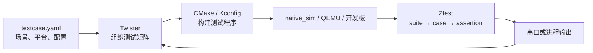

---
tags:
  - embed_note
  - zephyr
date: 2026-10-15
aliases:
  - Ztest
  - Twister
---

# Zephyr Ztest 与 Twister 测试

> 版本基线：Zephyr **4.2.0**。使用 `ZTEST` / `ZTEST_SUITE` API，不使用旧的 `ztest_test_suite()` 写法。
> 前置：[[02-Zephyr-项目结构与构建配置]]、[[04-West-工具]]；涉及线程和同步时参考 [[01-Zephyr-核心API]]。

## 1. Ztest 与 Twister 分别做什么

Zephyr 的测试系统需要分成两层理解：**Ztest 在测试程序内部执行用例；Twister 在开发机上发现、构建、运行测试并收集结果。**



| 名称 | 含义 | 示例 |
| --- | --- | --- |
| Test suite | C 代码中一组相关用例 | `ZTEST_SUITE(sample_window, ...)` |
| Test case | 一个独立的测试函数 | `ZTEST_F(sample_window, test_push)` |
| Assertion | 检查实际结果是否符合预期 | `zassert_equal(actual, expected)` |
| Test scenario | YAML 中一个可构建的测试场景 | `app.sample_window` |
| Test instance | 场景与平台等配置组合出的执行实例 | `app.sample_window` 在 `native_sim` 上执行 |
| Harness | Twister 识别测试输出的方式 | `harness: ztest` |

YAML 中的场景名不必与 C 中的 suite 名相同；一个场景可以编译进多个 suite。Twister 也支持其他 harness，不要求所有测试都使用 Ztest。

## 2. 一个完整的小测试

下面测试一个只保存最近一次采样值的模块，覆盖初始状态、正常写入和非法输入。重点是演示测试如何链接真实业务代码，以及如何在每个用例前重置状态。

### 2.1 目录

```text
my_app/
├── include/
│   └── sample_window.h
├── src/
│   └── sample_window.c
└── tests/
    └── sample_window/
        ├── CMakeLists.txt
        ├── prj.conf
        ├── testcase.yaml
        └── src/
            └── main.c
```

测试目录本身就是一个独立的 Zephyr 应用。它直接编译被测模块，不需要把产品应用的 `main()` 编进来。

### 2.2 被测模块

`include/sample_window.h`：

```c
#ifndef SAMPLE_WINDOW_H_
#define SAMPLE_WINDOW_H_

#include <stdbool.h>

struct sample_window {
    int latest;
    bool valid;
};

int sample_window_push(struct sample_window *window, int value);

#endif
```

`src/sample_window.c`：

```c
#include "sample_window.h"
#include <errno.h>

int sample_window_push(struct sample_window *window, int value)
{
    if (value < 0 || value > 100) {
        return -ERANGE;
    }

    window->latest = value;
    window->valid = true;
    return 0;
}
```

此接口约定调用方传入有效指针；本例只检查值域和状态变化，不增加与测试主题无关的参数兜底。

### 2.3 CMake 与 Kconfig

`tests/sample_window/CMakeLists.txt`：

```cmake
cmake_minimum_required(VERSION 3.20.0)
find_package(Zephyr REQUIRED HINTS $ENV{ZEPHYR_BASE})
project(sample_window_tests)

target_include_directories(app PRIVATE ../../include)
target_sources(app PRIVATE
    src/main.c
    ../../src/sample_window.c
)
```

`tests/sample_window/prj.conf`：

```ini
CONFIG_ZTEST=y
```

Ztest 提供默认入口并自动发现注册的 suite，通常不需要自己写 `main()` 或 `test_main()`。只有确实需要自定义运行逻辑时，才覆盖 `test_main()`，并查阅 `ztest_run_all()` 与 `ztest_verify_all_test_suites_ran()`。

### 2.4 Fixture 与测试用例

`tests/sample_window/src/main.c`：

```c
#include <errno.h>
#include <zephyr/ztest.h>
#include "sample_window.h"

struct sample_window_fixture {
    struct sample_window window;
};

static struct sample_window_fixture context;

static void *sample_window_setup(void)
{
    return &context;
}

static void sample_window_before(void *data)
{
    struct sample_window_fixture *fixture = data;

    fixture->window = (struct sample_window){0};
}

ZTEST_F(sample_window, test_initial_state)
{
    zassert_false(fixture->window.valid, "initial sample must be invalid");
}

ZTEST_F(sample_window, test_push)
{
    int ret = sample_window_push(&fixture->window, 42);

    zassert_ok(ret, "push failed");
    zassert_true(fixture->window.valid, "sample must become valid");
    zassert_equal(fixture->window.latest, 42, "unexpected sample");
}

ZTEST_F(sample_window, test_out_of_range_preserves_state)
{
    zassert_ok(sample_window_push(&fixture->window, 42));

    zassert_equal(sample_window_push(&fixture->window, -1), -ERANGE);
    zassert_equal(sample_window_push(&fixture->window, 101), -ERANGE);
    zassert_true(fixture->window.valid);
    zassert_equal(fixture->window.latest, 42, "rejected input changed state");
}

ZTEST_SUITE(sample_window, NULL, sample_window_setup,
            sample_window_before, NULL, NULL);
```

`ZTEST_F` 自动提供名为 `fixture` 的指针，类型为 `struct <suite名>_fixture *`，所以这里必须定义 `struct sample_window_fixture`。`setup()` 返回的对象要活到整组测试结束，不能返回局部栈变量的地址。

无共享上下文时，可以直接使用 `ZTEST(suite_name, test_name)`，并用 `ZTEST_SUITE(suite_name, NULL, NULL, NULL, NULL, NULL)` 注册。

### 2.5 Twister 描述文件

`tests/sample_window/testcase.yaml`：

```yaml
tests:
  app.sample_window:
    tags:
      - sample_window
    platform_allow:
      - native_sim
    integration_platforms:
      - native_sim
    harness: ztest
```

| 字段 | 作用 |
| --- | --- |
| `tests` 下的键 | 唯一场景标识，通常按领域分层命名 |
| `tags` | 分类，配合 Twister `--tag` 筛选 |
| `platform_allow` | 限制该场景允许使用的平台 |
| `integration_platforms` | 指定 `--integration` 模式使用的平台集合，不等于平台白名单 |
| `harness` | 指定结果解析方式；Ztest 场景可显式填写 `ztest` |

这里将示例固定在 `native_sim`，方便入门。真实项目应按依赖选择平台：使用 `depends_on` 声明硬件能力，使用 `filter` 表达 Kconfig / 设备树等条件；只有确实有平台约束时才设置白名单。

> 本笔记的文件名、字段与命令以 4.2.0 为准。升级项目时，先核对对应版本的 Twister 文档，再调整测试描述文件。

## 3. 如何运行

### 3.1 先运行一个测试应用

下面命令在 **my_app 根目录**执行，并假设 Zephyr 开发环境已经可用：

```sh
west build -p always -b native_sim tests/sample_window -d build/sample_window
west build -d build/sample_window -t run
```

`native_sim` 将测试程序编译成开发机上的原生可执行程序，运行的是 Zephyr 代码；它与只链接少量测试库的 `BOARD=unit_testing` 模式不同。

**`native_sim` 需要 Linux 环境**，Windows 开发机可以在 WSL 的 Zephyr 环境中执行。它不能代替实际外设、电气连接和芯片时序验证。

### 3.2 用 Twister 管理测试

以下命令在 **Zephyr 源码根目录**执行。将路径替换成实际的应用路径；Linux / WSL 中使用对应的 Linux 路径：

```sh
python scripts/twister -T /path/to/my_app/tests -p native_sim --inline-logs
```

| 参数 | 含义 |
| --- | --- |
| `-T <目录>` | 从指定测试树发现测试 |
| `-p <平台>` | 选择平台，可重复指定 |
| `-s app.sample_window` | 只选择指定场景 |
| `--tag sample_window` | 按标签筛选 |
| `--integration` | 使用场景声明的集成平台集合 |
| `--build-only` | 只构建；构建成功不能证明运行行为正确 |
| `--inline-logs` | 在终端显示失败日志，方便定位 |

默认结果写入 `twister-out/`，优先检查：

- `twister.json`：机器可读的场景与用例结果。
- `twister.xml`：JUnit 报告，可供 CI 收集。
- 对应实例目录的 `build.log` 和 `handler.log`：分别定位构建问题和运行输出。

先区分 **没有被选中 / 被过滤、编译失败、运行超时、断言失败**，不要把所有失败都归因于被测函数。

## 4. Suite 生命周期与隔离

```c
ZTEST_SUITE(name, predicate, setup, before, after, teardown);
```

| 回调 | 签名 | 时机与用途 |
| --- | --- | --- |
| `predicate` | `bool predicate(const void *state)` | 根据运行状态决定是否执行 suite；普通测试填 `NULL` |
| `setup` | `void *setup(void)` | 一次 suite 执行开始时调用，返回共享 fixture |
| `before` | `void before(void *fixture)` | 每个用例前调用，建立独立的初始状态 |
| `after` | `void after(void *fixture)` | 每个用例后调用，清理用例资源 |
| `teardown` | `void teardown(void *fixture)` | 一次 suite 执行结束时调用，释放组级资源 |

一次普通 suite 执行的顺序是：

```text
setup → before → case A → after → before → case B → after → teardown
```

不要依赖用例声明顺序，也不要让 case B 读取 case A 留下的状态。`setup()` 只初始化一次不够：共享对象会跨用例保留，因此示例将重置放在 `before()`。

对线程、work、timer 和设备回调，清理必须确保异步活动真正结束，再重置或释放它们访问的数据；仅把某个结构体清零并不能完成隔离。

## 5. 常用断言

| 断言 | 适用情况 |
| --- | --- |
| `zassert_true(condition)` / `zassert_false(condition)` | 布尔条件 |
| `zassert_ok(ret)` | Zephyr 风格的成功返回值 `0` |
| `zassert_equal(actual, expected)` | 整数、枚举等相等比较 |
| `zassert_not_equal(actual, unexpected)` | 不应相等 |
| `zassert_is_null(ptr)` / `zassert_not_null(ptr)` | 空指针判断 |
| `zassert_equal_ptr(actual, expected)` | 地址相等 |
| `zassert_mem_equal(actual, expected, size)` | 指定长度的内存内容相等 |
| `zassert_str_equal(actual, expected)` | 字符串内容相等 |
| `zassert_within(actual, expected, delta)` | 数值在容差范围内 |

这些宏可以带额外的格式化错误消息。断言失败后，当前用例不能继续按正常路径执行；需要每次完成的清理应由生命周期回调负责。

注意三种常见误用：字符串不能靠指针相等判断；包含 padding 的结构体不宜直接比较整块内存；`zassert_ok()` 不适合“正数也表示成功”的接口。

测试条件不满足时可使用 `ztest_test_skip()`，但应先用 YAML 表达已知的平台依赖。跳过是独立结果，不能当作已经通过测试。

## 6. Mock：控制依赖，而不是复制业务逻辑

例如业务函数先调用 `sensor_port_read()` 再处理数据。为了稳定复现“读取成功”和“读取失败”，单元测试可以替换端口函数；真实 I2C / SPI 通信放到集成测试验证。

Zephyr 提供两类常用工具：

| 工具 | 启用与入口 | 适用方式 |
| --- | --- | --- |
| Ztest mock | `CONFIG_ZTEST_MOCKING=y`，`<zephyr/ztest_mock.h>` | 用 `ztest_returns_value()`、`ztest_get_return_value()`、`ztest_expect_value()`、`ztest_check_expected_value()` 配对设置和消费预期 |
| FFF（Fake Function Framework） | `<zephyr/fff.h>` | 用宏生成 fake，设置返回值，检查调用次数、参数及调用历史 |

FFF 的最小使用片段如下，假设真实端口接口是 `int sensor_port_read(int channel)`：

```c
#include <zephyr/fff.h>
#include <zephyr/ztest.h>

DEFINE_FFF_GLOBALS;
FAKE_VALUE_FUNC(int, sensor_port_read, int);
```

每个用例的 `before()` 中重置：

```c
RESET_FAKE(sensor_port_read);
FFF_RESET_HISTORY();
```

用例中先设置依赖行为，再调用真实的业务入口，最后验证结果和必要的交互：

```c
sensor_port_read_fake.return_val = -EIO;
/* 调用依赖 sensor_port_read() 的业务入口，并断言其错误处理结果。 */
/* 调用后可检查 sensor_port_read_fake.call_count、arg0_val。 */
```

这是 Mock 接入片段，不是第二个完整测试应用。FFF 属于 Zephyr 模块依赖，构建环境需要有对应模块；`DEFINE_FFF_GLOBALS` 在同一测试程序中只定义一次。

构建目标应选择真实实现或 fake 实现，避免两者同时定义同一符号。不要为测试复制一份业务算法，也不要为了替换依赖到处添加条件编译；复用已有端口或模块边界即可。

## 7. 异步行为与真实硬件

### 7.1 用同步事件等待结果

不要通过“睡眠 100 ms 后检查全局变量”判断异步函数完成。应由完成回调发信号，再设置有上限的等待：

```c
/* 前提：启动真实异步操作，完成回调对 done 执行 k_sem_give()。 */
zassert_ok(k_sem_take(&done, K_MSEC(500)), "completion timeout");
```

`done` 需要由测试初始化，每个用例清理前一次操作和残留信号；超时后也要停止或等待未结束的操作。这里的 500 ms 是示例等待上限，应按接口的实际时限选择。

### 7.2 把测试放到合适的平台

| 验证目标 | 常用环境 |
| --- | --- |
| 纯数据处理、状态机、错误传播 | `native_sim`，必要时替换外部依赖 |
| 内核对象、线程协作、系统集成 | `native_sim` 或适合该场景的 QEMU 平台 |
| 驱动 API 与模拟外设交互 | 适配的 emulator / 仿真平台 |
| 实际总线、DMA、中断时序、功耗与板级连接 | 目标开发板和实际外设 |

普通单板测试可以直接构建、烧录并观察串口中的 Ztest 结果。Twister 还可以自动烧录、打开串口和解析输出；以下是单设备命令的结构：

```sh
python scripts/twister -T /path/to/my_app/tests/hardware \
  -p <board-target> --device-testing --device-serial <serial-port>
```

将占位符替换为实际板名和串口；烧录依赖相应 runner 配置。Windows 原生终端需要按所用 shell 调整换行写法。第 2 节示例限定了 `native_sim`，不能原样用来执行这条真机命令。

如果测试依赖回环线、传感器或其他外部装置，可在 YAML 声明 `harness_config.fixture`，再通过 Twister 的 fixture 参数或 hardware map 匹配设备。这里的 fixture 是**硬件装置标签**，与 `ZTEST_F` 的 C 上下文对象是两个概念。

## 8. 实践与排查入口

| 现象 | 优先检查 |
| --- | --- |
| Twister 找不到测试 | `-T` 目录、版本对应的 YAML 文件名、`tests:` 层级 |
| 场景被过滤 | `platform_allow`、`depends_on`、`filter` 和平台选择 |
| 单独通过，整组失败 | fixture 重置、fake 历史、线程 / work / timer 清理 |
| 编译通过，运行无用例 | `CONFIG_ZTEST`、测试源文件是否链接、suite 是否注册 |
| 真机执行一直超时 | 烧录结果、串口、输出配置、异步等待和 Twister 超时配置 |
| 模拟器通过，硬件失败 | 真实驱动、设备树、资源限制、并发与时序假设 |

日常先运行相关测试目录和目标平台；CI 再按需要扩展平台与配置组合。测试断言应围绕可观察的接口契约，例如返回值、数据和状态变化；只有交互本身属于契约时，才固定内部调用次数和顺序。

## 9. 资料索引

版本相关内容优先查项目对应 tag 的源码；链接中的 `4.2.0` / `v4.2.0` 与本文基线一致。

| 内容 | 入口 |
| --- | --- |
| Ztest、fixture、Mock、FFF、纯单元测试模式 | [Zephyr 4.2.0 Testing](https://docs.zephyrproject.org/4.2.0/develop/test/ztest.html) |
| Twister YAML、命令、报告、硬件管理 | [Zephyr 4.2.0 Twister](https://docs.zephyrproject.org/4.2.0/develop/test/twister.html) |
| native_sim 环境与限制 | [Zephyr 4.2.0 native_sim](https://docs.zephyrproject.org/4.2.0/boards/native/native_sim/doc/index.html) |
| Ztest 注册与生命周期 API | [ztest_test.h](https://github.com/zephyrproject-rtos/zephyr/blob/v4.2.0/subsys/testsuite/ztest/include/zephyr/ztest_test.h) |
| 断言定义 | [ztest_assert.h](https://github.com/zephyrproject-rtos/zephyr/blob/v4.2.0/subsys/testsuite/ztest/include/zephyr/ztest_assert.h) |
| 测试框架 Kconfig | [ztest/Kconfig](https://github.com/zephyrproject-rtos/zephyr/blob/v4.2.0/subsys/testsuite/ztest/Kconfig) |
| 官方集成测试示例 | [samples/subsys/testsuite/integration](https://github.com/zephyrproject-rtos/zephyr/tree/v4.2.0/samples/subsys/testsuite/integration) |

## 关联笔记

- [[02-Zephyr-项目结构与构建配置]]：CMake、Kconfig 与应用组织。
- [[04-West-工具]]：工作区、构建、烧录与调试。
- [[01-Zephyr-核心API]]：线程、信号量、work 与 timer。
- [[03-Zephyr-设备树与驱动开发]]：真机测试依赖的设备树与驱动。
