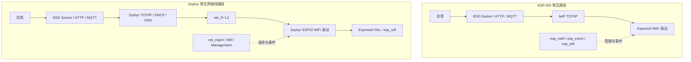

# Zephyr 网络栈与 WiFi 实战

> 面向熟悉 ESP-IDF 的读者：沿着官方示例，把 `esp_netif / esp_event / esp_wifi` 对应到 Zephyr。
> 版本基线：**Zephyr `b9df9f46ae4`（构建日志显示 4.4.99）**，下文源码链接固定到此提交；配置与关键驱动行为已核对，未在开发板编译或实机验证。
> ESP-IDF 侧的完整 API 见 [[04-ESP-IDF-WiFi与网络]]；本文只记录迁移差异。前置：[[02-Zephyr-项目结构与构建配置]]、[[03-Zephyr-设备树与驱动开发]]、[[04-West-工具]]。

## 目录

1. [先对齐 ESP-IDF 与 Zephyr 的分工](#1-先对齐-esp-idf-与-zephyr-的分工)
2. [先跑 ESP32 官方 APSTA 示例](#2-先跑-esp32-官方-apsta-示例)
3. [STA：连接路由器或手机热点](#3-sta连接路由器或手机热点)
4. [SoftAP 与 APSTA](#4-softap-与-apsta)
5. [事件与重连](#5-事件与重连)
6. [DNS、Socket 与应用协议](#6-dnssocket-与应用协议)
7. [用 Shell 分层验证](#7-用-shell-分层验证)
8. [真实示例与源码索引](#8-真实示例与源码索引)

## 1. 先对齐 ESP-IDF 与 Zephyr 的分工

### 1.1 同一颗 ESP32，TCP/IP 栈换了

ESP-IDF 常见路径是 `esp_netif + lwIP + Espressif WiFi 驱动`。本文采用 **Zephyr 原生网络栈**：IP、TCP/UDP、DHCP、DNS 由 Zephyr 提供，底层 ESP32 WiFi 驱动仍通过 Espressif HAL 调用 `esp_wifi_*`。



`hal_espressif` 提供底层依赖，不代表应用层继续使用 ESP-IDF 的 `esp_netif`、默认事件循环和 lwIP。其他平台还可能采用 IP / Socket offload，其协议栈位置与功能范围需另查驱动。

### 1.2 概念与 API 对照

以下是职责对照，生命周期不完全相同，不能机械地逐行替换。

| 熟悉的 ESP-IDF 用法 | Zephyr 中对应的入口 | 迁移时关注什么 |
| --- | --- | --- |
| `esp_netif_t *` | `struct net_if *` | 都围绕网络接口管理地址与状态 |
| `esp_netif_create_default_wifi_sta/ap()` | `net_if_get_wifi_sta/sap()` | Zephyr 此处取得已注册接口，不是创建接口 |
| `esp_netif_init()`、`esp_wifi_init()` | 启动阶段的网络子系统与设备驱动初始化 | 由 Kconfig、设备树、驱动注册决定；应用通常不手动重做 |
| `esp_event_handler_register()` | `net_mgmt_init_event_callback()` + `net_mgmt_add_event_callback()` | 回调注册对象要有足够长的存储期 |
| `esp_wifi_set_mode(WIFI_MODE_APSTA)` | `CONFIG_WIFI_USAGE_MODE_STA_AP` + 驱动并发支持 | 使用意图在编译期配置，运行时请求开启 AP、连接 STA |
| `esp_wifi_set_config()` + `esp_wifi_connect()` | `wifi_connect_req_params` + `NET_REQUEST_WIFI_CONNECT` | SSID、口令随请求传入，使用指针和显式长度 |
| `esp_wifi_disconnect()` | `NET_REQUEST_WIFI_DISCONNECT` | 检查请求返回值和异步结果 |
| `esp_wifi_scan_start()` | `NET_REQUEST_WIFI_SCAN` | 扫描结果逐条通知，最后有扫描完成事件 |
| `esp_wifi_sta_get_ap_info()` | `NET_REQUEST_WIFI_IFACE_STATUS` | 输出 `wifi_iface_status`，可查看 RSSI、信道等 |
| `esp_netif_dhcpc_start/stop()` | `net_dhcpv4_start/stop()` | 先确定由应用还是驱动负责 DHCP |
| `esp_netif_dhcps_start/stop()` | `net_dhcpv4_server_start/stop()` | AP 静态地址和租约池需明确配置 |
| `esp_netif_set_ip_info()` | `net_if_ipv4_addr_add()`、设置掩码与网关的接口 API | 地址、掩码、路由分开管理 |
| `socket/connect/send/recv` | `zsock_socket/connect/send/recv` 或启用 POSIX Socket 接口 | BSD 通信模型可沿用；可用选项以实现为准 |
| NVS 保存网络配置 | WiFi Credentials + Settings / PSA 等后端 | 连接请求本身不等于保存凭据 |

`net_if_up()` 管理的是接口 **admin up** 状态，不能直接当成 `esp_wifi_start()`。接口允许工作、WiFi 已关联、已有 IP、业务可达，是不同状态。

## 2. 先跑 ESP32 官方 APSTA 示例

### 2.1 阅读入口

从 `samples/net/wifi/apsta_mode/` 开始：

| 文件 | 看什么 |
| --- | --- |
| `README.rst` | 示例目标、支持板卡、运行方式；默认值仍需核对实际配置 |
| `Kconfig` | `CONFIG_WIFI_SAMPLE_*` 的定义，这些是示例专用选项 |
| `prj.conf` | 通用网络、APSTA、DHCP Client / Server 配置 |
| `socs/esp32_procpu.conf` | ESP32 示例的热点名、口令、AP 地址 |
| `src/main.c` | 接口获取、AP 开启、STA 连接、事件处理 |

你当前版本的 ESP32 配置由构建系统自动合并，日志中可以看到：

```text
Merged configuration '.../apsta_mode/prj.conf'
Merged configuration '.../apsta_mode/socs/esp32_procpu.conf'
```

### 2.2 配置路由器与开发板热点

在示例的 `socs/esp32_procpu.conf` 中修改已有配置：

```ini
CONFIG_WIFI_SAMPLE_SSID="MyRouter"
CONFIG_WIFI_SAMPLE_PSK="router-pass123"
CONFIG_WIFI_SAMPLE_AP_SSID="Zephyr-ESP32"
CONFIG_WIFI_SAMPLE_AP_PSK="local-pass123"
CONFIG_WIFI_SAMPLE_DHCPV4_START=y
CONFIG_WIFI_SAMPLE_AP_IP_ADDRESS="192.168.4.1"
CONFIG_WIFI_SAMPLE_AP_NETMASK="255.255.255.0"
```

STA 目标也可以是手机热点，先用 2.4 GHz、WPA2。AP 子网要避开上游子网；上游也是 `192.168.4.0/24` 时，另选不冲突的私网子网。

当前官方 ESP32 配置的 AP 口令默认为空，会开启开放热点；上面显式改为 WPA2 口令。`CONFIG_WIFI_SAMPLE_*` 只在这个示例的 Kconfig 中定义，自己的应用需要自己的配置入口。编译期凭据会进入固件，实验用真实口令不要提交到共享仓库。

### 2.3 构建依赖与板卡名称

从 `zephyr/` 源码根目录执行，先激活已有 Python 虚拟环境：

```sh
west update hal_espressif
west blobs fetch hal_espressif
west build -p always -b esp32_devkitc/esp32/procpu samples/net/wifi/apsta_mode
west flash
west espressif monitor
```

`west update hal_espressif` 同步当前 manifest 指定的 HAL 源码；`west blobs fetch` 下载 WiFi 等功能所需的预编译库。其他依赖也需按 West 工作区正常初始化，基础流程见 [[04-West-工具]]。

已在 `apsta_mode/` 目录时，构建命令省略最后的应用路径：

```sh
west build -p always -b esp32_devkitc/esp32/procpu
```

| 错误 | 原因与处理 |
| --- | --- |
| `Board qualifiers ... not found` | 目标名称不完整；本板使用 `esp32_devkitc/esp32/procpu` |
| `Assertion failed: ESP_IDF_PATH is not set` | 板级 CMake 从 `ZEPHYR_HAL_ESPRESSIF_MODULE_DIR` 设置路径，但模块未被识别；先同步 HAL，再排查模块筛选 |
| 后续找不到 WiFi 二进制库 | 检查 `west blobs fetch hal_espressif` 是否成功 |

`procpu` 是 ESP32 主核，`appcpu` 是第二核，和 WiFi 的 AP / STA 角色无关。

此版本的 `boards/common/esp32.board.cmake` 明确从 West 模块取得 `ESP_IDF_PATH`，无需手工指向另一套 ESP-IDF。若同步 HAL 后仍报同一错误，在工作区检查：

```sh
west list hal_espressif
ls /home/jasper/zephyrproject/modules/hal/espressif/zephyr/module.yml
west config manifest.group-filter
printenv ZEPHYR_MODULES
```

最后两项无输出本身不代表异常。有自定义模块列表或筛选时，还要检查是否把 HAL 排除了。

## 3. STA：连接路由器或手机热点

### 3.1 用 ESP-IDF 时序理解 Zephyr

| 阶段 | ESP-IDF 常见写法 | 当前 Zephyr ESP32 路径 |
| --- | --- | --- |
| 驱动与接口准备 | 初始化 NVS、esp_netif、事件循环、WiFi，创建 STA 接口 | 系统启动阶段初始化网络与驱动；应用获取 STA 接口 |
| 订阅状态 | 注册 `WIFI_EVENT`、`IP_EVENT` | 分别注册 WiFi 与 IPv4 的 `net_mgmt` 回调 |
| 发起连接 | 设置 STA 配置，启动后调用 `esp_wifi_connect()` | 将 `wifi_connect_req_params` 交给 `NET_REQUEST_WIFI_CONNECT` |
| 地址获取 | 默认 STA netif 通常自动运行 DHCP Client | 当前 ESP32 驱动支持 `CONFIG_WIFI_STA_AUTO_DHCPV4` |
| 启动业务 | 收到 `IP_EVENT_STA_GOT_IP` 后处理业务 | 确认目标接口 IP 就绪，再建立 DNS / TCP / TLS 会话 |

应用的核心请求只有这一类调用，完整上下文直接读官方 `connect_to_wifi()`：

```c
int ret = net_mgmt(NET_REQUEST_WIFI_CONNECT, sta_iface,
                   &sta_config, sizeof(sta_config));
```

`ret < 0` 表示同步请求失败；请求返回 `0` 后，还需要检查 `NET_EVENT_WIFI_CONNECT_RESULT` 的载荷。`NET_REQUEST_WIFI_DISCONNECT` 则用 `NULL, 0` 作为数据和长度。

### 3.2 参数结构的差异

| ESP-IDF `wifi_config_t.sta` | Zephyr `wifi_connect_req_params` | 注意 |
| --- | --- | --- |
| `ssid[]` | `ssid` + `ssid_length` | 指针和字节长度，长度不含终止符 |
| `password[]` | `psk` + `psk_length` | WPA2 普通口令使用 8～63 字符 |
| `threshold.authmode` 等安全策略 | `security` | `WIFI_SECURITY_TYPE_PSK` 表示 WPA2-PSK；与最低认证门槛的语义不同 |
| `pmf_cfg` | `mfp` | 按安全模式和驱动能力配置 |
| `channel = 0` | `WIFI_CHANNEL_ANY` | STA 通常不固定信道 |
| 按芯片能力选择频段 | `band` | 本例为 `WIFI_FREQ_BAND_2_4_GHZ` |

官方 APSTA 示例的 STA 路径固定使用 WPA2-PSK。连接开放热点需要同步修改 `connect_to_wifi()` 的安全类型，不能只清空口令。产品中的配置结构与凭据生命周期应集中管理。

### 3.3 DHCP 与连接事件的时机

熟悉 ESP-IDF 时，容易预期 `STA_CONNECTED → DHCP → GOT_IP`。在当前 Zephyr ESP32 驱动中，开启 `CONFIG_WIFI_STA_AUTO_DHCPV4` 后，实际关键路径是：

```text
NET_REQUEST_WIFI_CONNECT
  → ESP32 驱动完成 WiFi 关联
  → 驱动调用 net_dhcpv4_start()
  → NET_EVENT_IPV4_DHCP_BOUND
  → 驱动上报 NET_EVENT_WIFI_CONNECT_RESULT 成功
```

因此，**不能在等到连接成功事件后才启动 DHCP**，否则在这个驱动配置下可能建立循环等待。业务使用 IPv4 时，独立关注目标 STA 接口的地址状态；使用静态地址时，DHCP bound 不是适合的就绪条件。

| 谁负责 DHCP | 配置 / 调用 |
| --- | --- |
| 当前 ESP32 驱动自动管理 | `CONFIG_NET_DHCPV4=y`，`CONFIG_WIFI_STA_AUTO_DHCPV4=y`；避免应用重复启动 |
| 应用自己管理 | 关闭 `CONFIG_WIFI_STA_AUTO_DHCPV4`，由应用在合适的接口生命周期调用 `net_dhcpv4_start/stop()`，或配置静态地址 |

旧版 4.2.0 的 ESP32 专用开关叫 `CONFIG_ESP32_WIFI_STA_AUTO_DHCPV4`；当前提交已改用通用名称。不要混用两个版本的配置。

## 4. SoftAP 与 APSTA

### 4.1 对照默认 AP netif 的行为

ESP-IDF 的 `esp_netif_create_default_wifi_ap()` 提供默认 AP 网络接口与 DHCP Server 配置。在 Zephyr 官方示例中，要把这些职责分开看：

| 目的 | Zephyr 官方示例入口 |
| --- | --- |
| 获取 AP 接口 | `net_if_get_wifi_sap()` |
| 设置 AP 静态 IPv4 | `enable_dhcpv4_server()` 内的 `net_if_ipv4_addr_add()` 与掩码设置 |
| 配置租约池并启动 DHCP Server | `net_dhcpv4_server_start()` |
| 设置 SSID、口令、频段并开启 AP | `enable_ap_mode()` → `NET_REQUEST_WIFI_AP_ENABLE` |
| 观察手机加入 / 离开 | `NET_EVENT_WIFI_AP_STA_CONNECTED / DISCONNECTED` |
| 让手机访问网页 | 另行启动 HTTP 服务，AP 开启本身没有 Web 页面 |

该提交的示例在 `CONFIG_WIFI_SAMPLE_DHCPV4_START=y` 时，**先配置地址和 DHCP Server，再发 AP 开启请求**；这是当前示例的实际流程。它还将池起点设为 AP 地址最后一字节加 10，读取完整实现时留意这个地址规划约定。

示例里的网关设置是接口配置，不会自动建立上游转发。手机连上 AP、拿到地址和能访问互联网，是三件事。仅提供本地配置服务时，可按需求关闭 `CONFIG_NET_DHCPV4_SERVER_OPTION_ROUTER`，避免宣告默认路由。

### 4.2 ESP32 的并发配置

ESP-IDF 中熟悉的 `WIFI_MODE_APSTA`，在这个 Zephyr 示例中由以下配置组合表达：

```ini
CONFIG_WIFI=y
CONFIG_WIFI_NM=y
CONFIG_WIFI_USAGE_MODE_STA_AP=y
CONFIG_NET_DHCPV4=y
CONFIG_NET_DHCPV4_SERVER=y
CONFIG_NET_IF_MAX_IPV4_COUNT=2
```

这是官方 `prj.conf` 中的关键部分，不是完整可移植配置。在当前 ESP32 驱动 Kconfig 中，`WIFI_USAGE_MODE_STA_AP` 使 `CONFIG_ESP32_WIFI_AP_STA_MODE` 默认启用；WiFi Network Manager 的管理接口数也相应默认为 2。

**当前版本由 ESP32 驱动注册第二张 AP 接口，不需要复制旧 4.2.0 示例的 `socs/esp32_procpu.overlay`。** 对照 `esp_wifi_drv.c` 末尾的 `NET_DEVICE_DT_INST_ADD_IFACE` 与接口角色注册即可。

并发时继续沿用 ESP32 的单射频约束：STA 与 AP 不能视为两套完全独立的射频；信道行为由驱动决定。AP 与上游子网不能冲突；APSTA 不会自动实现桥接、NAT、DNS 转发或配网页面。

关闭 AP 的职责顺序：停止本地业务 → 停 DHCP Server → 请求 `NET_REQUEST_WIFI_AP_DISABLE` → 确认结果 → 按需要移除静态地址。STA 与 AP 的地址和业务状态分别管理。

## 5. 事件与重连

### 5.1 事件映射

| ESP-IDF 常见事件 | Zephyr 观察点 | 差异 |
| --- | --- | --- |
| `WIFI_EVENT_STA_START` | 接口与驱动状态、连接请求 | 应用通常不用复刻“等 STA_START 再调用 esp_wifi_connect”的模板 |
| `WIFI_EVENT_STA_CONNECTED` | `NET_EVENT_WIFI_CONNECT_RESULT` | 当前 ESP32 自动 DHCP 路径会推迟到 DHCP bound，不能视作完全等价的关联事件 |
| `WIFI_EVENT_STA_DISCONNECTED` | `NET_EVENT_WIFI_DISCONNECT_RESULT` | 检查载荷、接口与主动断开意图 |
| `IP_EVENT_STA_GOT_IP` | `NET_EVENT_IPV4_DHCP_BOUND`，或地址 / 连通状态监测 | DHCP bound 是租约事件；静态地址走另一条路径 |
| `WIFI_EVENT_AP_START/STOP` | `NET_EVENT_WIFI_AP_ENABLE_RESULT / DISABLE_RESULT` | 结果事件要检查成功状态 |
| `WIFI_EVENT_AP_STACONNECTED / STADISCONNECTED` | `NET_EVENT_WIFI_AP_STA_CONNECTED / DISCONNECTED` | 载荷为 `wifi_ap_sta_info`，加入 AP 不等于已取得租约 |

读官方 `wifi_event_handler()` 时要注意：这个演示直接打印了“Connected”，没有判断连接结果载荷。实际应用应检查 `cb->info` 中 `struct wifi_status` 的 `conn_status`；AP 结果检查对应的 `ap_status`，不要把收到结果事件直接当成成功。

### 5.2 从 ESP-IDF 回调迁移时的约束

- WiFi 与 IPv4 属于不同事件层 / layer code，分别使用 `net_mgmt_event_callback` 注册；不要把两组事件混在同一掩码里。
- 当前回调事件参数为 `uint64_t`；处理时精确比较事件值和目标 `iface`，避免掩码过滤误匹配。
- 读取载荷需启用 `CONFIG_NET_MGMT_EVENT_INFO`，并按事件检查指针、长度与结构类型；数据需要跨回调使用时先复制。
- 回调只做短任务：更新状态、发信号、投递工作。阻塞 DNS/TCP、长时间等待放到应用线程。

### 5.3 Connection Manager 放在哪里

| 机制 | 职责 |
| --- | --- |
| `net_mgmt` | 请求与事件通道，近似从 `esp_event` 角度理解入口，但还承担管理请求 |
| WiFi Network Manager | 选择 WiFi 管理实现、管理接口角色 |
| Connection Manager | 跨接口监测 IP 就绪；对已绑定连接实现的接口提供统一连接控制 |

`NET_EVENT_L4_CONNECTED` 表示监测范围内有接口满足 admin up、oper up 且有 IP，**没有执行公网、DNS 或业务服务器探测**。注册监测回调后，可用 `conn_mgr_mon_resend_status()` 补发当前状态。

AP 仅用于本地配置时，用 `conn_mgr_ignore_iface(ap_iface)` 排除它，避免把 AP 自身有地址误当成上游就绪。相关头文件为 `<zephyr/net/conn_mgr_monitor.h>`。使用 `conn_mgr_if_connect()` 前还需确认接口绑定了连接控制实现。

### 5.4 重连与持久化各有一个负责人

ESP32 驱动有 `CONFIG_ESP32_WIFI_STA_RECONNECT`；Connection Manager 的连接实现也可能管理重连。应用自己做时，要区分主动断开与意外断线，设置退避和退出条件。三者选定一处负责，避免重复发连接请求。

链路 / IP 失效后，业务关闭旧连接；恢复后重新建立 TCP/TLS/MQTT 会话。WiFi 恢复不保证旧 Socket 可继续使用。

WiFi Credentials 管理凭据，Settings / PSA 等后端负责持久化，自动重连负责连接策略；这些职责不能合并为“连接一次就自动保存并长期重连”。

## 6. DNS、Socket 与应用协议

这部分最接近 ESP-IDF：熟悉的 BSD Socket 调用顺序、TCP 字节流、UDP 数据报、短读短写与 `errno` 处理仍适用。

| ESP-IDF 常用入口 | Zephyr 原生入口 |
| --- | --- |
| `getaddrinfo / freeaddrinfo` | `zsock_getaddrinfo / zsock_freeaddrinfo` |
| `socket / close` | `zsock_socket / zsock_close` |
| `connect / send / recv` | `zsock_connect / zsock_send / zsock_recv` |
| `bind / listen / accept` | `zsock_bind / zsock_listen / zsock_accept` |
| `sendto / recvfrom / poll` | `zsock_sendto / zsock_recvfrom / zsock_poll` |

`zsock_*` 公共入口在 `<zephyr/net/socket.h>`；要沿用无前缀的 POSIX 名称，参考目标版本的 POSIX 配置与官方 Socket 示例，不必为了去掉前缀启用全部 POSIX 功能。

在已有网络与 DHCP 配置上，按业务增加：

```ini
CONFIG_NET_SOCKETS=y
CONFIG_NET_TCP=y
CONFIG_DNS_RESOLVER=y
CONFIG_NET_DHCPV4_OPTION_DNS_ADDRESS=y
```

DHCP Server 需要提供 DNS 地址；静态地址场景单独配置 DNS。先看 `sockets/echo` 的 TCP 服务端，再看 `sockets/http_get` 的域名解析与出站连接，具体文件见第 8 节。

ESP-IDF 的 `esp_http_client`、`esp_mqtt_client` 不能作为 Zephyr 的通用应用 API 直接套用。应用协议改用 Zephyr HTTP / MQTT 库或合适的可移植库，Socket 层保持统一。

HTTPS / MQTTS 可使用 TLS Socket：`CONFIG_NET_SOCKETS_SOCKOPT_TLS`、凭据与加密后端，配置 CA 对应的 `TLS_SEC_TAG_LIST`、`TLS_HOSTNAME` 和证书验证；证书有效期检查还需要正确系统时间。完整组合参照官方 HTTP Client / MQTT 示例。

## 7. 用 Shell 分层验证

### 7.1 先独立验证硬件与接入

从 `zephyr/` 根目录，单独构建 Shell 示例：

```sh
west build -p always -d build/wifi-shell -b esp32_devkitc/esp32/procpu samples/net/wifi/shell
west flash -d build/wifi-shell
west espressif monitor -d build/wifi-shell
```

在**开发板 Shell** 执行；多接口时先确认命令针对的 STA 接口，具体参数用 `wifi connect -h` 查看：

```text
net iface
wifi scan
wifi connect -s "MyHotspot" -p "example-pass123" -k 1 -b 2
wifi status
net iface
```

`-k 1` 表示 WPA2-PSK，`-b 2` 表示 2.4 GHz。确认已有 IPv4 后，用真实网关或同网段电脑测试：

```text
net ping 192.168.1.1
net dns example.com
wifi disconnect
```

DNS 命令需启用解析器。若明确选择由应用手动管理 DHCP，先检查接口编号，再用 `net dhcpv4 client start <接口编号>`；自动 DHCP 模式下无需重复启动。

### 7.2 按 ESP-IDF 熟悉的层次定位

| 现象 | 优先检查 |
| --- | --- |
| 构建阶段缺 HAL / blobs | 第 2 节的 West 依赖、模块发现 |
| 无 WiFi 接口 / 设备未就绪 | 驱动、设备树、固件和内存配置 |
| 请求返回 `-ENOTSUP` / `-EINVAL` | 驱动能力、使用模式、SSID / 密码长度、安全模式与信道 |
| 扫描不到手机热点 | 频段、热点开关、信道与法规限制 |
| 扫描得到但连接失败 | 结果载荷、口令、WPA2/WPA3、PMF 与接入限制 |
| 一直等“Connected” | 当前 ESP32 自动 DHCP 路径还要检查 DHCP 与上游地址池 |
| AP 可见，手机一直获取 IP | AP 静态地址、DHCP Server、租约池和接口选择 |
| 手机连 AP 提示无互联网 | 先验证本地地址与服务；共享互联网需要额外的路由 / NAT 设计 |
| IP 直连成功，域名失败 | DNS 配置、解析器和 DNS Server 可达性 |
| APSTA 业务走错出口 | 上下游子网冲突、默认路由、业务绑定的本地地址 / 接口 |

联调顺序：**驱动 → 扫描 / 关联 → IP → 同网段通信 → 路由 / DNS → TCP/TLS → 业务协议**。每次定位一层，再根据测量调整缓冲区和线程栈。

## 8. 真实示例与源码索引

### 8.1 推荐阅读顺序

以下路径相对 `samples/net/`，链接固定到本文提交：

| 顺序 | 示例与入口 | 学习目标 |
| --- | --- | --- |
| 1 | [wifi/apsta_mode/src/main.c](https://github.com/zephyrproject-rtos/zephyr/blob/b9df9f46ae4/samples/net/wifi/apsta_mode/src/main.c) | STA/AP 参数、接口、事件、DHCP Server；对照 `esp_wifi` 与 `esp_netif` |
| 2 | [dhcpv4_client](https://github.com/zephyrproject-rtos/zephyr/tree/b9df9f46ae4/samples/net/dhcpv4_client) | 独立看 DHCP 与 IP，不被 WiFi 模式切换干扰 |
| 3 | [sockets/echo/src/socket_echo.c](https://github.com/zephyrproject-rtos/zephyr/blob/b9df9f46ae4/samples/net/sockets/echo/src/socket_echo.c) | 最小阻塞 TCP Server；示例默认演示地址需按实际网络调整 |
| 4 | [sockets/http_get/src/http_get.c](https://github.com/zephyrproject-rtos/zephyr/blob/b9df9f46ae4/samples/net/sockets/http_get/src/http_get.c) | DNS、TCP 与 HTTP 请求 |
| 5 | [mqtt_publisher](https://github.com/zephyrproject-rtos/zephyr/tree/b9df9f46ae4/samples/net/mqtt_publisher) | MQTT 会话与应用协议生命周期 |
| 并行调试 | [wifi/shell/src/wifi_test.c](https://github.com/zephyrproject-rtos/zephyr/blob/b9df9f46ae4/samples/net/wifi/shell/src/wifi_test.c) | Shell 初始化；命令实现位于下方 `wifi_shell.c` |

`apsta_mode` 阅读顺序：`Kconfig → prj.conf → socs/esp32_procpu.conf → main()`，再沿 `enable_ap_mode()`、`enable_dhcpv4_server()`、`connect_to_wifi()` 和 `wifi_event_handler()` 跳转。这里不复制整份实现，后续直接核对对应提交。

### 8.2 继续追底层时看这些

| 问题 | 唯一实现 / 定义入口 |
| --- | --- |
| 示例参数和默认值 | [示例目录](https://github.com/zephyrproject-rtos/zephyr/tree/b9df9f46ae4/samples/net/wifi/apsta_mode) 中的 `Kconfig`、`prj.conf` 与 `socs/esp32_procpu.conf` |
| 请求、参数、事件载荷 | [wifi_mgmt.h](https://github.com/zephyrproject-rtos/zephyr/blob/b9df9f46ae4/include/zephyr/net/wifi_mgmt.h)、[wifi.h](https://github.com/zephyrproject-rtos/zephyr/blob/b9df9f46ae4/include/zephyr/net/wifi.h) |
| ESP32 如何调用 esp_wifi、转发事件、启动 DHCP、注册接口 | [esp_wifi_drv.c](https://github.com/zephyrproject-rtos/zephyr/blob/b9df9f46ae4/drivers/wifi/esp32/src/esp_wifi_drv.c) |
| ESP32 并发与自动重连开关 | [Kconfig.esp32](https://github.com/zephyrproject-rtos/zephyr/blob/b9df9f46ae4/drivers/wifi/esp32/Kconfig.esp32) |
| 通用自动 DHCP 与 WiFi NM 配置 | [WiFi Kconfig](https://github.com/zephyrproject-rtos/zephyr/blob/b9df9f46ae4/subsys/net/l2/wifi/Kconfig) |
| Shell 命令最终如何发管理请求 | [wifi_shell.c](https://github.com/zephyrproject-rtos/zephyr/blob/b9df9f46ae4/subsys/net/l2/wifi/wifi_shell.c) |
| 网络接口、地址与状态 API | [net_if.h](https://github.com/zephyrproject-rtos/zephyr/blob/b9df9f46ae4/include/zephyr/net/net_if.h) |
| 通用事件回调 | [net_mgmt.h](https://github.com/zephyrproject-rtos/zephyr/blob/b9df9f46ae4/include/zephyr/net/net_mgmt.h) |
| DHCP Server | [dhcpv4_server.h](https://github.com/zephyrproject-rtos/zephyr/blob/b9df9f46ae4/include/zephyr/net/dhcpv4_server.h) |
| Socket / TLS 配置与完整应用 | [socket.h](https://github.com/zephyrproject-rtos/zephyr/blob/b9df9f46ae4/include/zephyr/net/socket.h)、[HTTP Client](https://github.com/zephyrproject-rtos/zephyr/tree/b9df9f46ae4/samples/net/sockets/http_client) |
| IP 连通状态监测 | [conn_mgr_monitor.h](https://github.com/zephyrproject-rtos/zephyr/blob/b9df9f46ae4/include/zephyr/net/conn_mgr_monitor.h) |
| ESP_IDF_PATH 来源 | [esp32.board.cmake](https://github.com/zephyrproject-rtos/zephyr/blob/b9df9f46ae4/boards/common/esp32.board.cmake) |

升级 Zephyr 时，先对照目标提交的示例、Kconfig 和 ESP32 驱动，再调整应用配置；开发版的版本字符串 `4.4.99` 本身不能唯一标识这些行为。
