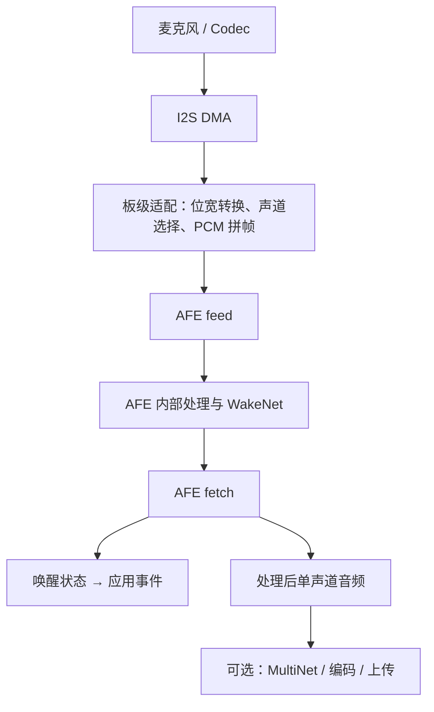

# ESP-SR：架构 → API → 最小唤醒模板

> ESP-SR 是乐鑫的本地语音处理框架；WakeNet 是其中的唤醒词检测引擎。典型用法是把 PCM 音频送入 AFE，再从 AFE 的输出中取得唤醒事件。
>
> 本文按 ESP-SR 2.x 的 AFE API 编写，核对时官方仓库组件清单为 **2.6.0**，要求 ESP-IDF ≥ 5.0。最小模板以 **ESP32-S3 + ESP-IDF 5.4 + 单路标准 I2S 麦克风**为目标。代码已对照官方接口整理，未进行实际工程编译和上板验证。[1][2]

## 1. 架构：声音怎样变成唤醒事件

### 1.1 三个核心部分

| 部分 | 输入 / 输出 | 作用 |
|---|---|---|
| AFE（Audio Front End） | 多通道 PCM → 处理后音频与检测状态 | 整合音频前处理及 WakeNet |
| WakeNet | 音频 → 唤醒状态 | 判断是否说出了模型支持的唤醒词 |
| MultiNet | AFE 输出的单声道音频 → 预设命令结果 | 唤醒后识别“打开灯”等离线命令 |

WakeNet 的结果不是完整转写文本；MultiNet 识别的是配置好的命令集合。只做“喊一声就触发”时，先接通 AFE + WakeNet 即可。[2][3][4]



图中表示应用数据流，不承诺 AFE 内部算法的固定排列。实际组合随目标芯片、输入通道和配置变化，可以用 `print_pipeline()` 查看当前实例的处理链。[5]

### 1.2 AFE 中的算法各解决什么问题

| 名称 | 解决的问题 | 接入条件 |
|---|---|---|
| AEC：回声消除 | 扬声器播放的声音被麦克风重新收进去 | 输入真实播放参考音频，并关注与采集音频的时序 |
| NS：降噪 | 风扇等环境噪声干扰 | 按所用算法 / 模型配置 |
| SE / BSS：阵列处理 | 多麦克风场景中的干扰与声源分离 | 需要对应多麦克风输入 |
| VAD：语音活动检测 | 判断当前是否有人说话 | 输出语音 / 非语音状态 |
| AGC：自动增益 | 音量偏弱或变化较大 | 按场景配置增益处理 |
| WakeNet | 判断指定唤醒词是否出现 | 选择并烧录对应模型 |

这些能力来自官方 AFE，但不会在所有输入格式下全部启用。[2][6]

### 1.3 两个任务：持续输入，持续取结果


官方示例分别创建 feed 与 fetch 任务。[2] 本笔记沿用这个结构：

- `feed_task` 只负责采集、转换和提交音频。
- `fetch_task` 只负责及时取结果、判断状态。
- 耗时业务通过队列交给其他任务，避免阻塞音频处理。

运行期间两者共享同一个 AFE 实例。若需要停止，应先让两个任务退出并确认不再访问实例，再销毁 AFE 和模型；不能由某个任务自行销毁仍被另一任务使用的对象。

### 1.4 音频格式：最容易接错的边界

本笔记使用的 `AFE_TYPE_SR` 输入要求：**16 kHz、signed 16-bit PCM、按通道交织**。[2][5]

`input_format` 描述送给 AFE 的内存数据：

| 字符 / 配置 | 含义 |
|---|---|
| `M` | 麦克风 |
| `R` | 播放参考 |
| `N` | 不使用的通道 |
| `"M"` | 一个麦克风通道 |
| `"MR"` | 一个麦克风 + 一个播放参考 |
| `"MMNR"` | 两个麦克风 + 一个不用的通道 + 一个播放参考 |

例如 `"MR"` 对应：`M0, R0, M1, R1, M2, R2, ...`。[2]

**I2S 的左右槽与 AFE 的逻辑通道是两个概念。** 模板只读取 I2S 左槽，转换成单声道 PCM，再以 `"M"` 输入 AFE。若直接读取左右槽交织数据，就必须先选出麦克风槽，或构造与输入配置匹配的缓冲区。

帧长与字节数的换算：

```text
N = get_feed_chunksize()        // 每个通道的采样点数
C = get_feed_channel_num()      // 输入逻辑通道数
一帧输入字节数 = N × C × sizeof(int16_t)
一帧时长 = N / 16000 秒
```

不要写死帧长，也不要把 API 返回的采样点数当成字节数。[5]

## 2. API：按生命周期理解调用顺序

### 2.1 模型、配置、接口表、实例

| 对象 | 类型 | 可以怎样理解 |
|---|---|---|
| `models` | `srmodel_list_t *` | Flash 中可用的模型列表 |
| `config` | `afe_config_t *` | 创建实例时使用的配置 |
| `afe` | `const esp_afe_sr_iface_t *` | 函数指针表，提供操作入口 |
| `data` | `esp_afe_sr_data_t *` | 某个 AFE 实例的运行状态 |

因此常见调用是 `afe->feed(data, pcm)`：通过接口表操作实例。相关定义见官方头文件。[5][6][7][8]

```text
esp_srmodel_init("model")
    ↓
afe_config_init("M", models, AFE_TYPE_SR, AFE_MODE_HIGH_PERF)
    ↓
设置 / 检查配置
    ↓
esp_afe_handle_from_config(config)
    ↓
afe->create_from_config(config)
    ↓
afe_config_free(config)
    ↓
循环 feed / fetch
    ↓
停止任务 → afe->destroy(data) → esp_srmodel_deinit(models)
```

创建成功后可以释放配置对象，官方示例也是这样处理；不要因此同时释放仍在使用的模型。[2]

### 2.2 初始化 API

| API | 用途 |
|---|---|
| `esp_srmodel_init("model")` | 从模型分区初始化模型列表 |
| `esp_srmodel_filter(models, "wn", NULL)` | 找出第一个名称包含 `wn` 的模型；找不到返回 `NULL` |
| `afe_config_init(...)` | 根据输入格式及模式生成配置 |
| `esp_afe_handle_from_config(config)` | 获取匹配的 AFE 接口表 |
| `afe->create_from_config(config)` | 创建运行实例 |
| `afe_config_free(config)` | 释放配置对象 |

只选择一个 WakeNet 模型时，可用 `filter()` 的结果配置 `wakenet_model_name`。若选了多个，应该明确指定模型，而不是依赖列表中的第一个。[6][7][8]

> 字段名以头文件为准：当前接口是 **`wakenet_init`**，不是某些旧说明里的 `wakeNet_init`。[6]

### 2.3 输入与输出 API

| API | 用途 / 注意点 |
|---|---|
| `get_feed_chunksize(data)` | 查询每通道输入采样点数 |
| `get_feed_channel_num(data)` | 查询输入通道数 |
| `feed(data, pcm)` | 输入一整帧，PCM 的排列必须匹配配置 |
| `get_fetch_chunksize(data)` | 查询处理后输出帧的采样点数 |
| `fetch(data)` | 获取输出，默认等待超时为 2000 ms |
| `fetch_with_delay(data, ticks)` | 指定等待时长，单位是 FreeRTOS tick |

例如 `fetch_with_delay(data, pdMS_TO_TICKS(100))`；这里与 I2S 的 `i2s_channel_read(..., timeout_ms)` 不同，后者超时参数的单位是毫秒。[5][9]

主要结果字段：[5]

| 字段 | 意义 |
|---|---|
| `ret_value` | 本次获取状态，先检查失败再处理数据 |
| `wakeup_state` | 唤醒检测状态 |
| `wake_word_index` | 唤醒词索引，从 1 开始 |
| `vad_state` | 语音活动状态 |
| `data` / `data_size` | 输出音频指针 / 字节数 |
| `vad_cache` / `vad_cache_size` | 补回语音起始部分的缓存 / 字节数 |

如果后续按 VAD 截取、录制或上传语音，应按官方说明把有效的 `vad_cache` 放在当前输出音频之前，避免丢失开头。[2] 模板只处理唤醒状态，不使用音频缓存。

对 `fetch()` 返回的数据采用保守的使用方式：在当前循环内处理；若要交给异步任务，先复制到应用拥有的缓冲区，不保存内部音频指针。

### 2.4 唤醒状态与运行控制

```c
if (result->wakeup_state == WAKENET_DETECTED) {
    // 发布唤醒事件；不要在这里执行耗时操作。
}
```

`WAKENET_CHANNEL_VERIFIED` 表示输出通道确认，主要在多通道场景中关注，不应直接当作另一条唤醒命令。[10]

运行控制入口包括 `disable_wakenet()`、`enable_wakenet()` 和 `set_wakenet_threshold()`。AFE 的阈值接口第二参数是 **WakeNet 模型索引**，不是唤醒词索引；先使用模型默认阈值，再结合漏唤醒、误唤醒测试调整。[5]

### 2.5 扩展到 MultiNet

唤醒后可在应用中进入命令识别状态，将 AFE 输出交给 `multinet->detect()`：

```text
等待唤醒
    ↓ WAKENET_DETECTED
命令识别
    ├─ ESP_MN_STATE_DETECTING：继续输入
    ├─ ESP_MN_STATE_DETECTED：get_results() → 执行业务
    └─ ESP_MN_STATE_TIMEOUT：返回等待唤醒
```

MultiNet 要求 16 kHz、16-bit、单声道输入，并要求其输入帧长与 AFE 输出帧长匹配。修改命令词后需要应用更新；命令格式取决于模型和语言，不能把任意中文字符串直接套入所有模型。[4]

## 3. 最小模板：单麦克风 → 唤醒日志

### 3.1 模板条件

本模板的目标是接通 `I2S → PCM16 → AFE → WakeNet → 日志`。

- ESP32-S3 开发板，建议准备有 PSRAM 的板卡；在 `menuconfig` 中按硬件开启 PSRAM。
- 标准 Philips I2S 麦克风，使用 32-bit 槽，采样值在接收的 32-bit 有符号数据中高位对齐。
- 麦克风输出左槽；如果配置为右槽，修改 `slot_mask`。
- GPIO 4 / 5 / 6 是示例接线，必须检查实际板卡是否可用。
- 不包含 Codec 的 I2C 初始化、PDM 输入、扬声器播放和 AEC 参考通道。

如果音频来自 ES8311 等 Codec，应替换采集初始化；如果有效位对齐不同，应替换 `raw[i] >> 16` 转换。不能把 32-bit 原始接收缓冲直接强转成 `int16_t *` 送给 AFE。I2S 槽格式和驱动入口见官方 IDF 文档。[9]

### 3.2 工程文件

```text
sr_minimal/
├── CMakeLists.txt
├── partitions.csv
└── main/
    ├── CMakeLists.txt
    ├── idf_component.yml
    └── main.c
```

根目录 `CMakeLists.txt`：

```cmake
cmake_minimum_required(VERSION 3.16)
include($ENV{IDF_PATH}/tools/cmake/project.cmake)
project(sr_minimal)
```

`main/CMakeLists.txt`：

```cmake
idf_component_register(SRCS "main.c" INCLUDE_DIRS "."
                       REQUIRES esp-sr esp_driver_i2s)
```

`main/idf_component.yml`：

```yaml
dependencies:
  idf: ">=5.4,<5.5"
  espressif/esp-sr: "2.6.0"
```

这里固定版本以便复现。若组件服务中无法获取该版本，先核对可用版本及对应头文件，不要混用旧版初始化宏和本文的 AFE 2.x 接口。[1]

`partitions.csv`，以下仅是 **8 MB Flash** 的示例布局，无 OTA：

```csv
# Name,   Type, SubType, Offset,  Size
nvs,      data, nvs,     0x9000,  0x6000
phy_init, data, phy,     0xf000,  0x1000
factory,  app,  factory, 0x10000, 0x300000
model,    data, ,        0x310000,0x4F0000
```

`model` 是官方要求的模型分区标签，大小须容纳所选模型。[11] 上述布局把 8 MB 中剩余空间分给模型；如果固件或模型超过对应分区，应调整布局或使用更大 Flash。

### 3.3 main.c

以下程序使用官方 AFE 生命周期及 IDF 新 I2S 驱动接口；双任务结构参照官方 AFE 示例。[2][5][6][7][8][9]

```c
#include <stdint.h>
#include <stdlib.h>

#include "freertos/FreeRTOS.h"
#include "freertos/task.h"
#include "driver/i2s_std.h"
#include "esp_err.h"
#include "esp_log.h"
#include "esp_afe_config.h"
#include "esp_afe_sr_iface.h"
#include "esp_afe_sr_models.h"
#include "model_path.h"

#define MIC_BCLK GPIO_NUM_4
#define MIC_WS   GPIO_NUM_5
#define MIC_DIN  GPIO_NUM_6

static const char *TAG = "sr_minimal";
static i2s_chan_handle_t rx;
static srmodel_list_t *models;
static const esp_afe_sr_iface_t *afe;
static esp_afe_sr_data_t *afe_data;
static int feed_samples;
static int32_t *raw;
static int16_t *pcm;

static void mic_init(void)
{
    i2s_chan_config_t channel =
        I2S_CHANNEL_DEFAULT_CONFIG(I2S_NUM_AUTO, I2S_ROLE_MASTER);
    ESP_ERROR_CHECK(i2s_new_channel(&channel, NULL, &rx));

    i2s_std_config_t config = {
        .clk_cfg = I2S_STD_CLK_DEFAULT_CONFIG(16000),
        .slot_cfg = I2S_STD_PHILIPS_SLOT_DEFAULT_CONFIG(
            I2S_DATA_BIT_WIDTH_32BIT, I2S_SLOT_MODE_MONO),
        .gpio_cfg = {
            .mclk = I2S_GPIO_UNUSED,
            .bclk = MIC_BCLK,
            .ws = MIC_WS,
            .dout = I2S_GPIO_UNUSED,
            .din = MIC_DIN,
        },
    };
    config.slot_cfg.slot_mask = I2S_STD_SLOT_LEFT;
    ESP_ERROR_CHECK(i2s_channel_init_std_mode(rx, &config));
    ESP_ERROR_CHECK(i2s_channel_enable(rx));
}

static void feed_task(void *arg)
{
    (void)arg;
    const size_t frame_bytes = feed_samples * sizeof(*raw);

    while (1) {
        // 即使发生部分读取，也必须累计到一整帧再送 AFE。
        size_t total = 0;
        while (total < frame_bytes) {
            size_t received = 0;
            esp_err_t err = i2s_channel_read(
                rx, (uint8_t *)raw + total, frame_bytes - total,
                &received, 1000); // 此处单位为毫秒。
            if (err != ESP_OK && err != ESP_ERR_TIMEOUT) {
                ESP_ERROR_CHECK(err);
            }
            total += received;
            if (err == ESP_ERR_TIMEOUT) {
                // 只在异常超时时输出，不按每个正常音频帧打印。
                ESP_LOGW(TAG, "I2S timeout, accumulated=%u",
                         (unsigned)total);
            }
        }

        for (int i = 0; i < feed_samples; ++i) {
            // 假设样本高位对齐：取有符号 32-bit 样本的高 16 位。
            pcm[i] = (int16_t)(raw[i] >> 16);
        }
        afe->feed(afe_data, pcm);
    }
}

static void fetch_task(void *arg)
{
    (void)arg;
    while (1) {
        afe_fetch_result_t *result = afe->fetch(afe_data);
        if (result == NULL || result->ret_value == ESP_FAIL) {
            ESP_LOGW(TAG, "AFE fetch failed or timed out");
            vTaskDelay(pdMS_TO_TICKS(10));
            continue;
        }

        if (result->wakeup_state == WAKENET_DETECTED) {
            ESP_LOGI(TAG, "Wake word detected, index=%d",
                     result->wake_word_index);
            // 实际项目在此投递事件，交由业务任务点灯 / 播放提示音。
        }
    }
}

void app_main(void)
{
    models = esp_srmodel_init("model");
    if (models == NULL) {
        ESP_LOGE(TAG, "Cannot load model partition");
        abort();
    }
    char *wake_model = esp_srmodel_filter(models, "wn", NULL);
    if (wake_model == NULL) {
        ESP_LOGE(TAG, "No WakeNet model: check menuconfig and flash");
        abort();
    }

    afe_config_t *config = afe_config_init(
        "M", models, AFE_TYPE_SR, AFE_MODE_HIGH_PERF);
    if (config == NULL) {
        abort();
    }
    config->wakenet_init = true;
    config->wakenet_model_name = wake_model;
    config->wakenet_model_name_2 = NULL;
    config->aec_init = false; // 无播放参考。
    config->se_init = false;  // 单麦克风。

    afe = esp_afe_handle_from_config(config);
    if (afe == NULL) {
        abort();
    }
    afe_data = afe->create_from_config(config);
    afe_config_free(config);
    if (afe_data == NULL) {
        abort();
    }

    feed_samples = afe->get_feed_chunksize(afe_data);
    int channels = afe->get_feed_channel_num(afe_data);
    if (feed_samples <= 0 || channels != 1) {
        ESP_LOGE(TAG, "Expected mono AFE input");
        abort();
    }
    raw = malloc(feed_samples * sizeof(*raw));
    pcm = malloc(feed_samples * sizeof(*pcm));
    if (raw == NULL || pcm == NULL) {
        abort();
    }

    ESP_LOGI(TAG, "model=%s, samples=%d, channels=%d",
             wake_model, feed_samples, channels);
    afe->print_pipeline(afe_data);
    mic_init();

    // ESP-IDF 的任务栈参数单位为字节；以下为示例初始值。
    if (xTaskCreate(feed_task, "sr_feed", 8192, NULL, 5, NULL) != pdPASS) {
        abort();
    }
    if (xTaskCreate(fetch_task, "sr_fetch", 4096, NULL, 5, NULL) != pdPASS) {
        abort();
    }
}
```

这是常驻演示程序：初始化失败直接停止，运行任务持续监听。工程化时可封装 `start/stop`，增加事件队列、可恢复错误处理和资源释放；停止时依次等待任务退出，关闭 / 删除 I2S 通道，再释放 AFE、模型和应用缓冲区。

### 3.4 配置、编译与烧录

在已激活 ESP-IDF 环境的终端中执行：

```powershell
idf.py set-target esp32s3
idf.py menuconfig
```

配置项：

1. Flash size：设为实际硬件容量；使用本文分区示例时应为 8 MB。
2. Partition Table：选择自定义分区，文件名设为 `partitions.csv`。
3. PSRAM：按实际板卡启用并选择正确模式。
4. ESP Speech Recognition：选择一个适用于 S3 的 WakeNet 模型，记下对应唤醒词；最小唤醒示例不需要 MultiNet 模型。[11]

```powershell
idf.py build
idf.py -p COM5 flash monitor
```

`COM5` 替换成实际串口。首次应使用 `flash` 烧录固件及模型；`app-flash` 只更新应用，不能代替首次模型烧录。更换模型后也要重新生成并烧录模型。[11]

### 3.5 验证与定位

预期观察到所选模型和处理链日志，然后说出**该模型对应的唤醒词**，串口出现：

```text
I (...) sr_minimal: Wake word detected, index=1
```

以下是本模板的排查顺序：

| 现象 | 先检查什么 |
|---|---|
| 找不到 WakeNet 模型 | 模型配置、`model` 分区、是否执行完整烧录 |
| 持续 I2S 超时 | 引脚、接线、I2S 初始化与麦克风供电 |
| PCM 长期为零 | 麦克风左 / 右槽配置与读取槽是否一致 |
| PCM 异常失真 / 近乎静音 | 位宽、对齐、Philips / MSB 格式、转换与增益 |
| 能录到正常声音但不唤醒 | 实际唤醒词、所选模型、距离及噪声 |
| 连续处理不稳定 | 任务阻塞、采集丢帧、栈和内存余量 |

建议先抽取一小段 PCM 检查振幅或试听，再调整检测阈值。不要在每个正常音频帧上打印整段采样数据。

## 4. 参考资料

下列资料为官方文档或官方源码，核对日期：2026-10-14。`latest` 文档和 `master` 源码会更新，实际工程仍以锁定组件版本中的头文件为准。

1. [ESP-SR 组件版本与 IDF 依赖](https://github.com/espressif/esp-sr/blob/master/idf_component.yml)
2. [AFE 架构、输入格式与双任务示例](https://docs.espressif.com/projects/esp-sr/en/latest/esp32s3/audio_front_end/README.html)
3. [WakeNet 唤醒引擎](https://docs.espressif.com/projects/esp-sr/en/latest/esp32s3/wake_word_engine/README.html)
4. [MultiNet 命令词识别](https://docs.espressif.com/projects/esp-sr/en/latest/esp32s3/speech_command_recognition/README.html)
5. [AFE 接口与结果字段](https://github.com/espressif/esp-sr/blob/master/include/esp32s3/esp_afe_sr_iface.h)
6. [AFE 配置字段](https://github.com/espressif/esp-sr/blob/master/include/esp32s3/esp_afe_config.h)
7. [模型加载与筛选接口](https://github.com/espressif/esp-sr/blob/master/src/include/model_path.h)
8. [AFE 接口表获取函数](https://github.com/espressif/esp-sr/blob/master/include/esp32s3/esp_afe_sr_models.h)
9. [ESP-IDF 5.4 I2S 驱动](https://docs.espressif.com/projects/esp-idf/en/v5.4/esp32s3/api-reference/peripherals/i2s.html)
10. [WakeNet 状态定义](https://github.com/espressif/esp-sr/blob/master/include/esp32s3/esp_wn_iface.h)
11. [模型选择、分区与烧录](https://docs.espressif.com/projects/esp-sr/en/latest/esp32s3/flash_model/README.html)

相关笔记：[[音频]]
